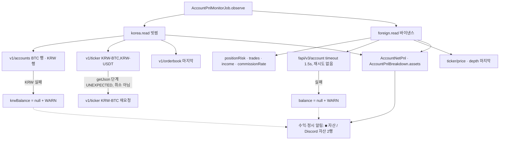
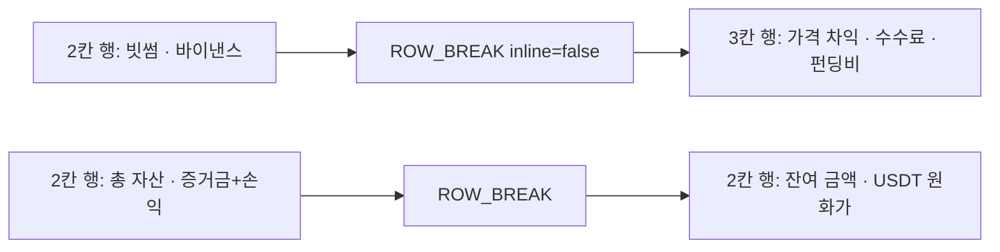

# 개발자 이해문서 — feat: 실계정 수익 알림에 자산 칸 추가 (#105)

- PR: (생성 전 — PR 본문에서 이 문서로 링크)
- 브랜치: feat/issue-105-account-balance-alert ← dev
- 작성: 2026-11-02 · 문맥: warm

## 1. TL;DR
실계정 수익·정시 알림에 "자산" 칸(총 자산 · 바이낸스 증거금+손익 · 잔여 금액 · USDT 원화가)을 추가했다.
값은 거래소 실제 값이다. 빗썸은 이미 호출하던 응답에서 읽고, 바이낸스는 `/fapi/v3/account`를 1회 추가로 부른다. 조회가 실패하면 그 칸만 "없음"이 되고, 순손익과 중단 판정에는 영향이 없다.
함께 Discord 공통 렌더러의 채움 칸을 non-inline 줄 끊기 칸으로 바꿨다. 이로써 2칸 행이 1/2 폭으로 나오고, 바이낸스 "(… USDT)"가 다음 줄로 넘어가던 문제가 고쳐진다.

## 2. 왜
- #102에서 알림을 사용자 사이트(PremiumTrading)와 같은 정보로 맞췄다. 그런데 실계정 모니터가 수집하지 않는 잔고·증거금·USDT 시세는 그때 넣지 못했다(#105).
- 사이트는 레버리지·잔여 금액을 **사람이 입력한 값**으로 계산한다(규모 ÷ 레버리지). 사용자는 알림에 **거래소 실제 값**을 원했다. 그래서 바이낸스 USDT 자산의 `marginBalance`(지갑 잔고 + 미실현 손익)를 "증거금+손익"으로 쓰고, 레버리지는 조회하지 않는다.
- Discord에서는 2칸 행(빗썸 | 바이낸스)이 1/3 폭으로 렌더돼 바이낸스 손익·평가액의 "(… USDT)"가 줄바꿈됐다. 원인은 `EmbedDocument`가 2칸 행 뒤에 넣는 **inline** 채움 칸(U+200B)이다. 이 칸이 사실상 3번째 칸이 되어 폭을 1/3로 만들었다.
- 제약: 잔고 실패가 순손익 계산·발송·`MonitoringOutagePolicy`에 닿으면 안 된다(합의 6). Job·Flyway·Redis·API는 바꾸지 않는다.

## 3. 무엇을 바꿨나

| 영역 | 파일 | 변경 |
|---|---|---|
| Domain 스냅샷 | `domain/.../accountpnl/AccountSnapshots.kt` | `KoreaSpotAccountSnapshot.krwBalance`·`usdtLastPriceKrw`, `ForeignPerpAccountSnapshot.balance: ForeignPerpBalance?`를 추가했다. 기본값은 null이라 기존 호출 43곳이 그대로 컴파일된다. 음수는 `require`로 막고, `toString`에서 금액을 숨긴다 |
| Domain 계산 | `domain/.../accountpnl/AccountPnlBreakdown.kt` | `AccountAssetBreakdown`과 `AccountPnlBreakdown.assets`를 추가했다. 총 자산 = 빗썸 BTC 평가액 + KRW 잔고 + `marginBalance` × USD/KRW 환율이고 반올림하지 않는다. 입력 하나라도 null이면 총 자산은 null이다. MANUAL_ENV면 바이낸스 값을 무시한다 |
| 문구 | `domain/.../accountpnl/AccountPnlAlertContent.kt` | 메일에 `■ 자산` 섹션, Discord에 [총 자산 \| 증거금+손익]과 [잔여 금액 \| USDT 원화가] 행(B안)을 추가했다. 값이 없으면 `없음`, 수동 모드의 바이낸스 칸은 `수동 모드 — 표시 안 함`이다 |
| 렌더러 | `domain/.../alertmessage/EmbedDocument.kt` | `SPACER`(inline)를 `ROW_BREAK`(U+200B, inline=false)로 바꿨다. 넣는 조건은 같다 |
| 빗썸 | `infrastructure/batch/.../bithumb/BithumbPrivateAccountAdapter.kt` | `/v1/accounts` KRW 행 `balance`(locked 제외, 행이 없으면 0)를 읽는다. `/v1/ticker`를 `markets=KRW-BTC,KRW-USDT`로 부르고 `market` 필드로 행을 고른다. 묶음 요청이 getJson 단계에서 UNEXPECTED로 실패하면 `KRW-BTC`만 한 번 다시 요청한다 |
| 바이낸스 | `infrastructure/batch/.../binance/BinanceFuturesPrivateAccountAdapter.kt`, `BinanceFuturesReadClient.kt` | `/fapi/v3/account` 서명 GET을 commissionRate 뒤·price 앞에 추가했다(depth는 여전히 마지막). 이 호출만 timeout 1.5초이고 `-1021`이어도 재시도하지 않는다. client `get`에 호출별 `timeout` 매개변수(기본값 유지)를 추가했다 |
| 공통 로그 | `infrastructure/batch/.../exchange/AccountBalanceLog.kt` (신규) | WARN 형식(`item`/`reason`/`category`/`error`), `isCancellation`, `rootErrorClass` |
| 문서 | `docs/work/alert-message-template/message-spec.md`, `.../design.md`(#102 §3.3·§6.2 개정 메모), `docs/runbooks/account-pnl-alert.md` | 문구 정본, Enable Reading 권한, 수동 모드 예외, AC8·AC9 확인 체크리스트 |

## 4. 설계

잔고 경로가 실패해도 순손익 경로는 그대로 간다.



Discord 행 끊기 규칙. 2칸 행 다음 행이 2칸 이상이면 non-inline 끊기 칸을 넣는다.



수익·정시 알림의 행 구성은 `[3,2,3,2,1,2,2]`, fields는 17개(칸 15 + 끊기 2)다.

## 5. 주요 결정과 버린 대안
- **사이트 공식(규모 ÷ 레버리지) 대신 거래소 실제 값.** 사용자가 결정했다. `marginBalance`에 증거금·잔여·미실현 손익이 이미 다 들어 있어 레버리지 조회가 필요 없고, 이중 합산도 없다. 대가는 사이트 숫자와 다를 수 있다는 점이다.
- **새 port 없이 기존 스냅샷에 nullable 필드를 붙였다.** 빗썸 값은 이미 부르는 응답에 있다. port를 따로 두면 같은 API를 두 번 부르게 된다. 실패는 adapter 안에서 흡수하므로 Job은 바뀌지 않는다.
- **Discord 자산 행 B안(2칸+2칸).** A안(3칸+1칸)은 "바이낸스 증거금+손익" 값이 1/3 폭에 들어가서 이번에 고치는 줄바꿈이 다시 생긴다. 대가는 fields가 하나 늘어난다는 것(17개, 한도 25개)이다.
- **줄바꿈 수정은 공통 렌더러에서.** 바이낸스 칸만 USDT로 줄이거나 위아래로 쌓는 안은 정보를 잃어서 버렸다. 시장·운영 알림의 2칸 행도 같이 1/2 폭이 된다. 대신 끊기 칸이 세로로 한 줄 정도 여백을 만든다(AC8 (e)에서 관찰).
- **잔고 호출 timeout 1.5초·-1021 미재시도(⑨ 리뷰 반영).** Job은 빗썸 호가 → 바이낸스 호가 순으로 관측한다. 그래서 바이낸스 depth 앞에 걸리는 시간은 skew 한도(5초)와 age 한도(10초)에 들어간다. 처음 구현에서는 잔고 호출이 client 기본 timeout 5초에 걸리면 회차 전체가 `STALE_MARKET_DATA`로 실패했다. 이러면 합의 6이 깨진다. 리뷰어는 depth 뒤로 옮기자고 제안했지만 버렸다. 동결된 AC6("depth 마지막")을 개정해야 하고, 옮겨도 빗썸 호가 age가 timeout만큼 늘어나기 때문이다. 대가: 바이낸스 계정 API가 1.5초보다 느린 날에는 잔고 칸이 자주 "없음"이 된다.
- **빗썸 ticker fallback은 getJson 단계 UNEXPECTED에서만.** NETWORK·AUTH·취소에서는 재요청하지 않는다. 200 응답의 해석 실패(배열 아님, KRW-BTC 행 없음)도 재요청 없이 실패한다. 묶음 요청이 거절돼도 BTC 체결가는 지키되, 장애 상황에서 요청을 늘리지 않으려는 것이다.

## 6. 동작 확인 방법
```bash
./gradlew test architectureTest :infrastructure:common:verifyMigrations :infrastructure:common:integrationTest :apps:api:integrationTest :apps:batch:integrationTest --parallel --continue --offline --no-daemon
./gradlew jacocoTestCoverageVerification --offline --no-daemon
bash docs/check-documentation.sh
```
- 실측(HEAD 5484173): unit 1,416건 실패 0, architectureTest 35건 실패 0. common/api/batch 통합은 96/174/117건 실패 0. verifyMigrations·coverage·문서 검사 통과.
- 핵심 테스트:
  - `EmbedDocumentTest`: 끊기 칸 inline 패턴
  - `AccountAssetBreakdownTest`: 공식·null·MANUAL_ENV
  - `AccountPnlAlertContentTest`: golden 17 fields, 변형 6종
  - `BithumbPrivateAccountAdapterTest`: fallback·경계·취소
  - `BinanceFuturesPrivateAccountAdapterTest`: 순서·실패 흡수·timeout 1.5초·-1021·취소
  - `AccountPnlMonitorJobBalanceTest`: 잔고 null 6분 동안 중단 알림 없음
- 사람 확인(머지 후 배포 환경): runbook `docs/runbooks/account-pnl-alert.md`의 AC8·AC9 체크리스트.
  - AC8: 실제 Discord에서 2칸 행 1/2 폭, 바이낸스 칸 줄바꿈 없음, 끊기 칸 여백
  - AC9: 운영 key로 Margin/Available Balance와 빗썸 KRW가 거래소 화면과 같은지
- ktlint·detekt는 로컬에서 돌리지 않았다. `ci/bootstrap-quality-tools.sh`가 네트워크 다운로드를 CI 전용으로 막는다. PR CI 결과로 판정한다.

## 7. 후속·리스크·함정
- **DoD는 `AWAITING_HUMAN`(AC8·AC9)이다.** 자동 기준 7개는 PASS다. 사람 확인은 머지 후에 한다.
- **배포 전 outbox에 쌓인 알림**은 enqueue할 때 렌더된 layout JSON 그대로 나간다. 그래서 옛 inline 채움 칸(1/3 폭)으로 발송된다. 데이터가 손상되지는 않는다.
- **바이낸스 API key 권한:** `/fapi/v3/account`는 Enable Reading 권한이면 된다. 권한이 없으면 401(-2015)이 나고 잔고 칸만 "없음"이 된다. WARN은 `item=BINANCE_USDT_ASSET`이다.
- **조회 전용 아키텍처 스캔:** `PrivateAccountReadOnlyArchitectureTest`가 adapter 소스·주석에서 `withdraw`·`deposit`·`transfer`를 금지한다. `/fapi/v3/account` 응답의 해당 필드명을 코드에 적으면 테스트가 깨진다.
- **timeout 테스트 시간:** 잔고 timeout 케이스는 보통 2.2초인데, 상한은 5초 미만(read elapsed)이다. 리뷰 중 한 번 case time 5.575초가 관측됐지만 재현되지 않았다. CI에서 실패하면 재시도로 덮지 말고 원인을 계측한다.
- **알려진 미해결 관찰:** 강제 재실행(`--rerun-tasks --parallel`) 중 `ObservabilityCardinalityArchitectureTest`가 `NoSuchFileException`으로 한 번 실패했다. 병렬 build 디렉터리 정리와 겹친 것으로 보이지만 증명하지는 않았다. 단독 재실행에서는 통과한다. 이번 변경과 무관한 기존 테스트다.
- **`BinanceFuturesReadClient.get`의 `timeout` 매개변수**는 잔고 호출만 쓴다. 다른 호출에 짧은 timeout을 넣을 때는 skew·age 영향을 같이 따져야 한다.
- 남은 polish(병합을 막지 않음): `lenientDecimal`/`decimalOrNull`과 기존 `dec`/`toDecimal`의 분기가 겹친다. 빗썸 adapter 함수 수는 17/20이다. message-spec의 기존 순손익 예시(469,354)와 golden(469,353)이 1원 다르다.
