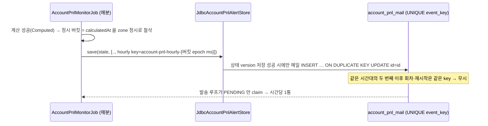

# 개발자 이해문서 — feat: 실계정 순손익 회차별 로그와 정시 보고 메일

- PR: (생성 후 본문에 링크)
- 브랜치: `feat/account-pnl-round-log` ← `dev` (base `85486e7`)
- 작성: 2026-10-22 · 문맥: warm (구현 세션에서 작성)

## 1. TL;DR

- batch 가 매분 계산하는 실계정 순손익을 회차마다 INFO 로그 한 줄(`Account PnL observed: ...`)로 남긴다. 로그 파일의 마지막 줄을 보면 "지금 수익률"을 바로 알 수 있다.
- 매 정시(한국 시각) 이후 계산이 처음 성공한 회차에 `정시 보고` 메일을 1통 보낸다. 1% 수익 알림 규칙과는 별개로 동작한다.
- 중복은 기존 outbox 의 `UNIQUE(event_key)`로 막는다. 시간대별 key 를 쓰므로 migration·새 상태 컬럼이 없다.

## 2. 왜

- 순손익은 매분 계산되지만 어디에도 남지 않았다. 로그에도, DB 에도, 화면에도 없었다. owner 가 볼 수 있는 것은 순수익률이 1% 에 닿았을 때 오는 수익 메일뿐이었다.
- owner 요구는 두 가지다.
  - 물어보면 바로 답할 수 있게 현재 수익률을 남겨 둘 것.
  - 1% 와 무관하게 매시간 현재 수익률을 메일로 받을 것.
- 제약.
  - 기존 알림·중단·복구 규칙과 상태 전이는 바꾸지 않는다.
  - 기존 수익 메일 본문은 바이트 단위로 그대로 둔다(golden 테스트).
  - 앱(`apps:batch`)은 infrastructure 타입을 import 하지 않는다.

## 3. 무엇을 바꿨나

| 파일 | 변경 |
|---|---|
| `apps/batch/.../job/accountpnl/AccountPnlMonitorJob.kt` | `observe()` 의 계산 성공 직후 `logObserved(pnl)`. `buildMails` 에서 `hourlyReportEnabled` 면 Computed 회차마다 정시 보고 메일을 추가. 생성자 기본값은 `false`(기존 테스트의 메일 건수 단정 유지) |
| `apps/batch/.../config/AccountPnlMonitorConfiguration.kt`, `application.yml` | `account-pnl-monitor.hourly-report.enabled` (env `ACCOUNT_PNL_HOURLY_REPORT_ENABLED`, 기본 `true`)를 `@Value` 로 Job 에 주입 |
| `domain/.../accountpnl/AccountPnlMailContent.kt` | `hourly(pnl, zone)` 추가. 수익 메일 본문을 `profitLines()` 로 추출해 공유 |
| 테스트 | `AccountPnlMonitorJobObservationLogTest`(4건), `AccountPnlMonitorJobHourlyReportTest`(7건), `AccountPnlMailContentTest` 메서드 4건 추가, 배선 테스트 1건 추가. 기존 테스트 메서드는 수정하지 않음 |
| `docs/runbooks/account-pnl-alert.md` | 로그 줄 설명과 확인 명령, `ACCOUNT_PNL_HOURLY_REPORT_ENABLED`, 동작 요약의 정시 보고 행, nohup 로그 파일 실행·중지 명령 |

로그 형식(한 줄):

```text
Account PnL observed: netPercent=-1.76%, netKrw=-511885, netPercentAtLast=-1.73%, netKrwAtLast=..., grossKrw=..., entryFeeKrw=0,
fundingKrw=0, exitFeeEstimateKrw=87101, koreaQty=0.266, koreaExit=..., foreignQty=0.266, foreignExit=81914.5, fxRate=1326.2097,
source=MANUAL_ENV, unrecovered=[...], calculatedAt=...
```

## 4. 설계

정시 보고는 "매 회차 넣고, 중복은 outbox 가 버린다"로 단순하게 만들었다.



## 5. 주요 결정과 버린 대안

| 결정 | 이유 | 버린 대안 / trade-off |
|---|---|---|
| 중복 방지를 outbox 의 event_key 유일성에 맡김 | 이미 있는 계약(같은 eventKey 무시, 통합 테스트로 고정). 재시작해도 같은 시간대에 다시 보내지 않는다 | 상태 테이블에 `last_hourly_sent_at` 컬럼 추가 — migration 이 필요. trade-off: 매분 `INSERT … ON DUPLICATE KEY` 가 AUTO_INCREMENT 를 하나씩 소비한다(BIGINT 라 실해 없음) |
| 정시 이후 첫 성공 회차에 발송 | 정각 회차가 실패해도 그 시간대 안에서 다음 성공 회차가 대신 보낸다 | 정각 회차에만 발송 — 그 회차가 실패하면 한 시간을 건너뜀 |
| 포지션 없음·실패 회차에는 보내지 않음 | 계산 값이 없다. 실패가 이어지면 기존 중단 메일이 알린다 | 실패 사실을 정시 보고로 보냄 — 중단 메일과 중복 |
| 기본값 `true` | 기능 자체가 owner 전용이고 owner 가 요청했다 | 기본 off 후 env 로 켜기 |
| 로그에 금액 포함 | owner 가 "물어보면 바로 답하기"를 원했다 | 비율만 기록 — 로컬 로그라도 계좌 금액이 남는다는 점을 runbook 에 명시 |

## 6. 동작 확인 방법

```bash
./gradlew test architectureTest --offline --no-daemon
grep 'Account PnL observed' ~/logs/account-pnl-batch.log | tail -1     # 최신 수익률
```

- 실제 확인(2026-10-22, owner 계정, `BINANCE_MODE=manual`): 이 브랜치 코드로 batch 를 실행했다.
  - 매 성공 회차에 `Account PnL observed` 줄이 남았다.
  - 17시 정시 보고(`account-pnl-hourly-1792656000000`)가 17:33 에 SENT 됐다.

## 7. 후속·리스크·함정

- **수익 메일과 정시 보고가 같은 분에 겹칠 수 있다.** 1% 를 처음 넘은 회차가 그 시간대 첫 회차면 내용이 거의 같은 메일 두 통이 간다(테스트가 의도로 고정).
- **관측된 별개 이슈: 빗썸 매수호가 깊이 부족.** 빗썸 `/v1/orderbook` 은 30단계만 주고 0 수량 단계를 빼면 깊이가 얇아진다. 그래서 0.266 BTC 를 채우지 못하는 회차가 가끔 `INSUFFICIENT_DEPTH` 로 실패한다(기동 직후 2회 관측). 계속되면 정시 보고가 그 시간대 뒤쪽으로 밀리거나 빠질 수 있다. 부분 VWAP + 잔량 최악가 처리 같은 후속 검토가 필요하다.
- **로그에 계좌 금액이 남는다.** 로그 파일을 공유하기 전에 확인한다.
