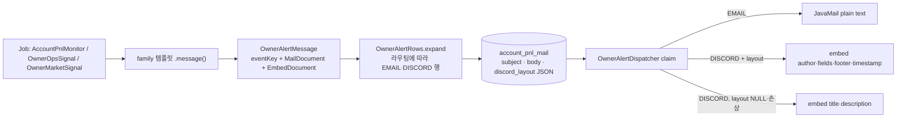

# 개발자 이해문서 — refactor: Discord·메일 알림 문구 템플릿화와 문구 정리 (#102)

- PR/MR: (생성 전) · 이슈 #102 · 후속 이슈 #105
- 브랜치: `refactor/issue-102-alert-message-template` ← `dev` (base `3d179e7`)
- 작성: 2026-10-30 · 문맥: warm

## 1. TL;DR
- owner 알림 21종과 회원 김프 메일 1종의 문구를 domain 템플릿 계층(`io.premiumspread.domain.alertmessage`)으로 모으고, 사용자가 확정한 문구(`message-spec.md`)로 바꿨다.
- Discord는 이제 embed **author·fields(칸)·footer·timestamp**로 나간다. 그 구조를 outbox에 보존하려고 Flyway **V23**으로 `account_pnl_mail.discord_layout TEXT NULL`을 추가했다.
- **배포는 API(Flyway)를 먼저** 해야 한다. 순서를 어기면 V23이 적용될 때까지 owner 알림 적재와 대기 행 발송이 멈춘다(데이터 손상은 없음).

## 2. 왜
- **문제.** 알림 문구가 Content object 5개와 batch 서비스 1곳에 `buildList { add("...") }` 문자열로 흩어져 있었다. 실계정 순손익 알림은 메일과 Discord를 다른 파일에서 따로 만들었다. 결과적으로 다음이 뒤섞여 있었다.
  - 제목 접두어 4종: `[김프 알림]`·`[운영]`·`[시장]`·`[premium-spread]`
  - 시각 표기 3종: 메일 `KST (UTC)` 병기, Discord `KST`, 회원 메일 UTC 원문
  - 문체 혼용, 런북 경로 줄, 영문 거래소명
- **사용자 판단.** 사용자(owner)가 "모든 메시지가 너무 난잡하다"고 보고, 실제로 나가는 메시지를 보면서 문구를 직접 정했다.
  - 대표 요구는 다음과 같다.
    - "청산"이라는 단어를 없앤다. 바이낸스의 강제 청산과 헷갈린다.
    - `gross`, 체결가 기준 대조값, `바이낸스 포지션: 거래소 API · 날짜` 줄을 없앤다.
    - 제목은 `+1.11% +469,353원` 형식으로 쓴다.
    - 수수료는 나열하고 합계를 보여 준다.
    - 수익 알림은 owner가 쓰는 김프 계산 사이트(현김프·매수김프·차이, leg별 평단·현재가·손익·평가액)와 같은 정보를 담는다.
  - Discord Markdown은 표를 지원하지 않는다. 그래서 시안 A(embed fields)와 시안 B(코드블록 정렬)를 그려 비교했고, 사용자가 A를 골랐다.
- **목표.** 22종 문구를 한 계층에서 만들고, 사용자가 확정한 구조를 테스트로 고정한다.
- **제약.**
  - domain은 순수 Kotlin이어야 한다. Jackson과 템플릿 엔진은 쓸 수 없다(`architectureTest`).
  - eventKey 형식은 outbox UNIQUE와 SMTP Message-ID에 묶여 있어 바꾸지 않는다.
  - 메일은 plain text를 유지한다.
  - 새 데이터 수집은 범위 밖이다. 총 자산·잔여 금액·증거금·USDT 원화가는 #105에서 다룬다.

## 3. 무엇을 바꿨나

| 영역 | 변경 | 핵심 파일 |
|---|---|---|
| 템플릿 계층 (domain, 신규) | 메일 문서 `MailDocument`, Discord 문서 `EmbedDocument`, 공용 서식 `AlertFormat`, 결과 묶음 `OwnerAlertMessage(eventKey, mail, discord)` | `domain/.../alertmessage/*.kt` |
| 알림 템플릿 (domain) | family별 진입점 하나: `AccountPnlAlertContent`(수익·정시·중단·복구), `AccountAlertContent`, `OwnerOpsAlertContent`, `OwnerMarketAlertContent`, `PremiumThresholdMailContent`(회원). 옛 `AccountPnlMailContent`·`AccountPnlDiscordContent`·`AccountPnlFormat`은 삭제 | `domain/.../accountpnl`, `ownerops`, `ownermarket`, `notification` |
| 수익 계산 (domain, 신규) | `AccountPnlBreakdown.of(pnl)`: 김프 3종, leg별 손익·평가액, 거래소별 진입·정리 수수료, 합계. `AccountNetPnl`은 그대로 두고 값 일치를 불변식 테스트로 고정 | `AccountPnlBreakdown.kt` |
| Discord 모델 (domain) | `DiscordMessage`에 선택 프로퍼티 `layout: DiscordLayout?`(author·fields·footer·timestamp, Discord 한도 검증). port 시그니처는 그대로 | `owneralert/OwnerAlertDiscord.kt` |
| outbox 저장 (infra:common) | V23 컬럼 추가. layout을 JSON(v1)으로 쓰고 읽는 `DiscordLayoutJson`. 손상 행은 layout 없이 내보내고 WARN(id·reason만) | `V23__add_owner_alert_discord_layout.sql`, `DiscordLayoutJson.kt`, `JdbcAccountPnlAlertStore.kt`, `OwnerAlertOutboxRows.kt` |
| 발송 (infra:batch, apps:batch) | layout이 있으면 embed author·fields·footer·timestamp로 보내고 description은 생략. 없으면 기존 title·description·color | `DiscordWebhookSenderAdapter.kt`, `OwnerAlertDispatcher.kt` |
| 회원 메일 (apps:batch) | 문구를 domain 템플릿으로 이동. zone은 `NotificationDeliveryConfiguration`의 `@Bean`이 주입(`@Value` 제거). 관측 시각을 KST로 표기 | `PremiumThresholdDeliveryService.kt`, `NotificationDeliveryConfiguration.kt` |
| 문서 | runbook 3개의 예시와 V23 배포 절, PROJECT_STATUS, ARCHITECTURE_DESIGN | `docs/runbooks/*alert*.md`, `.ai/*` |

## 4. 설계

알림 한 건이 만들어져 Discord·메일로 나가는 경로:



- **문서를 둘로 나눈 이유.** 메일과 Discord는 같은 값을 다른 구조로 보여 준다. 예를 들어 수익 알림의 수수료는 메일에서 하위 4줄이고 Discord에서는 칸 2개다. 그래서 한 모델에서 자동 변환하지 않고, 각 템플릿이 두 문서를 같은 값으로 만든다.
- **칸 배치.** `EmbedDocument.rows`는 "한 행에 나란히 놓일 칸 1~3개"의 목록이다. Discord는 inline 칸을 한 줄에 3개까지 채운다. 그래서 2칸 행 뒤에 다음 행이 이어지면 보이지 않는 채움 칸(U+200B)을 넣어 줄을 끊는다. 이 때문에 수익 알림의 fields는 칸 11개에 채움 1개를 더한 12개가 된다.
- **DISCORD 행의 body.** 새 행의 `body`에도 레이아웃을 평문으로 펼친 대체 설명을 넣는다. 그래서 구 binary로 롤백해도 읽을 수 있는 메시지가 나간다.

## 5. 주요 결정과 버린 대안

| 결정 | 이유 | 버린 대안 / trade-off |
|---|---|---|
| Discord는 embed fields(시안 A) | 칸이 나란히 놓여 표처럼 읽히고, 모바일에서는 세로로 쌓인다 | 코드블록 정렬(시안 B)은 스키마 변경이 없지만, Discord 코드 글꼴에 한글이 없어 PC·모바일에서 열이 어긋난다 |
| layout을 새 컬럼(V23)에 JSON으로 저장 | 구조를 그대로 왕복하고, 옛 행(NULL)과 구분된다 | body에 구조를 인코딩하면 구 binary 롤백 시 깨진 문자열이 나간다. 자식 테이블은 과하다 |
| JSON 직렬화는 infra:common의 Jackson | domain은 Jackson 금지. Jackson은 redisson을 거쳐 이미 classpath에 있어 선언만 추가했다(사용자 승인 D1) | 손으로 쓴 코덱은 유지 비용이 든다 |
| 메일 plain text 유지 | 범위 최소화 | HTML 표는 이번 범위 밖(이슈 제외 항목) |
| 수익 값은 `AccountPnlBreakdown`이 다시 계산 | `AccountNetPnl` 판정 경로를 건드리지 않는다. 같은 공식임을 불변식(gross·exitFee·net 일치) 테스트로 고정 | `AccountNetPnl`에 필드를 추가하면 판정 코드까지 diff가 퍼진다 |
| 금액은 항목별 반올림, 합계·순손익은 전체 정밀도 값을 반올림 | 순손익이 1% 판정값과 일치한다. 표시 합과 ±1원 차이는 허용(사용자 승인) | 표시값의 합으로 맞추면 판정값과 1원 어긋난다 |
| A단계(동작 보존) → B단계(family별 문구 전환) 커밋 분리 | A단계에서 기존 golden을 무수정 통과시켜 구조 변경만 증명하고, B단계는 커밋마다 spec 한 절과 대조할 수 있다 | "옛 문구를 새 템플릿으로 재현 → 문구 변경"의 순수 2단계는, 구조가 달라 재현 코드가 거의 다 버려진다 |
| "현재가" = 지금 정리하면 받는 호가 VWAP | 순수익률이 이 값으로 계산되므로 숫자가 서로 맞는다 | 최근 체결가는 판정값과 어긋난다(차트와는 몇천 원 차이 가능) |
| 바이낸스 출처(api/manual) 표시 삭제 | 사용자 요청. manual은 미반영 사유 `(수동 미입력)`으로만 드러난다 | manual 여부는 batch 설정(`BINANCE_MODE`)으로 확인한다(runbook에 기재) |

## 6. 동작 확인 방법

```bash
./gradlew test architectureTest --offline --no-daemon                 # unit 1,371 · architecture 35, 실패 0
./gradlew :infrastructure:common:integrationTest --offline --no-daemon # 93건 (V23·layout 저장·손상 행)
./gradlew :apps:batch:integrationTest --offline --no-daemon            # 115건 (E2E: 실제 outbox + MockWebServer Discord)
./gradlew :infrastructure:common:verifyMigrations --offline --no-daemon
```

- **구조 일치.** `AlertMessageSpecConformanceTest`가 22종 각각에서 다음을 검사한다.
  - 메일 접두어, 기준 시각 줄, Discord author·footer·timestamp, 행별 칸 수
  - 금지어(청산·gross·UTC 병기·영문 거래소명·런북 줄), Discord 한도
- **문구 전문.** family golden 테스트(`AccountPnlAlertContentTest` 등)가 메일 본문과 렌더된 fields 전체를 `isEqualTo`로 고정한다.
- **E2E.** `OwnerAlertDiscordLayoutIntegrationTest`가 세 경우를 확인한다.
  - (a) 새 행: embed fields로 발송된다.
  - (b) layout NULL 옛 행: title·description만 나간다.
  - (c) 메일 경로
- **눈으로 비교.** 확정 문구 비교 페이지 https://claude.ai/artifact/TGV8tW8oqfsdCA997Wwwp6 (비공개), 정본 `docs/work/alert-message-template/message-spec.md`
- **남은 사람 확인(AC18).** 실제 Discord webhook과 메일로 수익·정시 알림을 받아 칸 배치와 모바일 표시를 owner가 확인한다.

## 7. 후속·리스크·함정
- **배포 순서.** API(V23 Flyway)를 먼저 배포한다. batch를 먼저 띄우면 다음이 V23 적용 전까지 실패한다(`docs/runbooks/account-pnl-alert.md` "알림 문구 템플릿화 배포 (V23)").
  - `Unknown column 'discord_layout'`로 owner 알림 적재가 실패한다.
  - 대기 행 claim도 같은 이유로 실패한다. EMAIL 행도 포함된다.
- **배포 전 대기 행.** 배포 전에 쌓인 DISCORD 행은 layout이 NULL이라 옛 형식(title·description)으로 나간다. 정상 동작이다.
- **손상 layout 행.** 손상 layout 행은 WARN `reason=json|version|shape`과 함께 제목·설명 embed로 나간다. claim 전체는 멈추지 않는다. shape는 "layout을 빼면 조립되는데 layout을 넣으면 안 되는 경우"에만 붙는다.
- **회원 서비스 빈.** `PremiumThresholdDeliveryService`는 `@Service` 없이 Configuration `@Bean`으로 등록된다.
  - 클래스에 남은 `@ConditionalOnProperty`는 클래스를 직접 import하는 테스트 경로용이다. 실제 조건은 Configuration이 가진다.
  - `@Transactional`이 클래스 수준인 것도 의도된 것이다. kotlin-spring allopen 대상이 되어야 프록시가 만들어진다.
- **메일 정렬.** 메일 라벨 정렬은 표시 폭 규칙(한글 2칸)으로 맞춘다. 메일 앱이 비례 글꼴이면 완벽히 맞지 않는다(plain text의 한계).
- **롱 표기.** 바이낸스 leg가 롱이면 값 앞에 `롱 `이 붙지만 칸 이름은 `바이낸스 선물 숏`으로 고정된다. 모니터가 숏만 허용하므로 지금은 나오지 않는다.
- **후속 #105.** 총 자산, 잔여 금액(빗썸 KRW·바이낸스 USDT), 증거금+손익, USDT 원화가를 수집해 수익 알림에 추가한다.
