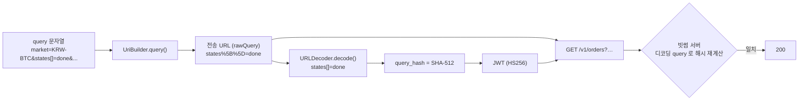

# 개발자 이해문서 — fix: 빗썸 실계정 조회의 실 API 불일치 수정

- PR: (생성 후 본문에 링크)
- 브랜치: `fix/bithumb-orders-query-hash` ← `dev` (base `97b8489`)
- 작성: 2026-10-22 · 문맥: warm (실 key 로컬 실행 중 발견·수정한 세션에서 작성)

## 1. TL;DR

- 실계정 순손익 알림을 실 key 로 처음 돌렸더니 빗썸 조회가 매 회차 실패해 순손익을 한 번도 계산하지 못했다. 원인은 빗썸 adapter 두 곳이 실제 API 와 맞지 않은 것이었다.
- ① `/v1/orders` 의 JWT `query_hash` 를 인코딩된 query(`states%5B%5D=done`)로 계산해 `401 invalid_query_payload` 가 났다. 디코딩된 query(`states[]=done`)로 계산하도록 고쳤다.
- ② 실제 orderbook 에는 `bid_size: 0` 인 단계(그 가격에 매도 호가만 있는 행)가 섞여 오는데, 이를 오류로 보고 응답 전체를 거부했다. 0 수량 단계는 건너뛰도록 고쳤다. 수정 후 실제 batch 에서 매분 계산이 성공한다.

## 2. 왜

- **배경.** PR #83(실계정 순손익 알림)과 #84(바이낸스 수동 입력 모드)는 MockWebServer 테스트로만 검증했고, 실 key 검산(AC13·AC9)은 owner 몫으로 남아 있었다. #84 merge 뒤 owner 가 `BINANCE_MODE=manual` 로 로컬 실행하면서 처음으로 실제 빗썸 API 를 탔다.
- **증상.**
  - 1차: `Account PnL observation failed: category=BITHUMB_AUTH` — `Bithumb /v1/orders responded 401`.
  - 1차 수정 후: `category=UNEXPECTED` — `orderbook level is not positive`.
  - 두 경우 모두 5분 뒤 `모니터링 중단` 메일이 갔다.
- **목표.** 실 API 응답 그대로 계산이 성공하게 한다. 그 밖의 동작(순손익 공식, 알림 정책, 전송 URL 형태)은 바꾸지 않는다.

## 3. 무엇을 바꿨나

| 파일 | 변경 |
|---|---|
| `infrastructure/batch/.../exchange/bithumb/BithumbPrivateAccountAdapter.kt` | `getJson`: JWT `query_hash` 입력을 `URLDecoder.decode(rawQuery, UTF_8)` 로. 전송 URL 은 인코딩 그대로 |
| 같은 파일 `readOrderbook()` | `bid_size` 를 먼저 파싱해 정확히 0(`signum() == 0`)이면 그 단계를 건너뜀(이때 `bid_price` 는 파싱하지 않음). 음수 수량, 양수 수량인데 가격이 0 이하면 여전히 `UNEXPECTED`. 남은 단계가 없으면 `orderbook has no bid levels` |
| `.../bithumb/BithumbOrderQueryHashTest.kt` (신규) | `/v1/orders` 의 `query_hash` = SHA-512(디코딩 query) 이고 인코딩 query 해시와 다름, 전송 URL 은 `states%5B%5D` 그대로, `/v1/orders/chance` 해시 불변 |
| `.../bithumb/BithumbPrivateAccountAdapterTest.kt` | 버그 동작을 고정하던 단언 2곳 교정(아래 §5), 호가 0 수량 건너뛰기·`"0.00000000"`/`0.0`·가격 없는 0 수량 행·가격 0 이하 케이스 추가 |
| `docs/runbooks/account-pnl-alert.md` | AC13 검산 (b) 항목을 확인된 규칙(디코딩된 query 로 해시)으로 갱신 |

## 4. 설계

`/v1/orders` 한 요청에서 서명과 전송이 갈라지는 지점이다.



## 5. 주요 결정과 버린 대안

| 결정 | 이유 | 버린 대안 / trade-off |
|---|---|---|
| 해시 입력을 rawQuery 디코딩으로 | "전송한 그대로를 디코딩"이라 서명과 전송이 같은 원천에서 나온다. 실 key probe: 인코딩 해시 → `401 invalid_query_payload`, 디코딩 해시(같은 URL) → `200` | `getJson` 의 원본 `query` 인자를 그대로 해시 — 인코딩→디코딩 왕복이 없어 더 견고하다(리뷰 의견). 다만 지금 서명 query 에는 `+`·`%` 가 없어 두 방식의 결과가 바이트 단위로 같다. 후속 과제로 남김 |
| bid 0 수량 단계는 건너뛰기 | 빗썸 orderbook 단위 행은 ask·bid 를 한 행에 묶는다. bid 쪽이 비면 `bid_size: 0` 이다(2026-10-22 실측 30행 중 7행). VWAP 는 수량 0 레벨을 어차피 쓰지 않으므로 계산 결과는 같다 | 0 도 정상 레벨로 남기기 — 의미 없는 레벨이 생기고 기존 양수 검증과 충돌 |
| 기존 테스트 단언 2곳 교정 | `query_hash == sha512(인코딩 query)`, `bid_size 0 → UNEXPECTED` 는 실제 API 가 거부하거나 실제로 오는 응답을 버그 쪽으로 고정하고 있었다. 직전 단위 design·dod 에는 이 둘을 요구하는 계약이 없다 | 기존 테스트를 그대로 두고 새 클래스만 추가 — 기존 테스트가 실패하거나 다른 분기로 녹색이 되어 의미를 잃음 |

## 6. 동작 확인 방법

```bash
./gradlew :infrastructure:batch:test --tests 'io.premiumspread.infrastructure.batch.exchange.bithumb.*' --offline --no-daemon
./gradlew :infrastructure:batch:test --offline --no-daemon
./gradlew architectureTest --offline --no-daemon
```

- 실 API 확인(2026-10-22, owner key, 조회 전용 GET): 수정 코드로 `SPRING_PROFILES_ACTIVE=local ./gradlew :apps:batch:bootRun` 을 실행했다(`BINANCE_MODE=manual`). 계산 실패 WARN 0건, `account_pnl_monitor_state.last_success_at` 이 매분 갱신, 앞선 중단 메일에 이어 `모니터링 복구` 메일이 SENT 됐다.
- 재현: `curl -s 'https://api.bithumb.com/v1/orderbook?markets=KRW-BTC'` 의 `orderbook_units` 에서 `bid_size` 가 0 인 행을 볼 수 있다(시점에 따라 개수가 다름).

## 7. 후속·리스크·함정

- **함정: MockWebServer 는 서명을 검증하지 않는다.** 이번 두 버그 모두 단위 테스트가 녹색인 채 merge 됐다. 거래소 adapter 를 바꾸면 실 key 로 한 번 돌려 보는 것(runbook AC13 체크리스트)이 사실상 유일한 검증이다.
- **후속: 해시 입력을 원본 `query` 로.** 앞으로 `+09:00` 같은 값을 서명 query 에 넣으면 `URLDecoder` 가 `+` 를 공백으로 바꿔 같은 401 이 다시 날 수 있다.
- **아직 확인하지 못한 것.** 수익 메일 본문(AC9-b·AC13)은 순수익률이 1% 에 닿아야 나온다. 빗썸 평단의 수수료 포함 여부(AC13-a)도 그때 대조한다.
