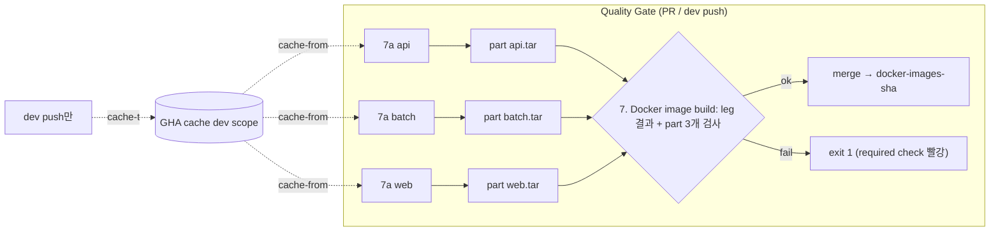
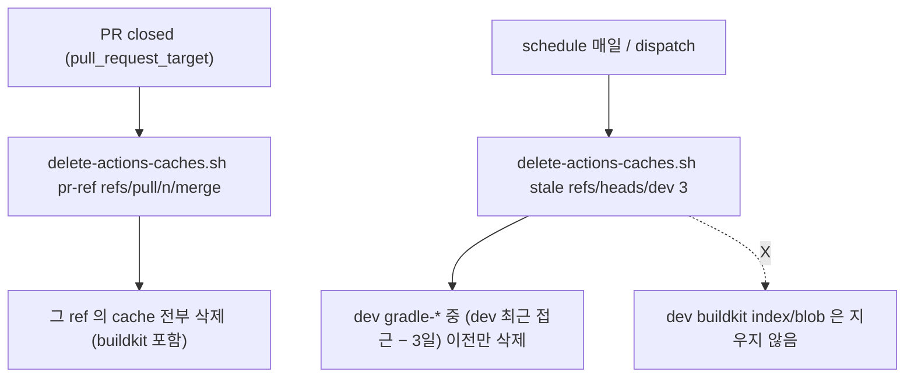

# 개발자 이해문서 — chore: Quality Gate Docker image build 시간 단축 (#107)

- PR: (생성 전 — PR 본문에서 이 문서로 링크)
- 브랜치: chore/issue-107-docker-build-time ← dev
- 작성: 2026-11-06 · 문맥: warm

## 1. TL;DR
Quality Gate의 Docker build가 가끔 6~7분으로 튀는 원인을 찾았다. GitHub Actions cache가 저장소 한도(10GB)를 넘어 dev의 API 의존성 레이어가 밀려난 것이다.
PR은 이제 Docker cache를 쓰지 않는다. 닫힌 PR의 cache와 오래된 Gradle cache는 자동으로 지운다.
API·Batch·Web 이미지는 matrix로 병렬 빌드한 뒤 기존과 같은 `docker-images-<sha>` artifact 하나로 합친다.

## 2. 왜
- #104(PR #106) 이후 Quality Gate의 전체 시간을 Docker build job이 정하게 됐고, 그 시간의 편차가 컸다. 최근 30회 기준 중앙값 229s, p90 400s였다.
- 레이어 로그를 비교한 결과는 이렇다.
  - 느린 회차에서는 API 이미지만 느렸다.
    - 원인 1: `materializeProductionBuildArtifacts` 의존성 레이어가 cache miss였다(113s).
    - 원인 2: `mode=max` cache export가 88s 걸렸다.
  - 같은 run의 Batch 이미지는 의존성 레이어까지 전부 CACHED였다. "입력이 바뀌었다"는 가설은 이것으로 기각했다.
- 근본 원인은 cache 용량이었다. 저장소 cache가 11.04GB로 한도를 넘었고, 그중 4.6GB는 PR마다 `mode=max`로 쓴 buildkit cache였다. LRU 축출이 dev의 API scope 레이어를 밀어냈다.
- 사용자는 두 가지를 다 원했다. 편차의 원인을 제거하는 것(캐시 압박 완화)과 Docker job 자체를 단축하는 것(병렬화)이다. Gradle cache 정리도 범위에 넣었다.
- 제약
  - 운영 런북(`docs/runbooks/deployment.md`, `docs/deploy/aws-setup.md`)은 artifact `docker-images-<sha>` 하나에 api/batch/web tar가 들어 있다고 가정한다. 이 계약은 유지한다.
  - 이미지 내용·Dockerfile·배포 파이프라인은 범위 밖이다.

## 3. 무엇을 바꿨나

| 파일 | 변경 |
|---|---|
| `.github/workflows/quality-gate.yml` | Docker job을 둘로 나눴다. `docker-image` matrix(`7a. Docker image (<component>)`, `fail-fast: false`)가 이미지를 만들어 part artifact(1일 보존)로 올린다. `docker-build` 조립 job(`7. Docker image build`, id·이름 유지)은 `if: !cancelled()`로 돌며, leg 결과를 검사하고, 만료되지 않은 part가 정확히 3개인지 확인한다(job 단위 `actions: read`). 이어서 `upload-artifact/merge`로 `docker-images-${sha}`를 만들고, `delete-merged`로 part를 지우고, provenance를 summary와 로그에 남긴다. `cache-to`는 dev push에서만 `type=gha,mode=max,scope=<c>,ignore-error=true`이고 그 밖에는 `''`다 |
| `.github/workflows/actions-cache-pr-cleanup.yml` (신규) | `pull_request_target` closed 이벤트에서 그 PR의 `refs/pull/<n>/merge` cache를 전부 지운다. base 브랜치만 checkout하고(`persist-credentials: false`) PR 번호만 env로 넘긴다 |
| `.github/workflows/actions-cache-stale-cleanup.yml` (신규) | 매일 1회 실행하고 dispatch도 받는다. dispatch는 `dry_run` 기본값이 true다. dev의 `gradle-*` cache 중 "dev 최근 접근 − 3일" 이전에 마지막으로 쓰인 것만 지운다 |
| `ci/delete-actions-caches.sh` (신규) | 실제 삭제를 맡는다. `pr-ref`와 `stale` 두 모드가 있다. ref는 정규식 화이트리스트를 거치고, entry마다 ref를 다시 확인한 뒤 id 단위로 삭제한다. 삭제 순서는 rank를 따르고, key는 로그에 쓰기 전에 정제한다 |
| `ci/delete-actions-caches-test.sh` (신규) | fake `gh`로 14개 케이스의 행동 계약을 확인한다 |
| `ci/actions-cache-cleanup-contract-test.sh` (신규) | cleanup workflow 두 파일을 통째로 정확히 비교한다. mutation 11종을 거부하는지 스스로 검증한다 |
| `ci/quality-gate-contract-test.sh` | matrix·조립·권한·cache-to·merge step의 정확 비교와 docker job `run:` 본문의 `bash -n`을 단정하도록 개정했다. 위 두 계약 스크립트도 여기서 호출한다 |
| `docs/runbooks/deployment.md` | 조립 job 구조, rerun 창(1일), BlobNotFound 수동 복구를 추가했다 |

일회성 운영 조치도 하나 있었다. 사용자 승인 후 닫힌 PR #106·#108·#109의 cache 130개(4.6GB)를 직접 지웠고, cache 사용량은 11.0GB에서 6.43GB로 줄었다.

## 4. 설계





## 5. 주요 결정과 버린 대안
- **PR은 Docker cache를 쓰지 않는다.** 한도를 채우던 것은 PR별 `mode=max` export였다. 대가는 의존성 파일을 바꾼 PR이 push할 때마다 의존성 레이어를 다시 만든다는 것(+~113s)이다. 그래도 병렬화 덕에 테스트 job 최장(중앙값 370s)보다는 짧다.
- **일정 정리는 Gradle만 지운다(F5).**
  - 처음 설계는 오래된 buildkit blob도 지우려 했다.
  - 확인해 보니 buildkit gha importer는 index가 가리키는 blob이 없으면 cache miss로 넘어가지 않고 **빌드를 실패시킨다**(moby/buildkit#7283, `BlobNotFound`).
  - blob key는 scope와 무관한 전역 sha256이라 api·batch·web이 공유할 수 있다. 그래서 부분 삭제는 위험하다.
  - buildkit은 PR 닫힘 정리와 GitHub 7일 만료에만 맡긴다. 사용자가 Gate 1 N4로 승인했다.
- **stale 기준은 상대값이다.** "dev 최근 접근 − 3일"로 정했다. 벽시계 기준이면 CI가 멈춘 연휴 동안 살아 있는 cache까지 지운다. 사용자가 N1로 결정했다.
- **artifact 계약을 유지하려고 merge 단계를 넣었다.** 이미지별 artifact로 나누면 런북을 고쳐야 한다. 조립 job은 skipped가 통과로 보이는 문제를 피하려고 `!cancelled()`로 항상 돌고 leg 결과를 직접 검사한다.
- **part 3개 검사에 job 단위 `actions: read`를 줬다(N5).** 실패 job을 하루 지나 재실행하면 성공했던 part가 만료되어 tar 1~2개짜리 artifact가 green으로 나갈 수 있었다. 저장소에 고정된 `download-artifact`가 없어서, 새 action을 들이지 않고 `gh api`로 검사한다.
- **cleanup workflow는 파일 전체를 정확히 비교한다.** ⑨ 리뷰가 우회 두 가지를 실측으로 재현했다. 하나는 `run: |` 블록 안에서 bracket 문법으로 PR 문자열을 쓰는 것이고, 다른 하나는 workflow 최상위 `env: BASH_ENV: ${{ …title }}`이다. 둘 다 `actions: write` 토큰으로 PR 제목을 실행하게 만든다. 단정을 덧대는 대신 파일 전체를 정확히 비교하도록 했다. 대가는 workflow를 고칠 때마다 계약 테스트의 기대 문자열도 같이 고쳐야 한다는 점이다.
- 버린 대안
  - `docker buildx bake`로 한 job 안에서 병렬 빌드: 2코어 runner에서 Gradle 빌드 두 개가 CPU를 다툰다.
  - 이미지별 artifact: 런북 계약을 바꿔야 한다.
  - buildkit stale 삭제: F5 때문에 위험하다.

## 6. 동작 확인 방법
```bash
bash ci/quality-gate-contract-test.sh            # 개정 계약 + 아래 두 스크립트 호출
bash ci/actions-cache-cleanup-contract-test.sh   # mutations rejected: 11
bash ci/delete-actions-caches-test.sh            # cases: 14
bash docker/deploy-contract-test.sh
bash docs/check-documentation.sh
```
- ⑩ 실측(HEAD 9c08851): 위 검사들과 local-offline·dependency-bootstrap 계약, `bash -n`, YAML 파싱, harnessCheck가 모두 통과했다. Kotlin·Gradle 변경이 없어서 Gradle 전체 gate는 돌리지 않았다.
- 컨트롤러가 임시 사본에 우회 12종을 넣어 시도했고 모두 거부됐다. 시도한 것은 최상위 env/defaults, 트리거 추가, 권한 확대, job env bracket, concurrency 등이다.
- PR CI에서 관찰할 것(AC4~AC6)
  - Docker 경로 최장 시간이 테스트 job 최장 이하인지
  - PR run이 buildkit cache를 새로 만들지 않는지(`gh cache list --ref refs/pull/<n>/merge --key index-` / `buildkit-blob-`)
  - `docker-images-<sha>`에 tar가 3개 있는지
  - provenance 로그가 남는지
- 머지 뒤 관찰할 것(AC7·AC8)
  - cache가 1개 이상 남은 PR이 닫힐 때 `deleted>=1`이 나오는지
  - `gh workflow run "Actions cache stale cleanup" -f dry_run=true`가 성공하는지

## 7. 후속·리스크·함정
- **cleanup workflow는 머지 뒤에만 돈다.** `pull_request_target`과 `schedule`은 기본 브랜치(dev)에 있는 workflow 파일로 실행된다.
- **AC7 표본이 드물다.** 이번 변경 뒤로 PR이 cache를 거의 쓰지 않아서 평범한 PR을 닫으면 `deleted=0`이 나온다. 닫기 전에 `gh cache list --ref refs/pull/<n>/merge`로 entry가 1개 이상인 PR을 표본으로 고른다.
- **BlobNotFound는 rerun으로 회복되지 않는다.** GitHub의 자체 만료나 LRU가 blob만 지우고 index를 남기면 dev 빌드가 계속 실패한다. 런북의 수동 복구 절차를 따른다: 해당 scope의 `index-*` 삭제 → 재실행 → 다음 dev push가 다시 채운다.
- **재실행 창은 1일이다.** part가 1일 보존이라 그 뒤에는 "Re-run all jobs"가 필요하다. merge 뒤 실패면 1일 안이어도 같다. merge에는 `overwrite`가 없어서 그래도 이름이 충돌하면 새 commit을 push한다.
- **cleanup workflow를 고칠 때는 계약 테스트의 기대 전문도 같이 고쳐야 한다.** 이건 의도한 동작이다.
- **기준 개정(edc6ffb).** AC2는 9종에서 11종으로, AC3는 13케이스에서 14케이스로 바뀌었다. 리뷰 수정이 먼저 들어갔고 사용자 승인은 그 뒤에 받았다. 두 변경 모두 검사를 강화하는 쪽이다.
- **dev cache 크기.** dev Gradle cache는 3.36GB, buildkit cache는 2.62GB가 남아 있다. 일정 정리가 Gradle 쪽 옛 entry를 줄여 나간다.
- **사용자에게 따로 묻지 않고 설계안대로 둔 것.** N2(AC2의 RED를 mutation 거부로 대체)와 티어 강등 사유다.
