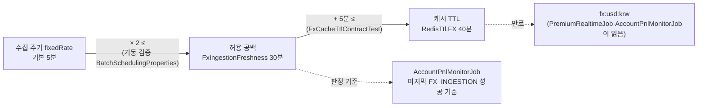
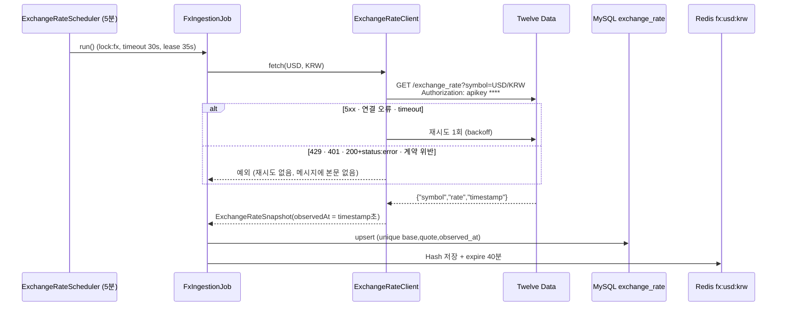

# 개발자 이해문서 — 환율 제공자 Twelve Data 교체와 FX 캐시 TTL 여유 (#93)

- PR: (생성 전) · 이슈 #93
- 브랜치: `fix/issue-93-fx-provider-twelve-data` ← `dev` (base `728e3f1`)
- 작성: 2026-10-26 · 문맥: warm

## 1. TL;DR

- USD/KRW 환율 제공자를 exchangerate-api(무료 플랜은 하루 1회 갱신)에서 Twelve Data(무료, 실시간 forex)로 바꾸고 수집 주기를 30분에서 5분으로 줄였다.
- 수집 주기 5분, 허용 공백 30분(Domain `FxIngestionFreshness`), 캐시 TTL 40분(`RedisTtl.FX`)을 하나의 시간 계약으로 묶고 테스트와 기동 검증으로 강제한다. 캐시가 freshness 판정보다 먼저 만료되던 #93이 이것으로 해결된다.
- 포트·클래스·env 이름은 그대로다. 운영자는 `EXCHANGE_RATE_API_KEY` 값만 Twelve Data 키로 바꾸고, 구 override를 지우면 된다.

## 2. 왜

**#93 현상.** 2026-10-23 14:00 KST 정시 보고가 14:04에야 나갔다. 13:59:59부터 Redis `fx:usd:krw`가 비어, 계정 순손익 회차 3번이 `STALE_FX`로 실패했고 `PremiumRealtimeJob`은 `missing_data`로 건너뛰었다.

**원인.** 캐시 TTL이 31분, 수집 주기(fixed-rate)가 30분이라 여유가 1분뿐이었다. 수집 스케줄은 단조 시계를 따르고, Redis TTL과 freshness 판정은 벽시계를 따른다. 그래서 벽시계가 3분 앞으로 튀자 캐시가 다음 수집 전에 만료됐다. NTP 보정, GC 정지, 제공자 지연 1분이면 운영에서도 같은 공백이 생긴다.

**조사하다 나온 더 큰 문제.** 로컬 DB `exchange_rate`를 보니 `observed_at`이 매일 `00:00:01 UTC`(KST 09:00)인 행 하나뿐이었다. exchangerate-api 무료 플랜은 **하루 1회** 갱신이라, 30분마다 다시 불러도 같은 값이 오고 unique key `(base_currency, quote_currency, observed_at)`에 걸려 하루 한 행으로 수렴했다. 김프 계산이 최대 하루 묵은 환율을 쓰고 있었다.

**목표.** 환율을 수 분 단위로 갱신하면서, 수집이 몇 번 실패하거나 시계가 튀어도 캐시가 판정보다 먼저 비지 않게 한다.

**제약.**
- 무료 크레딧 안에 들어야 한다. Twelve Data Basic은 분당 8, 하루 800 크레딧이다.
- key는 URL, 로그, 예외, `toString`에 남지 않아야 한다.
- 테스트는 실제 제공자를 호출하지 않는다.
- 모듈 의존 방향을 바꾸지 않는다. `modules:redis`는 Domain을 모른다.

## 3. 무엇을 바꿨나

| 영역 | 파일 | 변경 |
|---|---|---|
| Domain | `domain/.../exchangerate/FxIngestionFreshness.kt` (신규) | 허용 공백 `MAX_INGESTION_GAP` 30분, `isStale(lastSuccessAt, now)` (`>` 비교라 정확히 30분은 신선) |
| Redis 계약 | `modules/redis/.../RedisTtl.kt`, `docs/runbooks/redis-contract.md` | `FX` 31분 → 40분, 불변식 한 줄 |
| 불변식 테스트 | `infrastructure/common/.../FxCacheTtlContractTest.kt` (신규) | `RedisTtl.FX − MAX_INGESTION_GAP ≥ 5분`. Domain과 redis를 둘 다 의존하는 모듈이 이곳뿐이라 여기에 둠 |
| adapter | `infrastructure/batch/.../exchange/ExchangeRateClient.kt`, `ExchangeRateClientProperties.kt`, `ExchangeRateResponse.kt` | Twelve Data `GET /exchange_rate?symbol=USD/KRW`, `Authorization: apikey` 헤더, 응답 매핑과 거절 8종, 재시도 1회(5xx·연결·timeout), 오류 본문 비노출, `Properties.toString` 가림, 응답 DTO `toString`에서 message 가림 |
| Job | `apps/batch/.../AccountPnlMonitorJob.kt` | private `MAX_FX_INGESTION_GAP = 2h`를 지우고 `FxIngestionFreshness.isStale` 사용 |
| Job | `apps/batch/.../FxIngestionJob.kt` | 성공 로그 키 `base`, `quote`, `rate`, `observedAt` |
| 스케줄 | `BatchSchedulingProperties.kt`, `ExchangeRateScheduler.kt`, `application.yml` | 기본 5분, `fixedRate × 2 ≤ 30분` 기동 검증(15분 초과 시 기동 실패), endpoint·`max-retries 1` 기본값 |
| 문서 | `docs/runbooks/deployment.md` 외 | 제공자 절(크레딧 식, 4분 하한, key 하나에 batch 하나, 지울 override, timeout 관계, 주말), runbook·env 예시·아키텍처 문서의 주기·제공자 서술, 낡은 주석 4곳 |

Flyway, Redis key와 payload, `ExchangeRateProvider` 시그니처, `lock:fx` 설정은 바꾸지 않았다.

## 4. 설계

세 값의 관계. 이 중 하나가 깨지면 테스트가 빨개지거나 batch가 기동하지 못한다.



수집 한 회차. DB-first 순서는 기존과 같다.



## 5. 주요 결정과 버린 대안

| 결정 | 이유 | 버린 대안 / trade-off |
|---|---|---|
| **제공자를 Twelve Data로 교체**(사용자 결정) | 무료로 실시간 forex를 주고, 5분 주기여도 하루 크레딧 안에 든다 | **exchangerate-api Pro**($10/월, 1시간 갱신): 코드는 거의 안 바뀌지만 비용이 들고 1시간 주기가 남는다. **Open Exchange Rates** 무료: 1시간 주기에 월 1,000회라 여유가 적다. **Yahoo `KRW=X`**: 1분 단위지만 비공식이라 SLA가 없고 약관 위험이 있다. **수출입은행·ECB 계열**: 하루 1회라 의미가 없다. **두나무 CDN**: 이 환경에서 접속되지 않았다. Twelve Data 약관이 "Internal non-display usage"라 화면 공개 용도로 넓히면 다시 봐야 한다 |
| **TTL만 늘리는 #93 단독 수정 대신 제공자 교체와 묶음** | 제공자만 바꾸면 TTL 결함이 남고, TTL만 바꾸면 일일 제공자에 5분 주기가 무의미하다. 같은 시간 계약의 세 면이다 | 두 PR로 나누는 안: 중간 상태가 둘 다 불완전하다 |
| **허용 공백 2시간 → 30분** | 실제 한도는 이미 TTL 31분이었다. 5분 주기면 30분은 수집 6번 연속 실패를 뜻한다 | 2시간 유지: TTL을 2시간 넘게 둬야 하고, 30분 넘게 수집이 멈춰도 알 수 없다. 30분을 넘기면 "환율 수집 지연" 알림이 간다 |
| **불변식 테스트를 `infrastructure:common`에 둠** | 이 모듈만 Domain과 `modules:redis`를 둘 다 의존한다 | `modules:redis`가 Domain 상수를 참조: 의존 방향 위반. apps에 둠: apps main은 redis를 import하지 않는다 |
| **`max-retries` 3 → 1, 429 비재시도** | 최악의 경우 (288 + 2) × 2 = 580회로 800 안에 든다. 429에서 재시도하면 크레딧이 더 탄다. `overallDeadline`도 17s가 돼 Job timeout 30s, lease 35s 안에 든다(기존 기본값 r=3은 31s로 이미 30s를 넘고 있었다) | 재시도 3회: 최악 1,160회로 한도 초과 |
| **헤더 인증, 오류 본문 전면 비노출** | query `apikey`는 URL이 로그·예외에 찍힌다. 재시도 예외 메시지에도 본문이 들어가던 기존 경로를 막았다 | 본문 일부를 디버깅용으로 남기는 안: 제공자가 key를 메아리칠 수 있다(sentinel 테스트로 고정) |
| **기동 검증으로 15분 초과 주기 거부** | 조용히 STALE이 되는 것보다 기동 실패가 운영자에게 더 잘 보인다 | 경고 로그만 남기는 안. 대가로 구 override `EXCHANGE_RATE_FIXED_RATE=30m`이 남은 env에서는 batch가 뜨지 않는다(runbook에 명시) |
| **env·클래스 이름 유지** | 운영 전환이 키 값 교체로 끝난다 | `TWELVE_DATA_*`로 rename: 배포 스크립트·compose·runbook 전부를 고쳐야 한다 |
| **`TrackingFacade.FX_MAX_AGE`는 주석만 수정** | 제공자 timestamp 기준 35분 판정이라 평일엔 이번 변경으로 처음 통과하지만, 주말엔 forex 휴장으로 timestamp가 고정돼 실패한다. 판정을 바꾸는 것은 api 쪽 별도 계약이다 | 이번에 같이 고치는 안: 범위가 api 추적 확정 계약까지 커진다(후속 F1) |

## 6. 동작 확인 방법

판정 SHA `c92cc67` 기준 실측. 수치는 `dod.md` 증거 로그에 있다.

```bash
# 수용기준 단위
./gradlew :domain:test --tests 'io.premiumspread.domain.exchangerate.FxIngestionFreshnessTest' --offline --no-daemon          # AC1, 5건
./gradlew :infrastructure:common:test --tests '*FxCacheTtlContractTest' --offline --no-daemon                                 # AC2, 2건
./gradlew :apps:batch:test --tests 'io.premiumspread.config.FxIngestionScheduleContractTest' --offline --no-daemon            # AC3
./gradlew :infrastructure:batch:test --tests '*ExchangeRateClientTest' --offline --no-daemon                                  # AC4, 19건
./gradlew :apps:batch:test --tests 'io.premiumspread.application.job.accountpnl.*' --offline --no-daemon                      # AC5, 68건
./gradlew :apps:batch:integrationTest --tests 'io.premiumspread.interfaces.scheduling.ExchangeRateSchedulerE2ETest' --offline --no-daemon  # AC6, 5건 (Docker)

# 회귀
./gradlew test architectureTest --offline --no-daemon        # unit 1047, architecture 35
./gradlew :apps:batch:integrationTest --offline --no-daemon  # 106
```

- E2E 파일은 `apps/batch/src/integrationTest/kotlin/io/premiumspread/scheduler/`에 있지만 package는 `io.premiumspread.interfaces.scheduling`이다. `--tests` 필터는 package를 쓴다.
- 누출 테스트는 sentinel `fake-key-SENTINEL-93`이 `Authorization` 헤더에 실제로 실렸는지 먼저 확인(양성 대조)한 뒤, 예외 메시지·URL·`toString`·캡처 로그에 없음을 단언한다.
- **실제 제공자 확인(AC8, owner):** Twelve Data 키를 발급받아 `EXCHANGE_RATE_API_KEY` 값만 바꾸고 구 override(`EXCHANGE_RATE_FIXED_RATE`, `EXCHANGE_RATE_ENDPOINT`, `EXCHANGE_RATE_MAX_RETRIES`)를 지운 뒤 batch를 띄운다. 30분 동안 `Fetched exchange rate - base=USD quote=KRW ... observedAt=` 로그가 약 5분 간격으로 찍히고, 평일이면 `exchange_rate.observed_at`이 분 단위로 갱신되는지 본다.

## 7. 후속·리스크·함정

- **운영 전환 함정**
  - env에 `EXCHANGE_RATE_FIXED_RATE=30m`이 남아 있으면 기동 검증에 걸려 batch가 뜨지 않는다.
  - 구 `EXCHANGE_RATE_ENDPOINT`가 남아 있으면 exchangerate-api로 Twelve Data 형식 요청을 보내 매 회차 계약 오류가 난다.
  - key 하나는 batch 프로세스 **하나**만 써야 한다. 로컬 batch와 서버 배포가 같은 key를 쓰면 크레딧이 두 배로 든다.
- **주말 동작:** forex가 닫히면 `timestamp`가 금요일 마감에 고정된다.
  - DB에는 행이 하나로 수렴한다(upsert).
  - 캐시는 매 회차 `expire`로 갱신되므로 비지 않는다.
  - Job 판정은 값의 나이가 아니라 수집 성공 시각 기준이라 `STALE_FX`가 되지 않는다.
- **결정적 재현이 안 된 수정:** 본문을 받는 도중 Netty `ReadTimeoutException`이 Reactor `.timeout`보다 먼저 터지는 경로는 둘이 같은 시각에 경쟁해서 테스트로 고정하지 못했다. `isRetryable`과 metric 분류에 Netty timeout을 포함한 것은 코드 리뷰로만 확인했다.
- **후속 후보** (`.ai/PROJECT_STATUS.md`에 등록)
  - F1: api `TrackingFacade.FX_MAX_AGE` 주말 추적 확정 실패
  - `overallDeadline` 공식이 시도당 실제 상한(connect + responseTimeout + body timeout = 8s)이 아니라 5s로 계산한다. `max-retries`를 override하면 `block` deadline이 먼저 끊을 수 있다.
  - 한도 초과가 HTTP 200 + `code: 429`로 오면 metric이 `contract`로 집계된다.
  - `exchange_rate.rate DECIMAL(10,4)`와 캐시 `toPlainString` 사이의 정밀도 차이
- **ktlint·detekt**는 로컬에서 돌릴 수 없어(CI 전용, 우회 금지) PR CI 결과로 확인한다.
