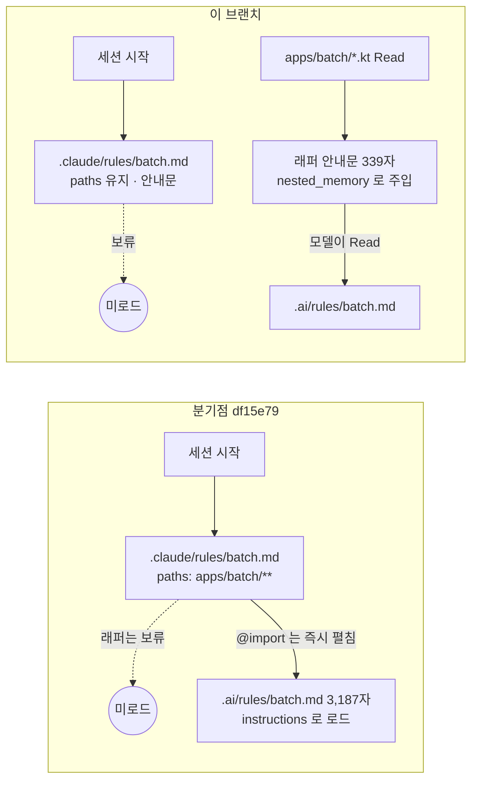

# 개발자 이해문서 — chore: 세션 자동 로드 문서 정리

- PR/MR: https://github.com/geonyeop123/premium-spread/pull/81
- 브랜치: `chore/harness-context-load` ← `dev` (분기점 `df15e79`)
- 작성: 2026-10-20 · 문맥: warm

## 1. TL;DR
Claude Code 세션이 시작될 때마다 자동으로 실리는 문서를 15,687자에서 9,752자로 줄였다(−38%).
`paths:` 조건을 달아 둔 batch·http 규칙이 실제로는 항상 실리고 있었는데, 그 원인인 래퍼 안의 `@import`를 없앴다.
그 밖에 사실과 다른 모듈 트리는 `AGENTS.md`를 가리키는 포인터로 바꿨고, 판단에 쓰이지 않는 변경 이력은 `docs/harness-changelog.md`로 옮겼다.

## 2. 왜
- **조건부 로딩이 무력화돼 있었다.** `.claude/rules/batch.md`(`apps/batch/**/*.kt`)와 `http.md`(`http/**`, `apps/api/**/interfaces/**/*.kt`)는 `paths:` frontmatter를 가진 래퍼이고, 본문은 `@../../.ai/rules/*.md` import 한 줄뿐이었다. 실측해 보니 래퍼 자체는 보류됐지만 **import 대상은 세션 시작 시 무조건 펼쳐졌다**. 그래서 API 작업에도 배치 규칙 3,187자가 실렸다.
- **`CLAUDE.md`의 모듈 트리가 틀려 있었다.** `domain/`, `infrastructure/*`, `architecture-tests/`, `apps/web`이 빠져 있었다. 같은 컨텍스트에 실리는 `architecture.md`는 "Flyway는 `infrastructure:common` 소유"라고 하는데, 트리에는 그 모듈이 없었다. 매 세션 틀린 지도를 먼저 주는 셈이다.
- **변경 이력 표가 `CLAUDE.md`의 36%를 차지했다.** 1,573자짜리 서술 3행이 매 세션 로드되지만 작업 판단에는 쓰이지 않는다.
- **제약이 하나 있었다.** `docs/check-harness.sh`가 `CLAUDE.md ## 하네스` 절을 단정하고 있고, 그 제거 조건 문구에 "변경 이력을 이전하면…"이 들어 있다. 이력을 옮기려면 검사기와 자가검증 픽스처도 같은 브랜치에서 바꿔야 했다.

## 3. 무엇을 바꿨나

| 파일 | 변경 |
|---|---|
| `.claude/rules/batch.md`, `http.md` | `@import` 제거. "이 경로를 고치기 전에 `.ai/rules/*.md`를 Read로 읽는다"는 안내문으로 교체했다. `paths`는 그대로이고 줄바꿈은 LF다 |
| `CLAUDE.md` | 모듈 트리를 `AGENTS.md` 포인터 한 줄로 바꿨다. `### 변경 이력`을 삭제했다. 하네스 표에 "변경 이력" 행을 추가했고, 계약 서술에 새 단정을 반영했다. 줄바꿈은 CRLF를 유지한다 |
| `docs/harness-changelog.md` (신규) | 기존 3행을 바이트 그대로 옮기고 이번 작업 행을 추가했다. 줄바꿈은 CRLF다 |
| `docs/check-harness.sh` | `require_section docs/harness-changelog.md '^\| 날짜 \| 변경 내용 \| 대상 \| 사유 \|'`를 추가했다. `## 하네스` 단정의 제거 조건 문구와 주석 2곳을 정정했다 |
| `docs/test-check-harness.sh` | 케이스를 24종에서 27종으로 늘렸다. 정상 표본은 "변경 이력의 과거 경로 무시", 위반 표본은 "파일 부재"와 "헤더 누락"이다 |
| orchestrator `SKILL.md`, `tech-docs.md`, tech-docs-sync `SKILL.md` | "`CLAUDE.md ## 하네스` 변경 이력에 한 행"이라는 지시 5곳을 새 파일로 바꿨다. "`CLAUDE.md` 모듈 트리 갱신" 지시도 정정했다 |
| `docs/work/harness-context-load/probe-rule-load.sh` (신규) | 세션 transcript를 읽어 규칙 로딩을 판정하는 검증 스크립트다 |

## 4. 설계



정본은 계속 `.ai/rules/`에 둔다. `AGENTS.md`와 Codex가 같은 정본을 공유하기 때문이다. Claude 쪽 래퍼는 "언제 읽을지"만 정한다.

## 5. 주요 결정과 버린 대안
- **래퍼를 안내문으로 바꿨다.** 버린 대안은 둘이다.
  - 래퍼에 정본 본문을 그대로 복제하는 방법: 사본이 둘이 되어 갈라진다.
  - 심볼릭 링크로 연결하는 방법: frontmatter를 `.ai/rules` 정본 쪽에 넣어야 하는데, 그러면 Codex와 문서 검사에 영향을 준다.
  - 이 선택의 대가는 조건이 맞는 순간 모델이 Read를 한 번 더 해야 한다는 것이다. 안내문은 그 Read를 지시만 할 뿐 강제하지 못한다.
- **모듈 트리는 정확하게 고치지 않고 포인터로 바꿨다(사용자 결정).** 같은 내용을 두 곳에 두면 다시 갈라진다. `CLAUDE.md` 하네스 절의 "옮겨 적지 않는다" 원칙과도 같은 방향이다.
- **변경 이력 파일은 참조 무결성(축 1) 검사 대상에서 뺐다.** 이력은 과거 경로를 그대로 담는 기록이라, 나중에 파일이 rename되면 게이트가 소급해서 빨개진다. 정상 표본 C1이 이 결정을 고정한다. 검사기에 `check_refs docs/harness-changelog.md`를 넣는 회귀가 생기면 C1이 실패한다(⑨ 리뷰에서 변형 주입으로 확인).
- **줄바꿈은 파일마다 다르게 정했다.**
  - `CLAUDE.md`와 changelog는 원래 CRLF를 유지한다. 그래야 diff가 최소가 되고, AC2의 바이트 비교도 맞는다.
  - 두 래퍼는 LF다. 처음에는 CRLF로 되돌렸는데, 그러면 dod AC4의 `…안내$`가 GNU grep에서 매칭되지 않아 실패했다.
  - 이 경우 동결된 계약을 고치는 대신 코드(파일)를 고쳤다(⑨ 규칙: 기준을 위반한 코드는 코드 수정).
- **AC6·AC7의 검증 수단을 개정했다(사용자 승인).**
  - 처음 계약은 `claude -p` 세션에 "안내문이 보이냐"고 묻는 자기보고 방식이었다. 결과는 batch 3/3, http 1/3처럼 흔들렸다. 그런데 인용하지 않은 회차도 "Read 결과에 안내문이 붙어 있었다"고 답했다. 로딩이 흔들린 것이 아니라 모델의 인용 판단이 흔들린 것이다.
  - 그래서 세션 transcript(`~/.claude/projects/<cwd>/<session>.jsonl`)의 `attachment` 기록을 직접 판정하는 방식으로 바꿨다. 결정적이다.

## 6. 동작 확인 방법

```bash
./gradlew harnessCheck harnessCheckTest --offline --no-daemon   # 27 케이스 통과
bash docs/check-documentation.sh

# 규칙 로딩 판정 (worktree 루트, claude CLI 로그인 필요, haiku 1~3턴)
bash docs/work/harness-context-load/probe-rule-load.sh none    # instructions=['testing'] nested_memory=[]
bash docs/work/harness-context-load/probe-rule-load.sh batch   # nested_memory=['batch']
bash docs/work/harness-context-load/probe-rule-load.sh http    # nested_memory=['http']
# 분기점(df15e79)의 detached worktree 에서 none 을 돌리면 instructions=['batch','http','testing'] (RED)

# 로드량
LC_ALL=C.UTF-8 wc -m CLAUDE.md .ai/rules/{architecture,testing,naming,git}.md   # 합 9,752
```

AC1~AC8의 판정과 실제 출력은 `dod.md`의 증거 로그와 최종 판정(PASS 8/8)에 있다.

## 7. 후속·리스크·함정
- **에이전트 셸의 `grep`은 GNU grep이 아니다.** Claude Code 셸에서 `grep`은 ugrep 래퍼 함수이고, CRLF를 줄 끝으로 흡수한다. 그래서 CRLF 파일에 `$` 앵커를 쓰면 로컬에서는 통과하고 CI(GNU grep)에서는 실패한다. 이번 작업에서도 이 때문에 거짓 green이 한 번 나왔다. 판정에는 `/usr/bin/grep`을 쓴다.
- **`.claude/rules/` 래퍼에 `@import`를 다시 넣지 않는다.** `paths` 래퍼에 넣으면 조건부 로딩이 조용히 무력화된다. 지금 게이트는 이것을 잡지 않는다. import 대상이 실재하면 통과하기 때문이다. 다시 넣는 일이 반복되면 "paths 래퍼에 `@` 행 금지" 단정을 추가하는 것을 검토한다.
- **`probe-rule-load.sh`는 Claude Code 내부 포맷에 의존한다.** transcript 경로 규칙(`/`·`.`을 `-`로 바꿈)과 attachment 스키마(`instructions.files[].path`, `nested_memory.content.path`)는 공개 계약이 아니다. CLI가 업데이트되면 깨질 수 있다. 일회성 검증 도구로 보고 CI에는 넣지 않았다.
- **보류한 minor 2건(⑨ code-reviewer).** 헤더 정규식에 끝 앵커가 없어서 열이 추가된 헤더도 통과한다. 또 셀이 패딩된 헤더(Prettier 포맷 등)는 실패한다. 둘 다 plan에서 지정한 정규식을 그대로 쓴 결과이고, 실패하면 메시지에 정규식이 나오므로 원인은 바로 보인다.
- **범위 밖에서 발견한 것(design §9).**
  - orchestrator `SKILL.md`의 "이 저장소에는 하네스 자동 게이트가 없으므로", tech-docs-sync의 "경로 실재는 사람이 확인"은 이미 낡은 서술이다.
  - `CLAUDE.md` 관련 문서 표에 "`feature-workflow` 산출물"이 남아 있다.
  - `CLAUDE.md` Tech Stack은 `AGENTS.md`와 중복이다.
