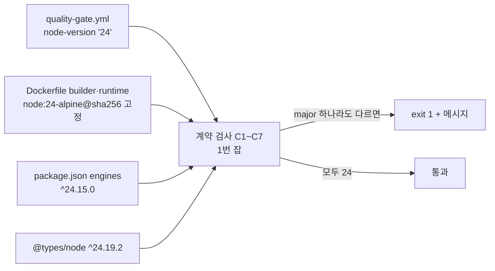

# 개발자 이해문서 — apps/web Node 런타임 20→24 전환과 jsdom 30 적용 (#118)

- PR/MR: (생성 전)
- 브랜치: `chore/issue-118-web-node24` ← `dev`
- 작성: 2026-11-09 · 문맥: warm

## 1. TL;DR
apps/web의 CI(Quality Gate 6번 잡)와 Docker 이미지(builder·runtime 두 stage)를 Node 20에서 Node 24로 올렸다. 이미지는 digest로 고정했다.
같은 PR에서 jsdom 27→30, `@types/node` 20→24를 적용하고 `package.json`에 `engines: {"node": "^24.15.0"}`을 넣었다.
네 곳(CI `node-version`, Dockerfile 두 stage, `engines`, `@types/node`)의 Node major가 갈리면 `ci/quality-gate-contract-test.sh`가 1번 잡에서 실패한다.

## 2. 왜
- Dependabot PR #114(jsdom 30.1.3)가 CI 6번 잡에서 테스트를 시작도 못 하고 실패해 닫았다.
  - jsdom 30의 engines는 `^22.22.2 || ^24.15.0 || >=26`이다.
  - jsdom 하위의 undici 8은 Node 20에서 로드되지 않는다(`undici/lib/interceptor/decompress.js`에서 `TypeError: Cannot read properties of undefined (reading 'bind')`).
- Node 20은 2026-04에 지원이 끝났다. 근본 해결은 런타임을 올리는 것이다.
- 목표 major는 24다(③ 합의). 2026-11 기준으로 Node 22는 2027-04에 지원이 끝나 5개월 뒤 다시 올려야 하고, 26은 LTS가 막 시작됐다. 24는 2028-04까지 지원된다.
- 제약
  - production 의존성 트리는 바뀌면 안 된다.
  - Kotlin/Gradle 쪽에는 영향이 없어야 한다.

## 3. 무엇을 바꿨나

| 파일 | 변경 |
|---|---|
| `.github/workflows/quality-gate.yml` | 6번 잡(`dependency-security`) `node-version: '20'` → `'24'` |
| `apps/web/Dockerfile` | 1·8행 `node:20-alpine@sha256:fb4c…` → `node:24-alpine@sha256:a34ab6d7f6f4813f4d0c5469d74685604b962fbdbf5793a7bc7b4998ecb867c8` (v24.22.2, npm 11.19.1) |
| `apps/web/package.json` | `engines` 추가, `@types/node` `^20`→`^24.19.2`, `jsdom` `^27.0.0`→`^30.1.3` |
| `apps/web/package-lock.json` | node:24-alpine의 npm 11.19.1로 `--package-lock-only` 재해결. 37건 변경, 전부 dev 트리. `libc` 필드 18곳 보존 |
| `ci/quality-gate-contract-test.sh` | Node major 일치 검사 C1~C7 (#98 블록 뒤, 최종 echo 앞) |
| `.github/dependabot.yml` | `@types/node` major ignore는 유지하고 주석 근거만 24로 |
| `docs/runbooks/deployment.md` | 77행 근거 문구 수정, "Node 런타임 major 갱신" 항목 추가 |
| `README.md` | 사전 요구사항 `Node.js 20+` → `Node.js 24 (apps/web, ^24.15.0)` |

## 4. 설계

계약 검사가 보는 것(전문은 plan Task 3):
- C1·C2: CI에 따옴표 친 major 하나(`'24'`)가 정확히 한 줄 있고, `dependency-security` 잡 안에 있다.
- C3~C5: Dockerfile `FROM`이 정확히 두 줄이고, 둘 다 `node:<major>-alpine@sha256:<64hex>`이며 같은 이미지다.
- C6: `engines`가 `"node": "^<major>.<minor>.<patch>"` 한 줄이다.
- C7: `@types/node`가 `^<major>`로 시작한다. 이 major가 앞의 셋과 같아야 한다.

## 5. 주요 결정과 버린 대안
- **Node 24.** 22는 EOL이 가깝고 26은 생태계 호환 위험이 있다. jsdom 30은 셋 다 지원한다.
- **lockfile은 npm 11(node:24 컨테이너)로 재해결.** 처음 계획은 로컬 npm 10.8.2였다.
  - 구현 중 npm 10.8.2가 lockfile의 `"libc": ["glibc"|"musl"]` 18곳을 지운다는 것이 드러났다.
  - 그중 `@next/swc-linux-*` 4건은 production 트리다. 이 필드가 없으면 alpine(musl)에서 glibc용 swc 바이너리가 설치 후보가 된다.
  - CI·Docker가 실제로 쓰는 npm 11.19.1은 필드를 보존했고, 변경도 55건에서 37건으로 줄었다.
  - design D5를 단독 커밋(5641e22)으로 개정했다. 동결된 기준(`nonDev=[]`)은 그대로다.
- **`engines`는 `^24.15.0`(jsdom 30 하한), `engine-strict`는 켜지 않음.** 로컬 Node 20·22에서 `npm ci`가 경고(`EBADENGINE`)만 내고 진행한다. 로컬 개발을 막지 않으면서 신호는 준다.
- **계약 검사 추가.** 세 곳이 갈리면 #114 같은 상황(CI는 20, 의존성은 22+ 요구)이 다시 생긴다. 일부러 엄격하게 만들었다. `FROM --platform=…`, `AS build-stage`(숫자·하이픈), `@types/node ~24` 같은 형식은 실패한다.
- **버린 대안**
  - jsdom 30만 ignore하고 Node 20 유지: 이미 EOL이라 같은 문제가 다른 패키지에서 반복된다.
  - 계약 스크립트 안에 변형 자가검사 추가: #98 블록과 같은 방식으로, 변형 13종은 구현 때 한 번 돌려 dod 증거로 남겼다.

## 6. 동작 확인 방법
- `bash ci/quality-gate-contract-test.sh`: exit 0. 변형 13종(M0~M12)이 각각 기대 메시지로 거부되고, 복원하면 다시 통과한다(dod AC2).
- node:24-alpine에서 HEAD 사본(`git archive`)으로 `npm ci --include=optional && npm run lint && npm run test && npm run build`
  - 테스트 10개 통과, 라우트 6개(dod AC5).
  - `bash ci/run-npm-audit.sh`는 high 0, moderate 11, low 2. 취약 패키지 이름 집합이 dev와 같다(R1).
- `docker build -f apps/web/Dockerfile .` 후 기동하면 `node -v`가 v24.22.2다. `/`와 `/login`이 200을 돌려준다(AC6).
- lockfile 검사: plan 공통 절의 `LOCKCHECK`로 BASE lock과 비교한다. `changed=37 nonDev=[]`, `prodDepsSame:true`, `grep -c '"libc"'` 18(AC4·R4).
- Gradle 회귀는 로컬에서 돌리지 않았다. 바뀐 파일 중 Gradle 입력이 없어서 PR CI 11개 check로 갈음한다(AC9).

## 7. 후속·리스크·함정
- **로컬 개발자는 Node 24가 필요하다.** Node 20으로도 설치는 되지만, jsdom 30 테스트(`npm run test`)는 Node 20에서 실패한다.
- **lockfile을 다시 만들 때는 npm 11 이상을 쓴다.** 로컬 npm 10.8.2로 `npm install`하면 `libc` 필드가 사라진다. `grep -c '"libc"' apps/web/package-lock.json`이 18인지 확인한다.
- **jsdom 하위 undici 8.12.4**(engines `>=22.19.0`)는 jsdom 전용 사본이다. 최상위 undici 7.30.1은 shadcn·@dotenvx가 쓴다.
- **Docker digest 자동 갱신이 없다.** Dependabot docker ecosystem은 이번 범위 밖이다. Node 20 때와 같은 상태다.
- **Node major를 올릴 때는 runbook "Node 런타임 major 갱신" 항목대로 다섯 곳을 한 PR에서 바꾼다.** 하나라도 빠지면 계약 검사가 1번 잡에서 실패한다.
- **⑨ 리뷰에서 보류한 MINOR 3건(PR 본문에도 기록)**
  - 스크립트 안 음성 테스트 없음.
  - FROM 형식이 엄격하다(`--platform` 도입 시 검사도 고쳐야 한다).
  - `@types/node`가 `~`나 고정 버전일 때 메시지가 `missing`으로 나온다.
