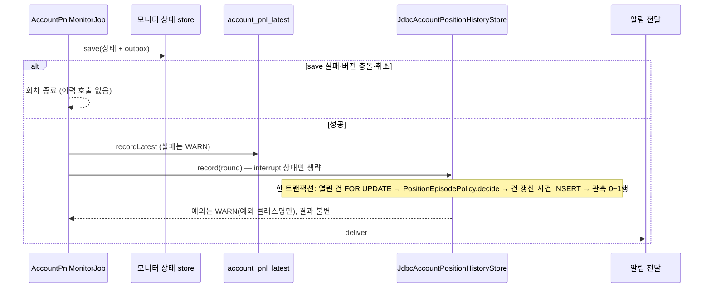
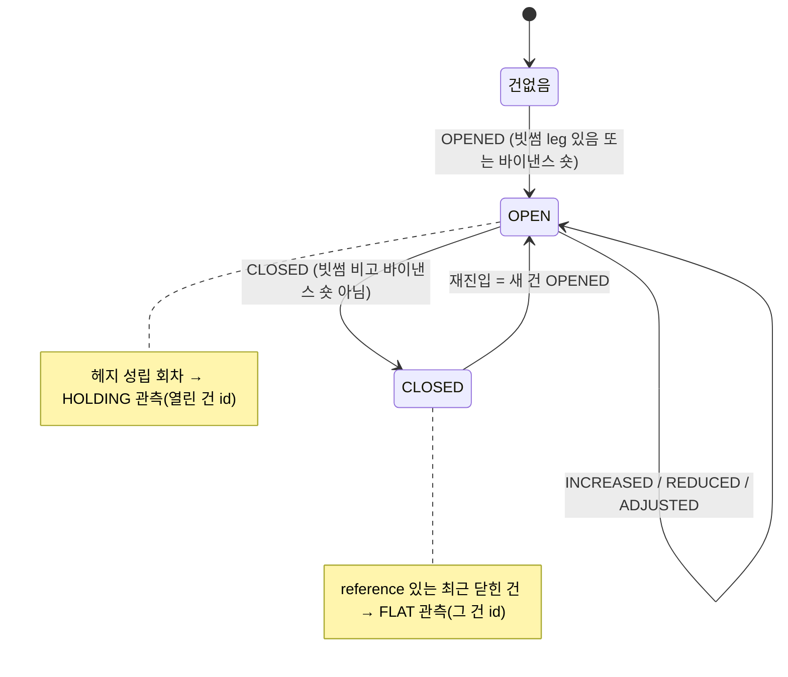

# 개발자 이해문서 — feat: 실계정 포지션 기록과 매분 관측 이력 저장 (#129)

- PR/MR: (생성 전) · 이슈 #129 (상위 #128)
- 브랜치: `feat/issue-129-position-history` ← `dev`
- 작성: 2026-11-11 · 문맥: warm (Task 1~4 는 2026-11-10 세션, Task 5·리뷰·검증은 이 세션)

## 1. TL;DR

- 실계정 모니터가 매분 계산하던 순손익이 DB 에 최신 한 건만 남던 것을, **포지션 한 건(수량 0 → 다시 0)·그 안의 사건·매분 관측**으로 쌓는다(V24 신규 테이블 3개).
- 포지션이 없는 기간에도 직전 포지션의 양쪽 평단을 기준으로 `FLAT` 관측을 계속 쌓아, 후속 #131(기준 대비 단계 알림)·#130(확정 손익)이 읽을 저장 기반이 된다.
- 기존 알림·`account_pnl_latest`·모니터 상태는 그대로다. 이력 쓰기가 실패해도 회차 결과·알림 전달은 바뀌지 않는다.

## 2. 왜

- **배경:** `AccountPnlMonitorJob` 은 매분 빗썸·바이낸스 실계정을 읽어 순손익을 계산하지만, 남는 것은 `account_pnl_latest` 한 행뿐이고 과거 값은 로그 파일에만 있다. 포지션을 정리하면 계정 알림도 전부 멈춘다.
- **목표(owner 합의, 2026-11-10):** "지금까지 얼마 벌었나, 특정 포지션에서 얼마 벌고 잃었나"를 추적한다. 보는 숫자는 "기준 포지션 대비 김프 차이(%p)"이고, 포지션이 없을 때도 이 계산이 이어져야 재진입 알림이 가능하다.
- **제약:**
  - 이 이슈는 **저장만** 한다. 알림 규칙·문구·기존 상태 전이는 바꾸지 않는다.
  - 조회 전용 유지(주문·출금 없음). 수량·평단·금액은 실계정 값이라 로그·`toString` 노출 금지.
  - 이력 실패가 순손익 계산·알림·중단 판정에 영향을 주면 안 된다(이슈 수용 기준).

## 3. 무엇을 바꿨나

| 모듈 | 파일 | 내용 |
|---|---|---|
| domain | `accountpnl/PositionEpisodePolicy.kt`, `PositionEpisode.kt` | 열린 건 + 현재 leg → 사건 0~1건(`OPENED`/`INCREASED`/`REDUCED`/`ADJUSTED`/`CLOSED`)과 다음 건 상태를 내는 순수 함수 |
| domain | `accountpnl/HedgeQuote.kt` | 김프(`premiumPercent`)·VWAP 공유 함수. `AccountPnlBreakdown`·`AccountNetPnl` 의 private 식을 꺼내 위임시켰다(동작 불변) |
| domain | `accountpnl/PositionObservation.kt` | `HOLDING`/`FLAT` 관측 값 계산. 계산 불가 입력이면 null(관측 0행) |
| domain | `accountpnl/AccountPositionHistoryStore.kt` | port — `record(round: PositionHistoryRound)` 하나 |
| infrastructure:common | `db/migration/V24__create_account_position_history.sql` | `account_position_episode`·`account_position_event`·`account_pnl_observation` (추가만) |
| infrastructure:common | `persistence/jdbc/accountpnl/JdbcAccountPositionHistoryStore.kt` | 한 회차 = 한 트랜잭션. 열린 건 `FOR UPDATE` → policy → 건·사건·관측 기록 |
| apps:batch | `AccountPnlMonitorJob.kt` | 상태 저장 성공 회차에서 `recordLatest` 다음·전달 전에 `recordHistory` |
| apps:batch | `AccountPnlMonitorConfiguration.kt`, `application.yml` | `account-pnl-monitor.position-history.enabled`(env `ACCOUNT_PNL_POSITION_HISTORY_ENABLED`, 기본 true) |
| docs | `docs/runbooks/account-pnl-alert.md` | "포지션 이력" 절 — 쌓이는 것, 첫 배포 시 `opened_at` 의미, 확인 쿼리 3개, 끄는 법, V24 배포/롤백 |

API·Redis·http 샘플 변경은 없다.

## 4. 설계

한 회차의 흐름. 이력은 기존 저장 **뒤**, 별도 트랜잭션이다.



포지션 건과 관측 종류의 관계.



## 5. 주요 결정과 버린 대안

| 결정 | 이유 | 버린 대안 / trade-off |
|---|---|---|
| 건 경계 = "어느 한 leg 라도 있으면 열림" | owner 는 한쪽 leg 를 먼저 체결한다. 그 1~2분을 닫힘으로 보면 한 번의 진입이 여러 건으로 쪼개지고 #130 의 체결 귀속 구간이 깨진다 | 헤지 성립 시에만 열림 — 선체결 구간에서 건이 끊김 |
| 바이낸스 롱은 수량 0 으로 정규화 | 기존 `AccountHedgePosition.resolve` 가 롱을 포지션으로 보지 않는 것과 맞춘다 | 롱 기록 — 이 전략에서 의미 없는 상태가 건 경계를 흔든다 |
| 기준은 김프(%)가 아니라 **양쪽 평단**(reference) | 매수김프를 매 회차 현재 환율로 다시 계산해야 환율만 움직인 변동이 걸러진다 | 진입 시 김프 저장 — 환율 변동이 차이에 섞임 |
| 사건 판정은 모니터 상태가 아니라 **이력 저장소 자신의 열린 건 leg** 와 비교 | 이력 기록만 실패해도 다음 회차가 같은 비교로 따라잡는다(감지 시각만 늦어짐) | 모니터 상태(`PositionWatchState`)와 비교 — 두 저장소가 어긋나면 사건 유실 |
| `save()` 트랜잭션과 **분리** | 이력 실패가 알림·중단 판정을 막으면 안 된다 | 한 트랜잭션 — 원자적이지만 수용 기준 위반 |
| 김프·VWAP 식을 `HedgeQuote` 로 추출 | `HOLDING` 과 `FLAT` 이 같은 식을 써야 #131 이 보유·미보유 구간을 이어 쓸 수 있다. 복제하면 반올림이 바뀔 때 조용히 갈린다 | 식 복제 |
| 수량·평단은 `VARCHAR(64)` 10진 문자열(관측 값만 DECIMAL) | V20 관례. DECIMAL 반올림이 다음 회차 `samePosition` 비교를 깨지 않게 | DECIMAL — scale 차이로 가짜 사건 발생 위험 |
| 관측 계산 불가(평단 0 → `ArithmeticException`)는 관측 0행으로 정규화, 건·사건은 커밋 | ⑨ 코드 리뷰에서 발견: 원래 구현은 계산 예외가 같은 트랜잭션의 `OPENED`/`CLOSED` 까지 롤백시켜, 평단 0 인 건을 닫으면 건이 영구히 OPEN 으로 남을 수 있었다 | 계산을 트랜잭션 밖에서 먼저 — `FLAT` 은 이번 회차 `CLOSED` 가 만든 reference 를 써야 해서 사건 반영 전에는 계산할 수 없다 |
| 보장 수준은 **약한 보장** | 모니터는 Job 락으로 단일 실행이라 버전 충돌은 락 상실 때만 생긴다. 건너뛴 회차의 관측은 버린다 | 건너뛴 회차도 기록 — 다른 실행의 존재를 가정해야 해 복잡도 대비 이득이 작음 |

## 6. 동작 확인 방법

```bash
# Domain 판정·계산
./gradlew :domain:test --tests 'io.premiumspread.domain.accountpnl.*' --offline --no-daemon
# Job 연결·실패 격리·호출 순서, 배선 스위치
./gradlew :apps:batch:test --tests 'io.premiumspread.application.job.accountpnl.*' \
  --tests io.premiumspread.config.AccountPnlMonitorPositionHistoryWiringTest --offline --no-daemon
# JDBC 저장소·V24 경로 (Docker 필요)
./gradlew :infrastructure:common:integrationTest --tests '*AccountPositionHistory*' --offline --no-daemon
./gradlew :infrastructure:common:verifyMigrations --offline --no-daemon
```

- 이 세션의 전체 검증 @ `5e2c26d`: unit·architecture 1,896건, 통합 400건(common 109·api 174·batch 117) 실패 0. 수치와 AC 매핑은 [dod.md](dod.md) 증거 로그.
- 핵심 시나리오 테스트: `JdbcAccountPositionHistoryStoreIntegrationTest` — 진입→추가→부분 정리→전량 정리 = 건 1행·사건 4행, 재진입 시 건 2행, 새 store 인스턴스로 같은 round 재호출해도 행 수 불변, 평단 0 이면 건·사건은 커밋되고 관측 0행.
- 실계정 확인(AC8, owner): 로컬 batch 를 실계정으로 띄우고 runbook "포지션 이력" 절의 확인 쿼리 3개를 실행한다. 보유 중이면 `OPENED` 1건 + 분당 `HOLDING` 1행.

## 7. 후속·리스크·함정

- **첫 배포의 `opened_at` 은 실제 진입 시각이 아니다.** 보유 중에 배포하면 첫 관측 시각에 `OPENED` 가 남는다. #130 이 체결 이력으로 보정해야 한다.
- **1분 표본 한계.** 두 회차 사이에 열렸다 닫힌 포지션, 버전 충돌로 건너뛴 회차에서만 보인 중간 상태는 기록되지 않는다(D5 약한 보장).
- **바이낸스 manual 모드:** env 값 변경이 그대로 사건이 된다. 건 행의 `position_source` 는 **개설 시 출처**이고 이후 바뀐 출처는 사건 행에 남는다.
- **보존 정책 없음.** 1일 최대 1,440행(연 약 53만 행). 삭제 작업은 두지 않았다. 용량이 문제 되면 별도 이슈.
- **batch 통합 테스트 스키마:** `apps/batch/src/integrationTest/resources/batch-schema.sql` 은 Flyway 가 아니라 이 파일로 스키마를 만든다. batch 통합 테스트가 실제 이력 adapter 를 쓰게 되면 V24 테이블을 이 파일에도 옮겨야 한다(지금은 쓰지 않음).
- **RED 증거의 약점:** Domain 계산(T1·T2)의 첫 RED 는 단언 실패가 아니라 `TODO()` 스텁의 `NotImplementedError` 였다. 이후 태스크는 단언 실패 RED 를 남겼다.
- **배포 순서:** V24 는 API(Flyway 실행 주체)가 먼저 배포돼야 한다. batch 는 ddl `validate` 라 V24 없이 뜨면 이력 adapter 쪽에서 실패한다. 롤백은 이미지만 되돌리며 테이블은 남는다(additive).
- **후속:** #131 기준 포지션 대비 단계 알림(포지션 없는 기간 포함), #130 정리한 포지션의 확정 손익(체결 기준). 둘 다 이 저장 기반을 읽고 서로는 독립이다.
