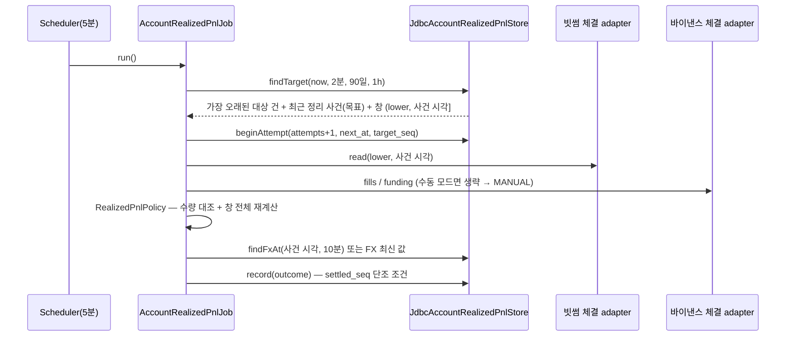
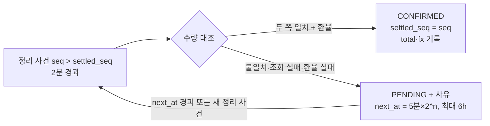

# 개발자 이해문서 — feat: #130 정리한 포지션의 확정 손익 — 체결 기준

- PR: (생성 전)
- 브랜치: feat/issue-130-realized-pnl ← dev
- 작성: 2026-11-11 · 문맥: warm

## 1. TL;DR

포지션 건에서 부분 정리나 전량 정리 사건이 생기면, 별도 정산 Job이 5분마다 빗썸·바이낸스 체결 내역을 읽어 실현 손익을 건 행에 확정합니다.
값은 매번 조회 창 전체를 다시 계산해서 구하고, 창 안 체결의 순수량이 사건 시점 보유량과 맞을 때만 확정합니다. 그래서 같은 체결을 두 번 세지 않고, 체결 반영이 덜 된 값으로 확정하지도 않습니다.
조회 실패와 수량 불일치는 PENDING으로 남습니다. 이때 시도 간격을 지수적으로 늘리며(backoff) 다시 보고, 한 건이 뒤의 건 정산을 막지 않습니다. 모니터 회차(순손익·알림)와는 완전히 분리돼 있습니다.

## 2. 왜

- 모니터 순손익은 "지금 전량 청산하면"을 가정한 추정치입니다. 실제 정리 체결가, 수수료, 보유 기간 펀딩비가 빠져 있어 포지션별 손익이 계좌와 맞지 않았습니다.
- #129가 포지션 건과 사건(OPENED·INCREASED·REDUCED·ADJUSTED·CLOSED)을 DB에 남기므로, 사건 시각을 경계로 체결을 귀속시킬 수 있게 됐습니다.
- 제약은 세 가지입니다.
  - 거래소 호출은 GET만 씁니다(`PrivateAccountReadOnlyArchitectureTest`).
  - 모니터는 1분 주기에 40초 timeout이고 호가 신선도 skew가 5초입니다. 그래서 체결 페이지를 넘기는 조회를 모니터 안에 넣을 수 없습니다.
  - 바이낸스 체결 이력은 6개월, 펀딩 이력은 3개월만 보관됩니다.

## 3. 무엇을 바꿨나

| 모듈 | 파일 | 역할 |
|---|---|---|
| domain | `accountpnl/RealizedPnl.kt` | 체결·펀딩 값 타입, 체결 조회 포트 2개, `AccountRealizedPnlStore` 포트, `SettlementTarget`·`SettlementOutcome`, 상태·실패 enum, `FillHistoryWindowLimitException` |
| domain | `accountpnl/RealizedPnlPolicy.kt` | 순수 계산: 빗썸 이동평균 원가(수수료 포함, dust 규칙), 바이낸스 `realizedPnl − abs(commission) + funding`, KRW 합계(HALF_UP 1회) |
| infrastructure:common | `V26__add_realized_pnl_settlement.sql` | `account_position_episode`에 nullable 정산 열과 CHECK 2개 추가 (additive) |
| infrastructure:common | `JdbcAccountRealizedPnlStore.kt` | 대상 선정(`findTarget`), 시도 시작(`beginAttempt`), 기록(`record`, 단조 조건), 사건 시각 환율(`findFxAt`) |
| infrastructure:batch | `BithumbFillHistoryPrivateAccountAdapter.kt` + `BithumbPrivateReadClient.kt` | 주문 목록(wait 따로, done·cancel 따로)과 주문 상세 `trades[]` → 체결 단위 창 필터, `paid_fee`를 체결금액 비율로 배분 |
| infrastructure:batch | `BinanceFillHistoryPrivateAccountAdapter.kt` + `BinanceFuturesSignedReadClient.kt` | userTrades·FUNDING_FEE income을 7일 창 단위로 앞으로 걸으며 읽음, id 중복 제거, BNB 수수료는 1분봉 시가 환산 |
| apps:batch | `AccountRealizedPnlJob.kt`, `AccountRealizedPnlScheduler.kt`, `AccountRealizedPnlConfiguration.kt` | 정산 흐름, 5분 스케줄, 배선(수동 모드면 바이낸스 체결 port 없음 → MANUAL) |
| architecture-tests | `PrivateAccountReadOnlyArchitectureTest.kt` | `REQUIRED_TARGETS`에 새 adapter 2개 추가 |
| docs | runbook "확정 손익 (#130)" | 계산, 상태, 전제·한계, 확인 쿼리, owner 대조 체크리스트, V26 배포 |

기존 빗썸·바이낸스 계정 adapter는 서명 GET 부분만 공유 클라이언트로 옮겼습니다. 동작과 기존 테스트는 바뀌지 않았습니다.

## 4. 설계





조회 창 하한은 `max(앞 건 closed_at, opened_at − 1h)`입니다(앞 건이 없으면 `opened_at − 1h`).

## 5. 주요 결정과 버린 대안

| 결정 | 이유 | 버린 대안 / trade-off |
|---|---|---|
| 별도 Job | 모니터의 timeout과 호가 신선도를 지키고, 정산 실패가 알림에 영향을 주지 않게 하려고 | 모니터 회차 안에서 정산: 페이지 조회가 회차 판정을 흔듦 |
| 매번 창 전체를 다시 계산 | 증분이 없으면 재시도·재시작·겹친 창에서도 중복 집계가 구조적으로 불가능 | 체결 행 테이블과 UNIQUE: 스키마와 저장 경로가 늘어남 |
| 수량 대조를 확정 조건으로 | 체결 반영 지연이나 창 밖 체결이 섞인 값으로 확정하지 않으려고 | 시간 지연만으로 확정: 틀린 값이 CONFIRMED로 남음 |
| 시도를 시작할 때 backoff를 먼저 기록 | timeout·취소로 기록 없이 끝나도 같은 건이 계속 잡혀 뒤의 건을 막지 않게(최종 리뷰 지적) | 결과를 기록할 때만 backoff: 취소된 회차가 영원히 재시도됨 |
| BNB 수수료는 체결 시각 1분봉 시가 | 같은 체결이면 언제 다시 계산해도 같은 값(codex 스펙 리뷰) | 정산 시점 시세: 재실행마다 값이 달라짐 |
| 환율은 정리 회차 관측 행 | "실시간 환율" 원칙(#131 owner 결정). 정리를 판정한 바로 그 환율 | 정산 시점 환율: 정리 시점과 어긋남 |
| 하한 `max(앞 건 closed_at, opened_at − 1h)` | 오래 쉬다 연 건이 90일 한도에 걸려 영구히 정산되지 않는 결함(최종 리뷰, owner 승인으로 계약 개정) | 앞 건 `closed_at`만 쓰기: 장기 공백 뒤 건이 영구 미정산 |
| 빗썸 wait 목록과 done·cancel 목록을 따로 조회 | Upbit 호환 v1 API가 상태 혼합 조회를 거부함. wait를 먼저 읽어 두 요청 사이 상태 전이의 틈을 막음 | 한 요청에 섞기: 실계정에서 400이 나면 빗썸 쪽이 영구 PENDING |

## 6. 동작 확인 방법

```bash
./gradlew :domain:test --tests io.premiumspread.domain.accountpnl.RealizedPnlPolicyTest --offline --no-daemon
./gradlew :apps:batch:integrationTest --tests io.premiumspread.application.job.AccountRealizedPnlSettlementIntegrationTest --offline --no-daemon
./gradlew :infrastructure:common:integrationTest --tests io.premiumspread.infrastructure.common.persistence.jdbc.accountpnl.JdbcAccountRealizedPnlStoreIntegrationTest --offline --no-daemon
./gradlew :apps:batch:test --tests io.premiumspread.application.job.accountpnl.AccountRealizedPnlJobTest --offline --no-daemon
./gradlew architectureTest --offline --no-daemon
```

- 끝 단 통합 테스트는 실제 adapter 2개를 MockWebServer에 붙이고, store는 Spring context에서 주입받습니다. 그래서 bean 등록까지 검증됩니다.
  - 기대값(79,929 / 85,053 → 133,450)은 테스트 주석에 손계산이 있습니다.
- 실계정 확인은 runbook "owner 대조 체크리스트 (#130 AC10)"를 따릅니다. 로컬 batch로 seed 건(2026-10-28~11-08)을 정산시키고 거래소 내역과 대조합니다.

## 7. 후속·리스크·함정

- **AC10 대기:** 빗썸 `/v1/order` 상세의 `trades[]` 형태는 fixture로만 검증했습니다. 필드가 다르면 UNEXPECTED로 PENDING이 되고(틀린 값 확정 없음), 실계정 대조에서 드러납니다.
- **잔여 위험 (owner 감수):** 7일보다 오래 전에 낸 지정가 주문 두 개가 창 안에서 같은 수량으로 사고팔면, 순수량이 0이라 대조를 통과합니다. 그 왕복 손익만 빠진 채 확정될 수 있습니다.
- **전용 계좌 전제:** 계좌의 KRW-BTC·BTCUSDT 체결은 모두 건에 귀속됩니다. 바이낸스 롱 잔량이나 BTC 입출금이 있으면 수량이 맞지 않아 PENDING으로 남습니다.
- **값 열의 의미:**
  - `total_realized_krw`·`fx_*`는 `settled_seq` 시점의 값입니다.
  - 쪽별 값은 그 쪽의 마지막 성공 계산입니다.
  - 환율 실패면 바이낸스가 PENDING이어도 값은 저장됩니다.
- **기존 결함 후보(범위 밖):** 공용 `JobExecutor`는 worker 안 취소를 `JobResult.Failure`로 바꿉니다. 모든 Job이 공유하는 동작이라 이번에 바꾸지 않았습니다(codex 집중 리뷰 지적, 반박 후 보류).
- **함정:**
  - `apps/batch/src/main/resources/application.yml`은 CRLF와 LF가 섞여 있습니다. 편집기가 줄바꿈을 정규화하면 diff 전체가 바뀝니다(이번에도 한 번 되돌림).
  - batch 통합 테스트 스키마는 `batch-schema.sql` fixture라서, 열을 추가하면 이 fixture도 같이 고쳐야 합니다.
