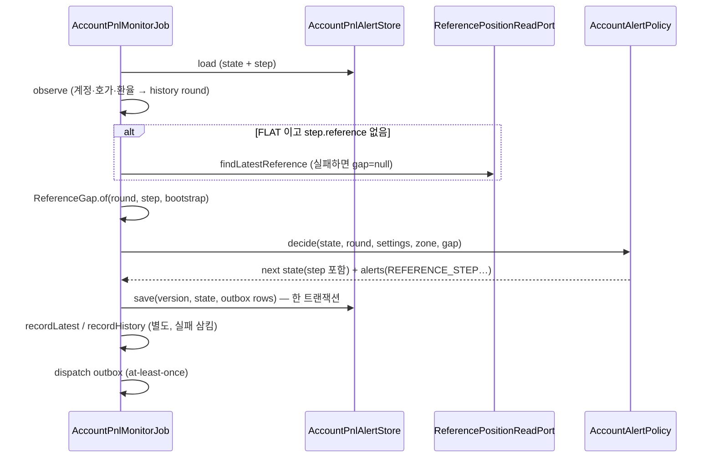
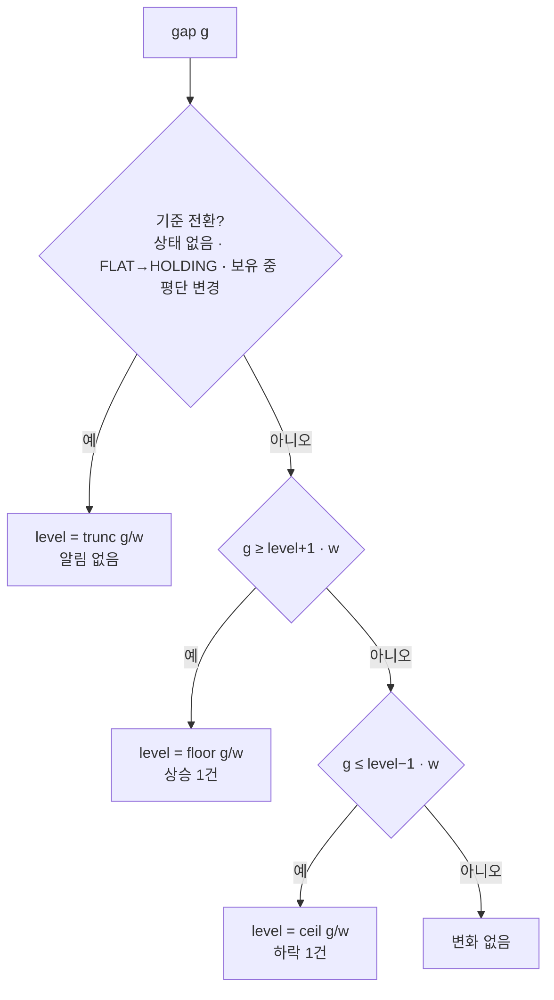

# 개발자 이해문서 — feat: 기준 포지션 대비 단계 알림 (#131)

- PR/MR: (생성 전)
- 브랜치: feat/issue-131-reference-position-step-alert ← dev (43f8833)
- 작성: 2026-11-11 · 문맥: warm

## 1. TL;DR
- 새 owner 알림 `REFERENCE_STEP`이 생겼다. 이 알림은 **기준 포지션 매수김프 대비 현재 김프 차이(%p)**가 단계 폭(기본 0.5%p) 경계를 넘을 때마다 Discord PNL 채널로 한 번 간다.
- 포지션을 정리한 뒤에도 직전 포지션을 기준으로 계속 판정한다. 차이가 0에 닿으면 "직전 진입 수준 도달"로 알린다.
- 단계 상태는 V25 열에 outbox와 같은 트랜잭션으로 저장한다. 그래서 재시작하거나 회차가 동시에 돌아도 같은 경계를 두 번 판정하지 않는다.

## 2. 왜
- **배경**: owner는 항상 "내 (직전) 포지션 대비 김프"를 기준으로 본다. 그런데 포지션을 정리하면 계정 알림이 멈춰서, 재진입 시점을 화면으로 지켜봐야 했다. 시장 김프 알림은 기준이 시장이라 환율만 움직여도 울린다.
- **목표**: 보유 중에도, 포지션이 없을 때도 기준 포지션 대비 차이가 단계 경계를 넘으면 한 번씩 알린다. 같은 경계 부근을 오르내리면 반복 발송하지 않는다. 재시작해도 상태가 이어진다.
- **제약**:
  - #129의 이력 기록은 상태 저장 뒤 별도 트랜잭션에서 하고, 실패하면 삼킨다. 그래서 정본으로 쓸 수 없다.
  - migration은 append-only다.
  - 기존 알림 테스트(수익·정시 급변·정시 보고)는 수정하지 않는다(이슈 수용 기준).

## 3. 무엇을 바꿨나

| 모듈 | 파일 | 내용 |
|---|---|---|
| domain | `accountpnl/ReferenceStep.kt` | 국면 `ReferencePhase`, 상태 `ReferenceStepState`, 판정 입력 `ReferenceGap`(`of`·`needsBootstrap`), 순수 정책 `ReferenceStepPolicy` |
| domain | `AccountAlert.kt`·`AccountAlertPolicy.kt`·`AccountAlertState.kt` | `AccountAlert.ReferenceStep` 추가. `decide(..., gap = null)`의 네 번째 정책으로 넣었다. `AccountAlertState.step`을 추가하고 `referenceStepWidth`(≥0.01)를 설정에 넣었다 |
| domain | `ReferenceStepContent.kt`·`AccountAlertContent.kt` | 메일·Discord 문구와 eventKey `account-pnl-reference-step-{up\|down}-{level}-{observedAt ms}` |
| domain | `owneralert/OwnerAlertRouting.kt` | `REFERENCE_STEP`(email=false, Discord PNL·SOUND) |
| domain | `AccountReferencePositionReadPort.kt` | 부트스트랩용 기준 조회 port |
| infrastructure:common | `V25__add_reference_step_state.sql` | `account_pnl_monitor_state`에 nullable 6열 추가: 기준 leg 4, 국면, level. CHECK는 "모두 NULL 또는 모두 NOT NULL" |
| infrastructure:common | `JdbcAccountPnlAlertStore`·`JdbcAccountPositionHistoryStore` | 단계 상태 저장·복원. `findLatestReference` 구현(열린 건 우선, 없으면 최근 닫힌 건) |
| apps:batch | `AccountPnlMonitorJob`·`AccountPnlMonitorConfiguration`·`application.yml` | gap 계산과 부트스트랩(실패 격리). env `ACCOUNT_PNL_REFERENCE_STEP_PERCENT`, route `reference-step` |
| apps:batch test fixture | `batch-schema.sql` | V25 열 동기화. batch는 Flyway를 쓰지 않는다 |
| docs | runbook `account-pnl-alert.md`, `message-spec.md`, `.ai/*` | 운영 절·문구 정본·현황 |

## 4. 설계

한 회차의 흐름이다. 기존 순서 안에 단계 판정이 들어갔고, 저장은 기존의 한 트랜잭션을 그대로 쓴다.



단계 판정은 히스테리시스로 한다. `level`은 마지막으로 알린 경계 번호이고, 경계값은 `level × w`다.



## 5. 주요 결정과 버린 대안

- **판정 값은 #129 `PositionObservation.premiumGapPercentPoint`를 재사용한다(실시간 환율).**
  - 계약 승인 때 사용자가 결정했다: "환율이 큰 리스크이자 수익안이라 실시간 환율에 영향 있게."
  - 버린 대안은 기준 시점 환율로 고정해 판정하는 방식이다. 이렇게 하면 환율만 바뀌었을 때 경계 직전에서 첫 알림이 나는 일은 없어진다.
  - trade-off: 차이 0은 환율과 무관하게 0이지만, 0이 아닌 차이는 환율에 비례해 움직인다. 그래서 경계 직전(예: 0.49, 환율 1300→1400)에서는 환율만으로 1건이 날 수 있다. AC2가 이 동작을 고정한다.
- **기준의 정본은 알림 상태(V25)이고, #129 이력은 부트스트랩에만 쓴다.**
  - codex 스펙 리뷰 ISSUE-2를 반영했다. 이력 기록은 상태 저장 뒤 별도 트랜잭션이고 실패를 삼킨다. 이력을 정본으로 쓰면 이력이 실패한 뒤 정리했을 때 기준이 사라지거나 옛 포지션으로 바뀐다.
  - 버린 대안은 매 무포지션 회차에 이력을 조회하는 방식이다.
- **기준 전환에 국면 전이 규칙을 넣었다(FLAT→HOLDING이면 평단이 같아도 전환).**
  - codex ISSUE-1을 반영했다. 평단만 비교하면 정리한 뒤 같은 평단으로 재진입했을 때 초기화되지 않는다.
  - 수량만 바뀐 경우(부분 정리)와 HOLDING→FLAT은 전환으로 보지 않는다. 그래서 정리 후에도 보유 중 단계가 이어진다.
- **전환 회차와 초기 회차는 알리지 않는다.** 배포 직후 현재 위치에서 곧바로 알림이 터지는 것을 막는 반목표다.
- **한 회차에 여러 경계를 넘어도 한 건만 보낸다.** 가장 먼 경계 하나다. 경계마다 따로 보내지 않는다.
- **판정 실패는 격리한다.** 최종 리뷰를 반영했다. gap 계산이나 부트스트랩에서 예외가 나면 warn 로그만 남기고 이번 회차 판정을 생략한다. 1% 수익 알림, 중단 알림, 상태 저장은 그대로 진행한다.
- **단계 폭 하한은 0.01이다.** codex 집중 리뷰를 반영했다. 폭이 아주 작으면 Int level이 overflow해서 모니터 전체가 실패하기 때문이다.

## 6. 동작 확인 방법

```bash
# 전체 (Docker 필요)
./gradlew test architectureTest :infrastructure:common:verifyMigrations :infrastructure:common:integrationTest :apps:api:integrationTest :apps:batch:integrationTest --parallel --continue --offline --no-daemon
# 핵심만
./gradlew :domain:test --tests io.premiumspread.domain.accountpnl.ReferenceStepPolicyTest --tests io.premiumspread.domain.accountpnl.ReferenceGapTest --offline --no-daemon
./gradlew :apps:batch:test --tests io.premiumspread.application.job.accountpnl.AccountPnlMonitorJobReferenceStepTest --offline --no-daemon
```

- `ReferenceStepPolicyTest`는 다음을 검증한다: 상승·하락, 진동 0건, 다중 경계 1건, 음수 trunc, 전환 3종, 수량만 바뀐 경우와 HOLDING→FLAT은 이어 가기.
- `ReferenceGapTest`는 국면 판별과 환율 시나리오 3개(0·0.30은 0건, 0.49→상승 1건)를 검증한다.
- `AccountPnlMonitorJobReferenceStepTest`는 다음을 검증한다:
  - 보유 +0.5·+1.0, 정리 후 0·−0.5·−1.0의 outbox 행
  - 이력 실패 격리, 부트스트랩 실패 격리, 판정 실패 격리
  - `accountAlerts` null일 때 부트스트랩 미호출
- 실계정 확인(AC10)은 runbook의 "기준 포지션 단계 알림 체크리스트 (#131 AC10)"를 따른다.

## 7. 후속·리스크·함정

- **AC10 대기**: 실계정 Discord 수신은 owner가 확인해야 한다. DoD 판정은 `AWAITING_HUMAN`이다.
- **별개 결함 (보류, codex 집중 리뷰 high)**: Job은 "save 직전 interrupt 검사 1회"로 취소를 확인한다. timeout·lock 상실이 이 검사 직후에 오면, 취소된 회차가 상태와 outbox를 커밋할 수 있다.
  - #89 이후 모든 계정 알림이 같은 구조라서 이번 변경으로 생긴 경로가 아니다. 별도 이슈로 다루는 게 맞다. 대안은 lease·owner fencing을 저장 트랜잭션 commit 직전까지 거는 것이다.
- **단계 폭을 바꾸면** 저장된 level이 남아서, 재시작 직후 `level × 새 폭` 기준으로 1건이 갈 수 있다(runbook에 적었다).
- **V25 롤백 뒤 재배포**하면 단계 상태는 롤백 시점 값이다. 그 사이 같은 평단으로 재진입했을 때만 오래된 level에서 1건이 갈 수 있다.
- 이력에서 기준을 한 번도 얻지 못한 계정은 무포지션인 동안 매분 부트스트랩 SELECT를 2회 한다. 테이블이 작고 인덱스가 있어 수용했다.
- 전달은 기존 outbox 그대로 at-least-once다. Discord 전송이 성공한 뒤 `markSent` 전에 프로세스가 죽으면 재전송될 수 있다.
- 보류한 테스트 보강:
  - AC3 fixture의 회차별 gap 값 직접 단언
  - `AccountAlert.ReferenceStep` toString 테스트
  - version 충돌 시 단계 상태 누출 테스트
  - `referenceGap` catch의 취소 분기 테스트
