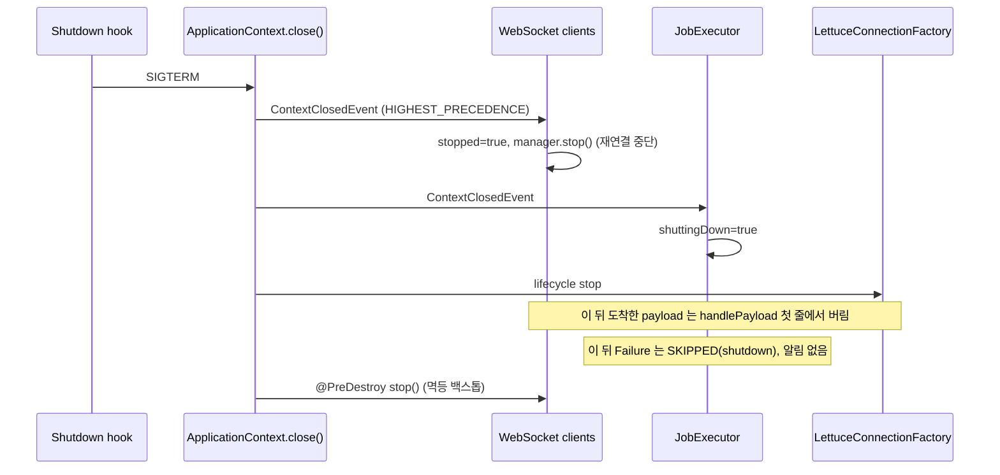
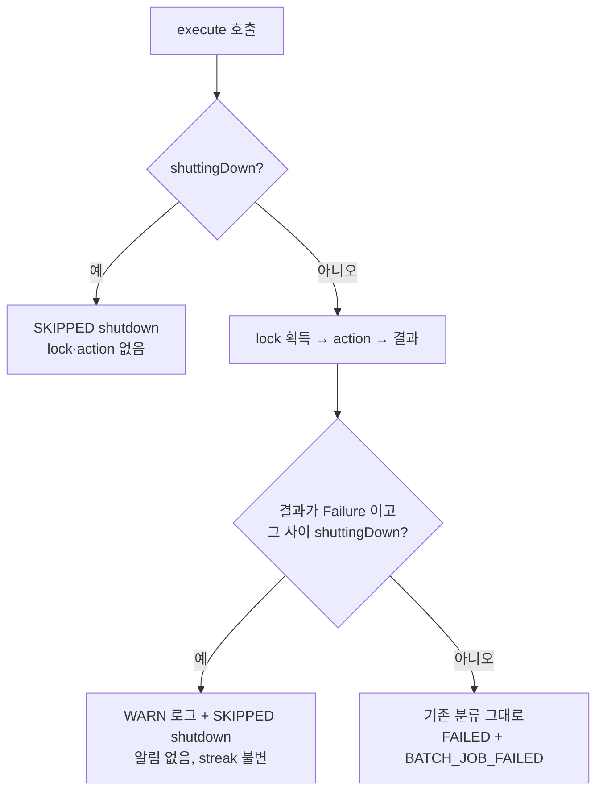

# 개발자 이해문서 — batch 종료 시 운영 알림 오탐 정리

- PR: (생성 전) · 이슈 [#135](https://github.com/geonyeop123/premium-spread/issues/135)
- 브랜치: `fix/issue-135-shutdown-false-alerts` ← `dev`
- 작성: 2026-11-12 · 문맥: warm

## 1. TL;DR
- batch 를 종료(재배포)하면 Redis 연결이 WebSocket 수집기보다 먼저 닫혔다. 그 사이 도착한 시세가 저장에 실패해 CRITICAL 알림이 쏟아졌다(실측 12건).
- WebSocket 클라이언트 2개와 `JobExecutor`가 이제 `ContextClosedEvent`를 최우선으로 받는다. 이 이벤트는 Redis lifecycle stop 보다 먼저 온다.
  - WebSocket 클라이언트는 그 시점에 멈춘다.
  - `JobExecutor`는 종료 중 결과를 `SKIPPED(shutdown)`으로 기록하고 운영 알림을 보내지 않는다.
- 종료가 아닐 때의 실패 분류는 그대로다. timeout, lock 상실, 일반 예외는 FAILED + CRITICAL 이다.

## 2. 왜
- **실측 (2026-11-12 09:25:31 로컬 종료):** 2ms 동안 `[binance] WebSocket ingestion hash 저장 5회 연속 실패: LettuceConnectionFactory is STOPPING` CRITICAL 이 12건 났다. Slack 을 쓰는 운영에서는 재배포마다 이 알림이 쏟아지고, 진짜 장애 알림이 묻힌다.
- **원인은 Spring 종료 순서다.** `AbstractApplicationContext.close()`는 세 단계를 순서대로 밟는다.
  1. `ContextClosedEvent` 발행
  2. lifecycle stop(`LettuceConnectionFactory`, 웹서버 graceful shutdown)
  3. 빈 파괴(`@PreDestroy`)

  WebSocket 클라이언트는 3단계에서야 멈췄다. 2단계와 3단계 사이에 도착한 시세가 닫힌 Redis 로 가서 실패했다.
- **`JobExecutor`도 같은 구간에 노출돼 있었다.** 종료 중 실행되던 Job 이 Redis·DB 종료나 interrupt 로 끝나면 `Failure`가 되어 `BATCH_JOB_FAILED` CRITICAL 과 연속 실패 streak 으로 이어졌다(#130 codex 지적).
- **범위를 좁힌 경위:** 원래 후보는 "Job 취소 정합성(L)"이었다. JobExecutor 의 취소→Failure 일반과 모니터 TOCTOU fencing 을 다루는 안이었다. 조사해 보니 그 두 건은 피해가 좁았고, 실측으로 드러난 것은 종료 오탐이었다. owner 결정으로 범위를 "종료 오탐 정리(M)"로 좁혔다.

## 3. 무엇을 바꿨나

| 파일 | 변경 |
|---|---|
| `apps/batch/.../application/common/JobExecutor.kt` | `ApplicationListener<ContextClosedEvent>`, `Ordered.HIGHEST_PRECEDENCE`. `shuttingDown` 플래그와 `shutdownAware()` 분류. 루트 컨텍스트 종료만 받는다 |
| `infrastructure/batch/.../binance/BinanceWebSocketClient.kt`, `.../bithumb/BithumbWebSocketClient.kt` | 같은 이벤트에서 `stop()`. `stopped` 플래그. `handlePayload` 첫 줄에서 정지 뒤 payload 를 버린다 |
| `JobExecutorShutdownTest` (신규, 11건) | 종료 분류 전 경로: 새 실행, action 예외, interrupt, timeout 보류 해제, 호출 스레드 interrupt, lock 획득·해제 예외, 성공 유지, 대조군, 컨텍스트 순서, 자식 컨텍스트 무시 |
| `WebSocketClientShutdownTest` (신규, 8건), `WebSocketShutdownOrderingTest` (신규, 2건) | 종료 전후 ingestion·sink 전달. 실제 `GenericApplicationContext`에서 Redis 대역(phase `Integer.MAX_VALUE`)보다 먼저 정지하는지. 자식 컨텍스트 무시 |
| runbook `owner-ops-alert.md`, `account-pnl-alert.md` | 종료 중 `SKIPPED(shutdown)` 동작. 모니터 TOCTOU 를 고치지 않는 근거 |

`WebSocketConnectionManager`와 기존 테스트(`JobExecutorTest`, wiring 테스트 등)는 수정하지 않았다.

## 4. 설계

## 5. 주요 결정과 버린 대안
- **종료 신호 = `ContextClosedEvent`.** lifecycle stop 보다 앞선다는 것이 Spring 계약이다. `SmartLifecycle` phase 경쟁(Lettuce phase 값에 의존)보다 단순하고, phase 값이 바뀌어도 깨지지 않는다.
- **종료 중 `Failure`는 원인을 가리지 않고 SKIPPED (owner 승인).**
  - 원인을 interrupt·cancel 로만 좁히면 `LettuceConnectionFactory is STOPPING` 같은 종료 부산물이 계속 CRITICAL 로 나간다.
  - 대가로 종료와 겹친 진짜 실패는 숨겨진다. 다만 원래 예외는 WARN 로그에 남고, 다음 기동이 같은 Job 을 다시 실행해 신호를 낸다.
- **`JobResult.Cancelled`나 메트릭 outcome 을 추가하지 않았다.** 기존 SKIPPED 가 이미 "알림 없음, streak 불변"이다. 새 타입은 모든 Job 의 분기와 메트릭 tag 를 건드린다.
- **루트 컨텍스트 판정 = `event.applicationContext.parent == null`.**
  - management 포트가 달라 자식 컨텍스트가 생기는데, 자식의 종료 이벤트도 부모 리스너로 전파된다. 자식만 닫히면 모든 Job 이 영원히 SKIPPED 가 될 수 있어 거른다.
  - 처음에는 `ApplicationContextAware`로 자기 컨텍스트를 비교했다. 그러자 strict `mockk<JobExecutor>()`를 빈으로 등록하는 wiring 테스트 17건이 `setApplicationContext`에서 깨졌다. 그래서 부모 유무 판정으로 바꿨다.
  - batch 가 언젠가 다른 컨텍스트의 자식이 되면 종료 분류가 꺼진다. 그래도 예전 동작으로 돌아갈 뿐이라 안전한 쪽이다.
- **모니터 저장 직전 취소 검사 TOCTOU(#131 codex)는 고치지 않았다.**
  - 저장이 `version` 조건부라 이중 커밋과 중복 발송이 없다. 남는 일은 "실패로 기록된 회차의 판정이 다음 회차에 발송되는 것"뿐이다.
  - commit fencing 을 하려면 DB fencing token 이 필요하다. 근거는 runbook 에 남겼다.
- **codex P2 "정지 검사 통과 후 in-flight handler 경합" 은 반박했다.**
  - `onMessage`는 `session.receive().doOnNext` 안에서 직렬로 호출되므로, 클라이언트당 처리 중인 handler 는 최대 1개다.
  - ingestion 알림은 5회 연속 실패라야 나간다. 실패 1건으로는 알림이 날 수 없다.
  - 최종 리뷰어도 코드로 확인했다.

## 6. 동작 확인 방법
- 자동 (DoD AC1~AC3):
  - `./gradlew :apps:batch:test --tests io.premiumspread.application.common.JobExecutorShutdownTest --offline --no-daemon`
  - `./gradlew :infrastructure:batch:test --tests io.premiumspread.infrastructure.batch.exchange.WebSocketClientShutdownTest --tests io.premiumspread.infrastructure.batch.exchange.WebSocketShutdownOrderingTest --offline --no-daemon`
- 회귀: `./gradlew test architectureTest :apps:batch:integrationTest :infrastructure:common:integrationTest --offline --no-daemon --continue` 결과는 1,947건, 실패 0(@ 0a52411).
- 실기동 (AC4):
  1. 로컬 batch 를 `SPRING_PROFILES_ACTIVE=local ./gradlew :apps:batch:bootRun`으로 띄운다.
  2. 1분 이상 지난 뒤 Boot JVM 에 `kill -TERM <pid>`를 보낸다. gradle 프로세스가 아니라 Boot JVM 이다.
  3. 로그에서 다음을 확인한다.
     - `Stopping Binance/Bithumb WebSocket client`가 `Commencing graceful shutdown`보다 앞서 1회씩 찍힌다.
     - 그 뒤 구간에 `[ALERT][CRITICAL]`이 0건이다.
  - 결과: 변경 전 12건, 변경 후 0건(2회 측정).

## 7. 후속·리스크·함정
- **종료 뒤 미뤄 둔 lock 해제 (기존 동작):** 종료 중 timeout 보류 경로에서 `close()`가 먼저 실행되면, 미뤄 둔 lock 해제 작업 제출이 `RejectedExecutionException`으로 끝날 수 있다. 그러면 lock 은 lease 만료로 풀린다. 오탐은 없어 후속 후보로만 남긴다.
- **종료 중 진짜 실패는 SKIPPED 로 기록된다.** 원래 예외는 WARN `{job} interrupted by application shutdown - recorded as skipped`에서 찾는다.
- **함정: Aware 콜백과 mock 빈.** 이 타입들에 Spring Aware 콜백 인터페이스를 다시 붙이지 마라. 테스트가 strict mock 을 빈으로 등록하고 있어 wiring 테스트가 깨진다(이번에 실제로 겪었다).
- **로컬에서 detekt 를 돌릴 수 없다.** 로컬 bootstrap 이 CI 전용이라 detekt 는 PR CI 에서만 돈다.
- **범위 밖:** `NotificationDeliveryJob`·`OwnerAlertDeliveryJob` 내부 executor 와 `BoundedOperatorAlertAdapter` 의 종료 처리는 이번에 다루지 않았다.
