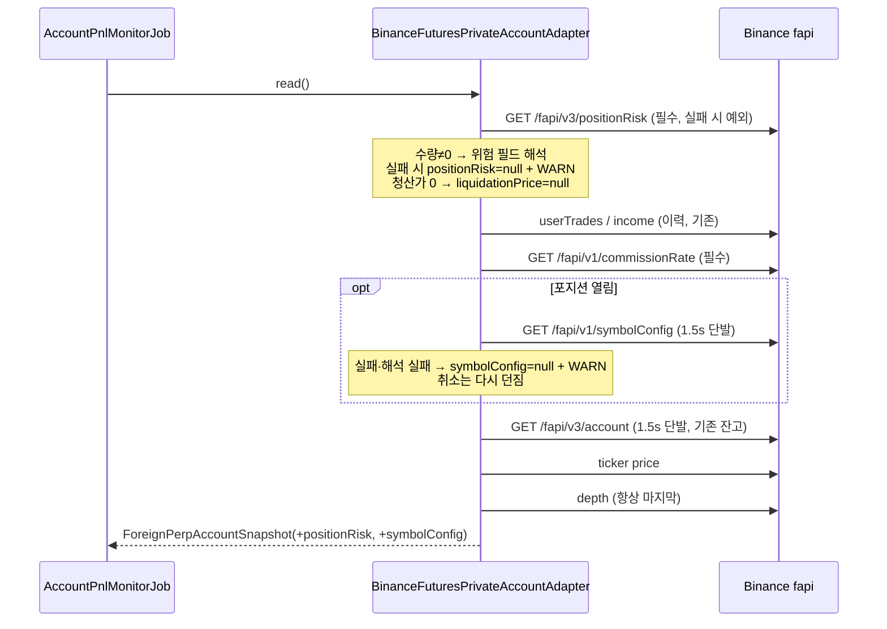

# 개발자 이해문서 — feat: #138 바이낸스 위험 지표(positionRisk·symbolConfig)를 스냅샷에 싣는다

- PR/MR: (생성 전)
- 브랜치: feat/issue-138-binance-risk-metrics ← dev
- 작성: 2026-11-12 · 문맥: warm

## 1. TL;DR
- 바이낸스 실계정 스냅샷(`ForeignPerpAccountSnapshot`)에 청산가·마크가·증거금·notional(`positionRisk`)과 레버리지·마진 모드(`symbolConfig`)를 nullable로 싣는다.
- 레버리지·마진 모드는 새 서명 GET `/fapi/v1/symbolConfig`로 읽는다. 1.5초 단발이고, 포지션이 열려 있을 때만 부른다. 실패하면 그 항목만 null + WARN이다.
- 지금은 아무도 이 값을 읽지 않는다. #137의 다음 하위 이슈(레그 이력, 자산 표기, 청산 알림)가 이 값을 쓴다.

## 2. 왜
- **배경:** 상위 #137은 바이낸스 숏 레그의 청산 위험을 기록하고 표시하고 알리려 한다. 세 하위 이슈가 같은 값을 쓰므로, 조회만 먼저 한 PR로 분리했다.
- **문제:** 기존 어댑터는 `/fapi/v3/positionRisk`에서 수량과 진입가만 읽었다. 레버리지와 마진 모드는 어디서도 조회하지 않았다.
- **제약:**
  - 이 조회 때문에 이미 동작하는 순손익 회차와 알림이 실패하면 안 된다. 이슈에 "symbolConfig 실패 시 그 항목만 없음"이라고 적혀 있다.
  - 실계정 adapter는 조회 전용이다. 아키텍처 테스트가 GET 외 호출과 주문·출금 경로를 막는다.
  - 깊이(depth) 조회가 회차의 마지막이어야 한다. Job은 빗썸과 바이낸스 호가의 관측 시각 차이를 5초(`MAX_QUOTE_SKEW`)로 제한한다.

## 3. 무엇을 바꿨나
| 영역 | 파일 | 변경 |
|---|---|---|
| domain | `domain/.../accountpnl/AccountSnapshots.kt` | 새 타입 `ForeignPerpPositionRisk`·`ForeignPerpSymbolConfig`·`ForeignPerpMarginType` 추가(불변식은 `init`에 둠, `toString`은 금액을 숨김). 스냅샷 끝에 `positionRisk`·`symbolConfig` 필드를 기본값 null로 추가 |
| infra | `infrastructure/batch/.../binance/BinanceFuturesPrivateAccountAdapter.kt` | positionRisk 위험 필드를 해석하고 symbolConfig를 조회한다. 잔고와 symbolConfig가 공용 헬퍼 `sendOnceOrNull`·`valueOrWarn`·`Parsed<T>`를 쓰도록 정리했다 |
| infra | `infrastructure/batch/.../exchange/AccountBalanceLog.kt` | `BalanceItem`에 `BINANCE_POSITION_RISK`·`BINANCE_SYMBOL_CONFIG`를, `BalanceUnavailableReason`에 `UNKNOWN`을 추가 |
| arch test | `architecture-tests/.../PrivateAccountReadOnlyArchitectureTest.kt` | 두 읽기 경로 리터럴이 GET 전용 스캔 대상 파일 안에 있는지 단언 |
| test | `BinanceFuturesPrivateAccountAdapterTest`, `ForeignPerpRiskMetricsTest`, `BinanceFuturesManualAccountAdapterTest`, fixture `symbol-config.json`·`position-risk-hedge.json` | AC1~AC9 |
| docs | `docs/runbooks/account-pnl-alert.md`, `.ai/PROJECT_STATUS.md` | 조회 대상과 WARN 항목 |

## 4. 설계



## 5. 주요 결정과 버린 대안
- **값 타입을 출처별로 둘로 나눴다.** 하나의 `RiskMetrics`에 묶는 안은 버렸다. 두 값은 실패 단위가 다르다. 묶으면 "일부만 없음"을 표현하려고 내부 필드가 전부 nullable이 된다.
- **positionRisk 위험 필드가 깨지면 그 묶음만 null로 둔다.** 계약 승인 때 사용자가 고른 안이다. 기존 필수 필드처럼 회차를 UNEXPECTED로 실패시키는 대안은 버렸다. 새로 추가한 값 때문에 기존 순손익 회차가 깨지면 안 되기 때문이다. 수량과 진입가는 지금처럼 예외를 던진다.
- **포지션이 없으면 symbolConfig를 부르지 않는다.** 이슈에 "포지션이 없을 때 위험 지표가 없다"고 되어 있다. 호출 1건과 시세 신선도 예산도 아낀다.
- **symbolConfig는 잔고 조회와 같은 방식이다.** 1.5초 timeout으로 한 번만 보내고, `-1021`이 와도 서버 시각을 다시 재지 않는다. 최악의 경우 선택 호출 둘이 3초를 쓰는데, skew 한도 5초 안이다(design D4).
- **로그 문구 `Account balance unavailable`은 그대로 뒀다.** 최종 리뷰에서 "balance"라는 말이 오해를 부른다는 지적이 있었다. 하지만 이슈가 잔고와 같은 방식을 요구했고, 문구를 바꾸면 이를 grep하는 쪽이 깨질 위험이 있다. 실패 항목은 `item=` 필드로 구분한다.
- **잔고 코드를 공용 헬퍼로 묶었다.** 잔고 쪽의 동작은 그대로다. 취소 시 다시 던지기, -1021 처리, 로그 인자, timeout이 모두 같고, 기존 잔고 테스트는 수정 없이 통과한다.

## 6. 동작 확인 방법
```bash
./gradlew :infrastructure:batch:test --tests io.premiumspread.infrastructure.batch.exchange.binance.BinanceFuturesPrivateAccountAdapterTest --offline   # AC1~AC7
./gradlew :domain:test --tests io.premiumspread.domain.accountpnl.ForeignPerpRiskMetricsTest --offline   # AC8
./gradlew architectureTest --offline   # AC9
./gradlew test architectureTest --parallel --offline --no-daemon   # 전체: 1672 tests, 0 failures
```
- 실패 표본: 401, 503, 깨진 JSON, -1021, 응답 없음, BTCUSDT 행 없음, leverage 비숫자, 알 수 없는 marginType. 각 경우에 다른 필드가 정상 케이스와 같은지, 로그에 비밀값이나 레버리지 값이 없는지 단언한다.
- AC4(포지션 없음 → symbolConfig 미호출)는 구현 전에도 참이어서 RED가 없었다. 그래서 어댑터를 잠깐 바꿔 항상 호출하게 했고, 테스트가 실패하는 것을 확인했다(dod 증거 로그).

## 7. 후속·리스크·함정
- **소비자 없음:** 이번 PR은 값을 실어 나르기만 한다. 기록(이력 테이블)과 표시(알림), 청산 알림은 #137의 다른 하위 이슈에서 한다.
- **timeout 예산:** 깊이 조회 전에 선택 호출(잔고, symbolConfig)을 더 붙이면 skew 5초 안에 들어오는지 다시 계산해야 한다.
- **hedge mode:** 지금은 SHORT 행을 먼저 고르고, 없으면 BOTH 행을 고른다. hedge mode에서 LONG 행의 위험 지표는 읽지 않는다.
- **`position-risk-hedge.json`:** SHORT 행의 `liquidationPrice`를 "0"에서 실제 값으로 바꿨다. 청산가 0인 경우는 별도 테스트가 덮는다.
- **ktlint:** 로컬에 jar가 없어 실행하지 않았다. PR CI(`quality-gate.yml`)가 판정한다.
