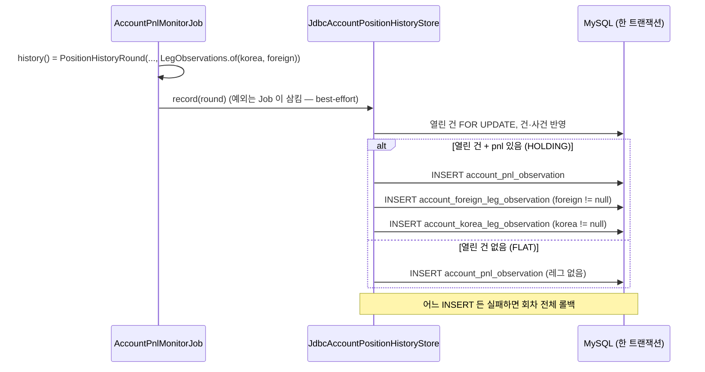

# 개발자 이해문서 — feat: #139 레그별 관측 이력 테이블

- PR/MR: (생성 전) · Closes #139 · 상위 #137
- 브랜치: feat/issue-139-leg-observation ← dev
- 작성: 2026-11-13 · 문맥: warm

## 1. TL;DR
- 매분 HOLDING 관측(`account_pnl_observation`)마다 바이낸스 레그 지표와 빗썸 진입 수수료를 새 테이블 두 개(V28)에 1:1 로 남긴다.
- 레그 행은 관측과 **같은 트랜잭션**에서 쓰여, 레그 저장이 실패하면 그 회차의 관측·건·사건이 함께 롤백된다. Job 쪽 best-effort 경계는 그대로라 알림은 영향이 없다.
- 찾지 못한 수수료·펀딩(`미반영`)은 0 이 아니라 NULL, 수동 모드는 바이낸스 행 자체가 없다.

## 2. 왜
- #129 이력은 순손익·김프·환율·청산가 VWAP 만 저장한다. "그 시점의 바이낸스 청산가·레버리지·누적 수수료·펀딩"은 매분 스냅샷에만 있고 사라진다.
- 상위 #137(청산 위험 관리)의 후속 판단과 사후 분석에 이 값의 이력이 필요하다.
- owner 결정(2026-11-12, 이슈 본문): 관측과 1:1 로 분리한 레그 테이블 두 개, 레그 없거나 수동이면 행 없음, 관측과 같은 트랜잭션.
- 제약: migration 은 append-only, batch 는 Flyway 를 쓰지 않는다(테스트는 `batch-schema.sql` fixture), 실계정 값은 로그·toString 에 남기지 않는다.

## 3. 무엇을 바꿨나

| 계층 | 파일 | 변경 |
|---|---|---|
| migration | `infrastructure/common/.../db/migration/V28__create_account_leg_observation.sql` | `account_foreign_leg_observation`·`account_korea_leg_observation` 생성. PK·FK `(episode_id, observed_at)` → `account_pnl_observation`, CHECK 3개 |
| domain | `domain/.../accountpnl/PositionLegObservation.kt` (신규) | `ForeignLegObservation`·`KoreaLegObservation`·`LegObservations.of(korea, foreign)` — 레그 생성 조건과 null 보존 |
| domain | `domain/.../accountpnl/PositionObservation.kt` | `PositionHistoryRound.legObservations`(기본 `NONE`) + `MANUAL_ENV` 인데 바이낸스 레그가 있으면 `require` 실패 |
| store | `infrastructure/common/.../JdbcAccountPositionHistoryStore.kt` | HOLDING `insertObservation` 직후 `insertLegs` (같은 `TransactionTemplate`, 중복 키 무시) |
| job | `apps/batch/.../AccountPnlMonitorJob.kt` | `history(...)` 가 `LegObservations.of(koreaSnapshot, foreignSnapshot)` 를 채움 |
| test fixture | `apps/batch/src/integrationTest/resources/batch-schema.sql`, `BatchTestConfig.BATCH_TABLES` | V28 DDL 복사, truncate 목록에 추가 |
| 문서 | `docs/runbooks/account-pnl-alert.md`, `.ai/PROJECT_STATUS.md`, `.ai/architecture/ARCHITECTURE_DESIGN.md` | 테이블 목록, 수동 삭제 순서(레그 먼저), V28 배포·롤백 절 |

## 4. 설계



레그 존재 규칙(`LegObservations.of`):

| 조건 | 바이낸스 레그 | 빗썸 레그 |
|---|---|---|
| EXCHANGE_API, 수량 ≠ 0 | 있음 | 수량 ≠ 0 이면 있음 |
| MANUAL_ENV | 없음 | 수량 ≠ 0 이면 있음 |
| 수량 0 | 없음 | 없음 |
| `positionRisk`/`symbolConfig` null | 있음, 해당 열 묶음 NULL | — |
| 수수료·펀딩 null(`미반영`) | 해당 열 NULL | `entry_fee_krw` NULL |

## 5. 주요 결정과 버린 대안
- **DECIMAL 저장 (계약 승인 결정).** V26 관례(`DECIMAL(30,8)` USDT, `DECIMAL(24,4)` 원화). 다음 회차 비교 키가 아니라 조회·집계용 지표라 VARCHAR 정규화(V20·V24)를 버렸다. trade-off: 넘친 소수 자리는 반올림된다.
- **FK 를 관측 유니크 키 `(episode_id, observed_at)` 에.** "관측 없는 레그 행 금지"를 DB 가 보장한다. "HOLDING 관측에만 레그"까지 DB 로 강제하는 안(부모에 `(episode_id, observed_at, kind)` 유니크 추가 + 자식 상수 열)은 codex 스펙 리뷰에서 나왔으나 부모(연 52만 행) 인덱스 추가 비용 대비 이득이 작아 버렸다 — writer 가 하나이고 통합 테스트가 FLAT 레그 0행을 검증한다.
- **CHECK 는 3값 논리에 맞춰 명시적 `IS NOT NULL`.** `margin_type IN (...)` 만 쓰면 `leverage=5, margin_type=NULL` 이 UNKNOWN 으로 통과한다. 구현 중 테스트가 잡았다.
- **수동 모드 바이낸스 레그는 도메인 생성자에서 거부.** 처음엔 Job 팩토리만 막고 있었다. codex 집중 리뷰 지적으로 `PositionHistoryRound` init `require` 를 추가해 모든 호출 경로를 막았다(DB 에는 `position_source='EXCHANGE_API'` CHECK 가 별도로 있다).
- **배포 게이트를 새로 만들지 않음.** `docker/deploy.sh` 가 이미 "Batch 중지 → API(Flyway) → readiness → Batch" 를 강제한다.

## 6. 동작 확인 방법

```bash
./gradlew :domain:test --tests io.premiumspread.domain.accountpnl.PositionLegObservationTest --offline --no-daemon
./gradlew :infrastructure:common:integrationTest --tests io.premiumspread.infrastructure.common.persistence.jdbc.accountpnl.JdbcAccountPositionHistoryStoreIntegrationTest --offline --no-daemon
./gradlew :infrastructure:common:integrationTest --tests io.premiumspread.infrastructure.common.migration.V28LegObservationMigrationIntegrationTest --offline --no-daemon
./gradlew :apps:batch:integrationTest --tests io.premiumspread.config.AccountPositionHistoryFixtureSchemaIntegrationTest --offline --no-daemon
./gradlew :apps:batch:test --tests io.premiumspread.application.job.accountpnl.AccountPnlMonitorJobPositionHistoryTest --offline --no-daemon
```

전체: `./gradlew test architectureTest :infrastructure:common:verifyMigrations :infrastructure:common:integrationTest :apps:batch:integrationTest --parallel --continue --offline --no-daemon` (a59a873 에서 BUILD SUCCESSFUL). 운영 확인은 배포 후:

```sql
SELECT o.observed_at, f.leverage, f.liquidation_price, f.funding_usdt, k.entry_fee_krw
FROM account_pnl_observation o
LEFT JOIN account_foreign_leg_observation f USING (episode_id, observed_at)
LEFT JOIN account_korea_leg_observation k USING (episode_id, observed_at)
WHERE o.kind = 'HOLDING' ORDER BY o.observed_at DESC LIMIT 5;
```

## 7. 후속·리스크·함정
- **수동 정리 순서가 바뀌었다.** 이력 테이블을 지울 때 레그 두 테이블을 `account_pnl_observation` 보다 먼저 지워야 한다(FK). runbook 반영됨.
- 레그 INSERT 실패는 회차 이력 전체(건·사건 포함)를 롤백한다. 기존 "관측 INSERT 실패" 계약의 확장이며 WARN `Account position history record failed` 로만 드러난다.
- DECIMAL 정수부 초과(USDT 22자리 초과)는 INSERT 오류 → 이력 롤백. 현실 범위 밖.
- 행 수: 레그당 분당 최대 1행(연 약 52만). 보존 정책은 범위 밖.
- 범위 밖으로 남긴 것: 청산 알림 판정(#137 별도), 조회 API·화면, FLAT·한쪽 레그 회차의 레그 기록.
- 보류한 테스트 보강(정확성 영향 없음): fixture 테스트의 DECIMAL 정밀도 비교, 빗썸 레그 실패 주입, NoPosition 회차 `legObservations` 단언.
