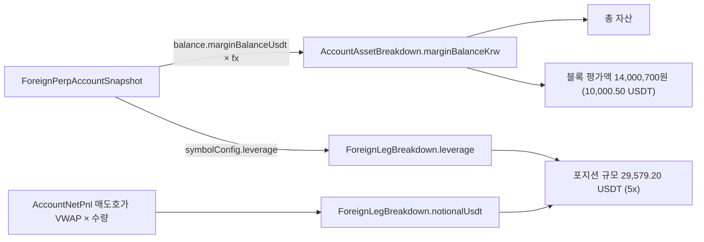

# 개발자 이해문서 — fix: #140 실계정 알림 바이낸스 평가액을 증거금+손익 기준으로

- PR: (생성 전 — PR 본문에 링크)
- 브랜치: fix/issue-140-binance-asset-display ← dev
- 작성: 2026-11-13 · 문맥: warm

## 1. TL;DR
- 수익·정시 알림 바이낸스 블록의 `평가액`이 명목 규모(현재가 × 수량)에서 **증거금+손익**(marginBalance × 환율)으로 바뀐다.
- 명목 규모는 새 줄 `포지션 규모 29,579.20 USDT (5x)`로 분리된다. 레버리지는 #138 의 symbolConfig 값이고, 모르면 `(5x)`를 생략한다.
- 자산 칸의 `바이낸스 증거금+손익` 행은 블록 평가액과 값이 같아져서 지웠다. 계산 로직(순손익·김프·총 자산)은 그대로다.

## 2. 왜
- 바이낸스는 레버리지 선물이라 `현재가 × 수량`은 자산이 아니라 명목 규모다. 이 값을 "평가액"이라고 부르면, 빗썸 평가액 + 빗썸 원화 + 바이낸스 평가액이 `총 자산`과 맞지 않는다. 운영자는 두 거래소 평가액을 더해 보고 총 자산과 맞지 않아 혼란을 겪었다.
- `총 자산` 계산(`빗썸 평가액 + 빗썸 KRW + marginBalance × 환율`)은 맞다. marginBalance 는 격리 증거금, cross 잔여, 미실현 손익을 모두 포함한다(이슈에서 GET 응답과 대조해 확인). 그래서 계산은 건드리지 않고 **표기만** 고쳤다.
- 목표: `빗썸 평가액 + 빗썸 원화 + 바이낸스 평가액 = 총 자산`. 각 값을 원 단위로 반올림해 표시하므로 오차는 최대 몇 원이다.

## 3. 무엇을 바꿨나

| 파일 | 변경 |
|---|---|
| `domain/.../accountpnl/AccountPnlBreakdown.kt` | `ForeignLegBreakdown`의 `valueUsdt`·`valueKrw` 를 `notionalUsdt` 로 바꾸고 `leverage: Int?`(= `foreign.symbolConfig?.leverage`) 추가. toString 은 그대로라 금액이 노출되지 않는다 |
| `domain/.../accountpnl/AccountPnlAlertContent.kt` | 바이낸스 블록 pairs 를 `평단·현재가·손익·평가액·포지션 규모` 순서로 바꿈. `평가액`은 자산 칸이 쓰던 `AssetTexts.margin` 문자열을 재사용한다(없음·수동 모드 규칙 포함). 자산 섹션과 Discord 자산 행에서 `바이낸스 증거금+손익` 삭제 |
| `AccountPnlAlertContentTest.kt` | golden 갱신, AC2(세 평가액 합 = 총 자산), AC3(레버리지 없음), 수동 모드 조합 테스트 |
| `AlertMessageSpecConformanceTest.kt` | 수익·정시 Discord 행 구성 하드코딩을 `[3,2,3,2,1,2,2]` → `[3,2,3,2,1,1,2]` 로 바꿈 |
| `docs/work/alert-message-template/message-spec.md` | 문구 정본: 수익·정시 두 절의 예시와 주석 |
| `docs/runbooks/account-pnl-alert.md` | 예시, Discord 칸 수, 모드 표, 자산 설명, 체크리스트 (b)(d)(g), manual 모드가 드러나는 곳 서술 |

## 4. 설계



블록 평가액과 총 자산은 같은 BigDecimal(`marginBalanceKrw`)에서 나온다. 그래서 표시된 세 평가액을 더하면 총 자산과 같다(반올림 오차만 남는다).

## 5. 주요 결정과 버린 대안
- **블록 평가액은 자산 칸의 문자열을 재사용한다.** 평가액을 블록에서 따로 계산하면 반올림이나 수동 모드 처리가 자산 칸과 어긋날 수 있다. 같은 `AssetTexts.margin`을 쓰면 `없음`·`수동 모드 — 표시 안 함` 규칙도 그대로 따라온다.
- **포지션 규모는 USDT로만 표기한다.** 원화 명목값을 같이 쓰면 다시 자산처럼 읽힌다. 이슈 예시 형식을 따랐다.
- **레버리지를 모르면 배수만 생략한다.** 청산 근접 알림처럼 `확인 불가`를 쓰는 안은 버렸다. 이 줄에서 중요한 정보는 명목값이기 때문이다.
- **자산 칸 `바이낸스 증거금+손익` 행 삭제(사용자 결정).** 계약 승인에서 "행 유지"와 비교했다. 같은 값이 두 번 나오는 쪽보다 Discord 자산 첫 행이 `[총 자산]` 1칸이 되는 쪽을 택했다.
- **Breakdown의 원화 명목값(`valueKrw`)은 제거했다.** 더 이상 표시하지 않는 값을 남겨 두지 않는다. 소비처는 domain 안에만 있었다(grep으로 확인).

## 6. 동작 확인 방법
```bash
./gradlew :domain:test --tests io.premiumspread.domain.accountpnl.AccountPnlAlertContentTest --offline   # AC1~AC4
./gradlew :domain:test architectureTest --offline --no-daemon                                              # 회귀
bash docs/check-documentation.sh
grep -n "포지션 규모" docs/work/alert-message-template/message-spec.md docs/runbooks/account-pnl-alert.md  # AC5
```
DoD 판정: `docs/work/issue-140-binance-asset-display/dod.md` — VERIFIED (5/5).

## 7. 후속·리스크·함정
- **Discord 레이아웃이 바뀐다.** 자산 행이 2칸에서 1칸(non-inline)이 되면서 fields 는 17개에서 15개로 준다. 실제 Discord 줄바꿈 모양은 runbook 체크리스트 (d) 로 운영에서 확인한다.
- **`AlertMessageSpecConformanceTest` 는 행 구성을 정본에서 읽지 않고 하드코딩한다.** 레이아웃을 다시 바꾸면 그 테스트도 함께 고쳐야 한다.
- **수동 모드(`MANUAL_ENV`)** 에서는 symbolConfig 가 없어서 `포지션 규모` 줄에 배수가 붙지 않고, 블록 평가액은 `수동 모드 — 표시 안 함` 으로 나온다.
- 보류한 Minor 항목: `AssetTexts.of` 를 한 메시지에서 세 번 만든다(순수 함수라 비용만 든다). 테스트 이름 하나에 '증거금'이 남아 있다.
