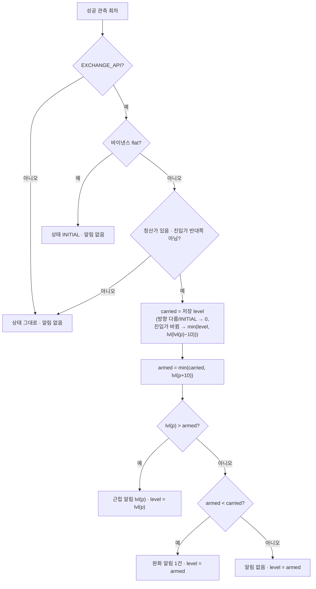

# 개발자 이해문서 — 청산 근접 단계 알림 (issue #141)

브랜치 `feat/issue-141-liquidation-proximity-alert` · base `dev` · 상위 #137 · 선행 #138

## 1. TL;DR

- 바이낸스 선물 포지션의 진입가→청산가 진행률이 50·60·70·80·90% 경계를 처음 넘으면 메일 + Discord PNL(소리)로 알리고, 한 단계 아래 경계 밑으로 내려가면 완화 알림(Discord PNL 무음)을 1건 보낸다.
- 판정은 도메인 순수 정책 `LiquidationProximityPolicy` 하나가 하고, 상태 `(방향, 진입가, 마지막 알린 경계)` 는 V27 nullable 열 3개로 기존 모니터 상태와 같은 버전 조건부 저장에 outbox 행과 함께 원자 저장된다.
- 수동 모드·관측 실패·청산가 없음 회차는 판정도 상태 변경도 하지 않는다. Job 변경은 #138 위험 지표를 `AccountRound` 에 넘기는 두 줄뿐이다.

## 2. 왜

- **배경:** 김프 헤지의 바이낸스 숏 leg 는 가격이 오르면 청산가에 다가간다. #138 이 실계정 스냅샷에 청산가·마크가·레버리지·마진 모드를 실었지만 이를 보는 알림이 없었다.
- **목표:** 청산에 다가가는 동안 단계별로 한 번씩 알린다. 같은 경계를 가격 진동마다 반복하지 않고, 재시작해도 이미 보낸 단계를 기억한다.
- **제약:** 조회 전용(대응 동작 없음). 알림 상태·outbox 는 기존 원자 저장을 그대로 쓴다. 실계정 가격은 로그·toString 에 남기지 않는다(문구에는 owner 결정으로 싣는다).

## 3. 무엇을 바꿨나

| 영역 | 파일 | 내용 |
|---|---|---|
| 도메인 정책 | `domain/.../accountpnl/LiquidationProximity.kt` | `PerpSide`, `LiquidationProximityState`, `LiquidationProximityPolicy`(진행률·경계·재무장·초기화) |
| 도메인 알림 | `AccountAlert.kt`, `LiquidationProximityContent.kt`, `AccountAlertContent.kt` | `LiquidationProximity`·`LiquidationEased` 알림과 메일·Discord 문구, eventKey |
| 조합 | `AccountAlertPolicy.kt`, `AccountAlertState.kt` | 기준 단계 다음에 청산 판정. `AccountRound.foreignRisk/foreignConfig`, `AccountAlertState.liquidation` |
| 라우팅 | `OwnerAlertRouting.kt`, `apps/batch/.../application.yml` | `LIQUIDATION_PROXIMITY`(메일 + PNL·SOUND), `LIQUIDATION_EASED`(PNL·SILENT), env 덮어쓰기 |
| 저장 | `V27__add_liquidation_proximity_state.sql`, `JdbcAccountPnlAlertStore.kt` | nullable 열 3개 + CHECK, 저장·복원 |
| Job | `AccountPnlMonitorJob.round()` | `positionRisk`·`symbolConfig` 전달 |
| 테스트 fixture | `batch-schema.sql`, `AccountPnlFixtureSchemaIntegrationTest` | batch 통합 테스트 스키마에 V27 열 반영 |
| 문서 | `message-spec.md`, `docs/runbooks/account-pnl-alert.md`, `.ai/*` | 문구 정본, 라우팅 표·env·동작·한계·체크리스트 |

## 4. 설계

진행률 `p = (mark − entry) / (liq − entry) × 100` (scale 4, 0 쪽 절사). 숏·롱 모두 이 식 하나다. `lvl(x)` = x 이하인 가장 높은 경계(50~90), 없으면 0.



예: 45→55→65→95% 는 50·60·90 세 건(95 에서 70·80 은 건너뛰고 가장 높은 하나). 55→49→55 는 추가 0건(49 는 40 밑이 아니다). 50·60 뒤 45 면 완화 1건, level 50.

## 5. 결정과 버린 대안

| 결정 | 버린 대안 | 이유 |
|---|---|---|
| 재무장은 한 단계 아래 경계 밑 (사용자 승인) | 경계 바로 아래 / 재무장 없음 | #131 단계 알림과 같은 히스테리시스. 진동 재발송을 막으면서 다시 위험해지면 알린다 |
| 초기화는 바이낸스 flat + 진입가 변경 시 현재 경계 재알림 (사용자 승인) | #129 episode 기준 (이슈 원안) / flat 만 | episode 는 빗썸·바이낸스가 둘 다 비어야 닫혀 바이낸스만 재진입하면 단계를 물려받는다. flat 만 쓰면 1분 사이 같은 방향 재진입 때 새 포지션의 첫 경고가 빠진다(codex 스펙 리뷰가 MAINTAINED 로 고수). 바이낸스 진입가는 추가 진입·새 포지션에서만 바뀌므로 재발송 비용이 사용자 행동 횟수로 한정된다 |
| 완화 알림 보냄, 별도 종류·PNL 무음 (사용자 승인 + 구현자 결정) | 보내지 않음(이슈 제안) | 사용자가 회복 알림을 원했다. 라우팅은 `MONITORING_RECOVERED`·`OPS_RECOVERED` 처럼 낮은 강도로 두고 env 로 바꿀 수 있다 |
| 상태를 기존 `account_pnl_monitor_state` 열로 | 별도 테이블 | 기존 버전 조건부 `save` 한 트랜잭션에 상태와 outbox 행이 함께 들어가 새 트랜잭션 경계가 없다 |
| CHECK 에 `IS NOT NULL` 명시 | `level IN (...)` 만 | NULL 은 UNKNOWN 이고 MySQL CHECK 는 UNKNOWN 을 통과시켜 부분 상태 행이 저장된다(codex 스펙 리뷰 ISSUE-1) |
| 판정 대상은 #138 어댑터가 관측하는 숏·one-way 롱 | hedge mode LONG 지원 | 어댑터가 SHORT 우선, 없으면 BOTH 행만 읽는다. LONG 행 지원은 어댑터 계약 변경이라 범위 밖 |

## 6. 동작 확인 방법

```bash
./gradlew :domain:test --tests io.premiumspread.domain.accountpnl.LiquidationProximityPolicyTest --offline   # AC1~AC5·AC10
./gradlew :domain:test --tests io.premiumspread.domain.accountpnl.LiquidationProximityContentTest --offline  # AC9
./gradlew :apps:batch:test --tests io.premiumspread.application.job.accountpnl.AccountPnlMonitorJobLiquidationTest --offline  # AC7
./gradlew :infrastructure:common:integrationTest --tests io.premiumspread.infrastructure.common.persistence.jdbc.accountpnl.JdbcAccountPnlAlertStoreIntegrationTest --offline  # AC6 (Docker)
./gradlew test architectureTest :infrastructure:common:verifyMigrations :infrastructure:common:integrationTest :apps:api:integrationTest :apps:batch:integrationTest --parallel --continue --offline --no-daemon
```

운영: 기동 INFO `owner-alert routes:` 에 `liquidation-proximity=email+discord(PNL,SOUND)`·`liquidation-eased=discord(PNL,SILENT)` (Discord 켜짐 기준). 체크리스트는 runbook `account-pnl-alert.md`.

## 7. 후속 · 리스크 · 함정

- **함정 — 테스트 스키마 fixture:** batch 통합 테스트는 Flyway 가 아니라 `apps/batch/src/integrationTest/resources/batch-schema.sql` 로 스키마를 만든다. migration 열을 더하면 이 파일과 `AccountPnlFixtureSchemaIntegrationTest` 도 같이 고쳐야 한다(이번에도 처음엔 빠져 BadSqlGrammar 8건).
- **함정 — 진행률 표시:** 판정은 0 쪽 절사다. 표시도 1자리 절사(`59.96` → `59.9%`)로 맞췄다. HALF_UP 으로 바꾸면 "50%" 제목 아래 "60.0%" 가 찍힌다.
- **한계:** 1분 회차라 급등은 회차 시점 값으로만 본다. 관측 실패 회차(호가·환율 지연)에는 판정하지 않는다. 청산가는 거래소 추정값이고, 교차 마진은 지갑 잔고가 청산가를 움직인다. 추가 진입으로 진입가가 바뀌면 현재 경계가 1회 다시 온다. 유리한 쪽까지 내려가면 완화 제목의 진행률이 음수다.
- **보류한 리뷰 지적:** 진입가 문자열 64자 초과 시 저장 전체가 실패한다 — 기존 기준 leg 검사와 같은 방식이고 바이낸스 진입가로는 현실성이 없다.
- **후속:** #139(레그별 관측 이력 테이블)도 migration 을 더하므로 이 PR merge 뒤 V28 로 시작한다. #140(자산 표기)은 `message-spec.md` 를 같이 고치므로 늦게 merge 하는 쪽이 충돌을 정리한다.
