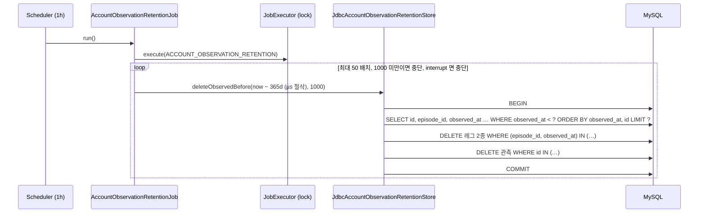

# 개발자 이해문서 — feat: #148 실계정 포지션 관측 이력 보존 기간 정책

- PR/MR: (생성 전) · Closes #148 · 관련 #129 · #139 · #130
- 브랜치: feat/issue-148-observation-retention ← dev
- 작성: 2026-11-16 · 문맥: warm

## 1. TL;DR
- 새 batch Job 이 한 시간마다 `observed_at < now − 365d` 인 관측 행(`account_pnl_observation`)과 그 레그 행 두 종류를 1000행씩, 레그 먼저·관측 나중 한 트랜잭션으로 지운다. 회차당 최대 5만 행.
- 보존 기간이 정산 `max-age`(기본 90일) + 1일 이하이면 batch 가 시작하지 않는다 — 확정 손익 정산이 정리 시점 환율을 이 관측에서 읽기 때문이다.
- 건·사건·정산 데이터는 지우지 않는다. 모니터 on/off 와 무관하게 돌고, `ACCOUNT_PNL_OBSERVATION_RETENTION_ENABLED=false` 로 끈다.

## 2. 왜
- 관측 테이블(#129)과 레그 테이블(#139)은 매분 1행씩, 테이블당 연 약 52만 행 쌓이는데 보존 정책이 없었다. 운영 배포(#25) 전에 정한다.
- 제약 1 — 정산(#130) `JdbcAccountRealizedPnlStore.findFxAt(occurredAt, 10분)` 이 관측의 `fx_rate` 를 읽는다. 정산 대상은 하한이 `max-age` 이내인 건이므로 필요한 관측은 `now − max-age − 10분` 이후뿐이다.
- 제약 2 — 레그 → 관측 FK(V28). 레그를 먼저 지워야 한다.
- 제약 3 — batch 앱은 component scan 에서 `io.premiumspread.infrastructure..*` 를 뺀다. infrastructure bean 은 `CommonInfrastructureAutoConfiguration` 의 `@Import` 로만 들어온다.

## 3. 무엇을 바꿨나

| 계층 | 파일 | 변경 |
|---|---|---|
| domain | `domain/.../accountpnl/AccountObservationRetentionStore.kt` (신규) | port `deleteObservedBefore(cutoff, limit): Int` |
| domain | `domain/.../job/JobPorts.kt` | `JobId.ACCOUNT_OBSERVATION_RETENTION` |
| store | `infrastructure/common/.../JdbcAccountObservationRetentionStore.kt` (신규) | SELECT(LIMIT) → 레그 DELETE(정확한 키) → 관측 DELETE(id), 한 `TransactionTemplate` |
| 배선 | `infrastructure/common/.../CommonInfrastructureAutoConfiguration.kt` | store `@Import` 등록 |
| job | `apps/batch/.../AccountObservationRetentionJob.kt` (신규) | `JobExecutor` 경유, 배치 반복·상한 WARN·취소 |
| 설정 | `apps/batch/.../config/AccountObservationRetentionConfiguration.kt` (신규), `BatchJobProperties`, `JobConfig`, `application.yml` | 설정 5개·lock spec·시작 검증(`Binder` 로 max-age 직접 바인딩) |
| scheduler | `apps/batch/.../AccountObservationRetentionScheduler.kt` (신규) | `fixedDelay` 1h, Job 1회 호출 |
| 문서 | `docs/runbooks/account-pnl-alert.md`, `.ai/PROJECT_STATUS.md`, `.ai/architecture/ARCHITECTURE_DESIGN.md` | 환경 변수 8개, 보존 정리 소절(긴급 중지·복구·처리량·로그·주의) |

## 4. 설계



시작 검증: `retention > max-age + 1d` 이어야 Job bean 이 만들어진다(아니면 `IllegalStateException`). 기본 365d > 91d.

## 5. 주요 결정과 버린 대안
- **기본 365일 (계약 승인 결정).** 180·120일도 후보였다. 1년 전 같은 시기 비교를 남기는 쪽을 골랐다. 테이블당 최대 약 52만 행.
- **max-age 는 bean 이 아니라 `Binder` 로 읽는다.** `AccountRealizedPnlProperties` 는 모니터·정산이 모두 켜져야 등록된다. 정산을 꺼 둔 상태에서도 다시 켤 때 근거가 남아 있어야 하므로 사용자 값을 직접 본다(codex 스펙 리뷰 지적).
- **행 잠금(`FOR UPDATE`) 없음.** 모니터는 최근 시각 행만 INSERT 해 삭제 범위와 겹치지 않고, 분산 lock 이 동시 삭제를 막는다.
- **cutoff 는 µs 로 절삭.** DB 가 DATETIME(6) 이라 바인딩 반올림으로 경계가 흔들리지 않게 했다.
- **다운샘플링(시간 단위 보관)은 버렸다.** 지금 조회 기능이 없어 이득이 불분명하다. 필요해지면 별도 이슈.

## 6. 동작 확인 방법

```bash
./gradlew :infrastructure:common:integrationTest --tests io.premiumspread.infrastructure.common.persistence.jdbc.accountpnl.JdbcAccountObservationRetentionStoreIntegrationTest --offline --no-daemon
./gradlew :apps:batch:test --tests io.premiumspread.application.job.accountpnl.AccountObservationRetentionJobTest --tests io.premiumspread.config.AccountObservationRetentionConfigurationTest --offline --no-daemon
./gradlew :apps:batch:integrationTest --tests io.premiumspread.config.BatchComponentScanBoundaryTest --offline --no-daemon
```

운영 확인: batch 로그에서 Job 의 완료·상한·실패·취소 문구(runbook "보존 정리 (#148)" 절에 원문). 첫 회차는 현재 데이터가 모두 365일 안이라 0행이다.

## 7. 후속·리스크·함정
- **삭제는 되돌릴 수 없다.** 복구는 DB 백업뿐이다. 긴급 중지는 `ACCOUNT_PNL_OBSERVATION_RETENTION_ENABLED=false` 후 batch 재시작.
- **함정 — infrastructure bean 등록.** `@Repository` 만으로는 batch 앱에 들어오지 않는다. 처음 구현에서 빠졌고 codex 표준 리뷰가 잡았다(통합 테스트는 스케줄링을 꺼서 Job bean 을 만들지 않아 못 잡았다). `BatchComponentScanBoundaryTest` 가 이제 지킨다.
- batch-size 를 크게 올리면 레그 DELETE 의 row constructor 가 커져 full scan 으로 떨어질 수 있다 — runbook 주의 참조.
- 보존 기간 하한은 `max-age + 1d` 뿐이다. 그보다 짧은 실수 값(예: 92d)은 허용된다.
- 보류: AC6 테스트는 Kotlin 기본값을 보고 yml placeholder 기본값과의 일치는 보지 않는다(현재 같음).
