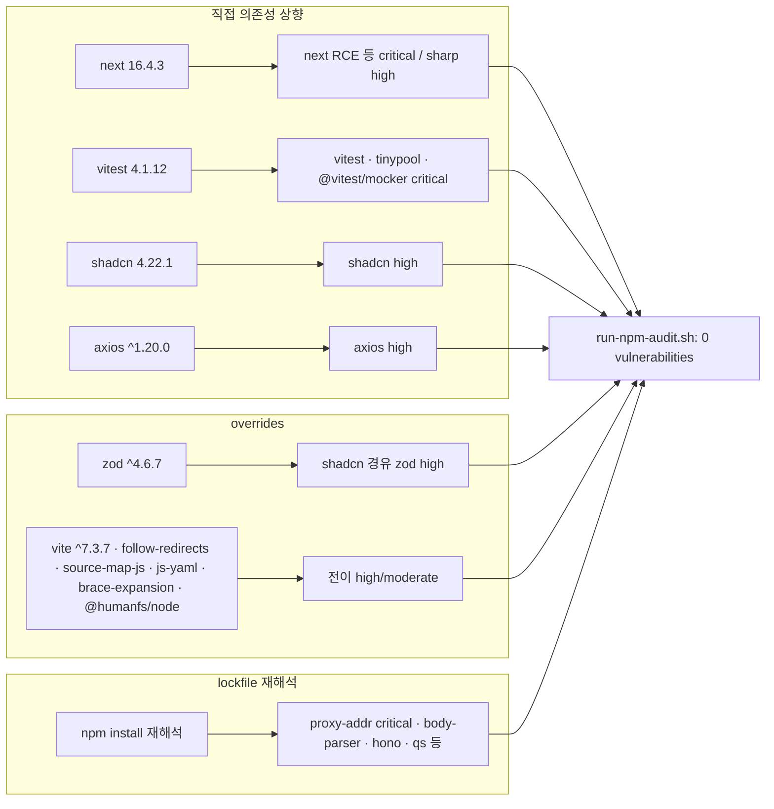

# 개발자 이해문서 — fix: apps/web npm audit 취약점 해소 (issue #82)

- PR: (생성 전)
- 브랜치: `fix/issue-82-web-npm-audit` ← `dev`
- 작성: 2026-10-26 · 문맥: warm

## 1. TL;DR

- `apps/web` 의존성을 올려 `npm audit` high·critical 15건(전 등급 23건)을 0건으로 만들었다. Quality Gate 6번 잡이 다시 통과한다.
- 직접 의존성 상향: `next`·`eslint-config-next` 16.4.3, `vitest` 4, `shadcn` 4, `axios` ^1.20. 전이 의존성은 `overrides`로 정리했다.
- 웹 소스는 바꾸지 않았다. 새 lint 규칙이 트래킹 두 페이지에서 오류를 내서 그 두 파일에서만 규칙을 껐다.

## 2. 왜

- **배경:** `quality-gate.yml`의 `6. Dependency + security scan`은 `bash ci/run-npm-audit.sh`(`npm audit --audit-level=high`)를 실행한다. 2026-09-16부터 dev와 모든 PR에서 이 잡이 실패했다.
- **원인:** `package.json`·`package-lock.json`이 바뀐 것이 아니다. 그 사이 advisory가 새로 공개됐다.
- **문제:** 게이트가 늘 빨간색이라 다른 실패가 이 실패에 묻혔다. PR #81도 이 잡만 실패한 채 머지됐다.
- **목표:** suppression이나 임계값 완화 없이 high·critical을 0건으로 만든다. 스크립트가 suppression을 금지한다.
- **제약:** 변경은 `apps/web`의 의존성 파일로 한정한다. Node 20(Docker `node:20-alpine`)은 유지한다. 웹 기능은 바꾸지 않는다.

## 3. 무엇을 바꿨나

| 파일 | 변경 |
|---|---|
| `apps/web/package.json` | `next`·`eslint-config-next` 16.2.12 → 16.4.3 (정확 고정 유지) |
| | `vitest` ^3.2.4 → ^4.1.12 |
| | `shadcn` ^3.8.5 → ^4.22.1 |
| | `axios` ^1.16.0 → ^1.20.0 |
| | `overrides` 하한 상향: `sharp`·`js-yaml`·`brace-expansion` |
| | `overrides` 신규: `follow-redirects`·`vite`·`source-map-js`·`zod`·`@humanfs/node` |
| `apps/web/package-lock.json` | 위 결과로 재생성 |
| `apps/web/eslint.config.mjs` | `src/app/trackings/page.tsx`·`src/app/trackings/[id]/page.tsx`에서만 `react-hooks/set-state-in-effect` off |
| `.ai/PROJECT_STATUS.md` | Known Issues 8번 추가: audit 게이트는 실시간 advisory를 보므로 lockfile이 그대로여도 다시 빨개질 수 있다 |
| `docs/work/issue-82-web-npm-audit/` | design·plan·dod(FROZEN)·이 문서 |

## 4. 설계

어느 advisory를 어떤 수단으로 해소했는지 정리한다.



## 5. 주요 결정과 버린 대안

- **shadcn은 제거하지 않고 업그레이드했다.**
  - 이슈 원문은 "1.0.0 다운그레이드 대신 제거·업그레이드·대체 중 결정"이었다.
  - `src/app/globals.css`가 `@import "shadcn/tailwind.css"`를 쓰므로 CLI 전용이 아니라 빌드 의존성이다.
  - 4.22.1에도 `./tailwind.css` export가 있고, 바뀐 점은 기존 줄 유지에 542줄 추가(scroll-fade 유틸리티)뿐이다.
  - 버린 대안은 패키지를 제거하고 CSS를 저장소에 복사하는 방식이다. 이후 shadcn 컴포넌트를 추가할 때 불편해진다.
- **`npm audit fix` 대신 `overrides`를 썼다.**
  - npm 10.8.2의 `npm audit fix`가 arborist 버그(`Cannot read properties of null (reading 'edgesOut')`)로 두 번 실패하고 파일을 바꾸지 않았다.
  - 계획에 있던 대안 경로대로 `overrides` 하한을 올리거나 항목을 추가했다.
  - 모든 override 버전이 소비자가 선언한 범위 안인지 `npm ls`·`npm view`로 확인했다. 예: `zod` 소비자는 모두 `^4`를 허용하고, `vite`는 vitest 4와 plugin-react 양쪽이 `^7`을 허용한다.
- **`axios`는 `package.json`의 직접 의존성 하한을 올렸다.** 직접 의존성에 override를 걸면 `EOVERRIDE`로 충돌한다.
- **lint 규칙은 두 파일에서만 껐다(사용자 결정).**
  - `eslint-config-next` 16.4.3이 `eslint-plugin-react-hooks`를 7.1.1로 올렸다. 이 버전의 새 규칙 `set-state-in-effect`가 effect 안에서 조회 함수를 호출하는 3곳을 오류로 잡는다.
  - 버린 대안 1: 플러그인을 7.0.1로 고정하는 것. `eslint-config-next`가 `^7.1.0`을 요구해 범위를 어긴다.
  - 버린 대안 2: 소스를 리팩터링하는 것. 웹 코드가 바뀌어 범위를 넘고 로딩 동작이 달라질 위험이 있다.
  - 버린 대안 3: 소스에 disable 주석을 다는 것. 소스 파일을 건드린다.
  - 다른 파일에는 규칙이 그대로 적용된다(`eslint --print-config`로 확인).
- **glob `[[]id[]]`:** eslint의 minimatch에서 `[id]`는 문자 클래스로 해석되므로 대괄호를 이스케이프했다.

## 6. 동작 확인 방법

worktree 루트에서 실행한다. 결과 원본은 `docs/work/issue-82-web-npm-audit/dod.md`의 증거 로그에 있다.

```bash
rm -rf apps/web/node_modules && npm --prefix apps/web ci --include=optional
bash ci/run-npm-audit.sh                                   # found 0 vulnerabilities, exit 0
npm --prefix apps/web ls next eslint-config-next --depth=0 # 둘 다 16.4.3
npm --prefix apps/web run lint                             # exit 0
npm --prefix apps/web run test                             # 10 passed
npm --prefix apps/web run build                            # 6개 라우트

# production 이미지 (CI 7번 잡은 빌드만 하므로 기동까지 확인)
docker build -f apps/web/Dockerfile -t premium-web:issue-82 .
docker run -d --name pw82 -p 3082:3000 premium-web:issue-82
curl -s -o /dev/null -w '%{http_code}\n' http://localhost:3082/login   # 200
docker rm -f pw82
```

화면(프리미엄 차트·트래킹)은 사람이 육안으로 확인해야 한다(DoD AC6, T4). 그 확인 전까지 PR은 Draft로 두고 `Closes #82`를 넣지 않는다.

## 7. 후속·리스크·함정

- **다시 빨개질 수 있다.**
  - audit은 실시간 advisory DB를 본다. lockfile이 그대로여도 새 advisory가 나오면 6번 잡이 다시 실패한다(`.ai/PROJECT_STATUS.md` Known Issues 8).
  - 주기적 갱신(Dependabot/Renovate)은 별도 검토 대상이다.
- **override는 무조건 고정이다.**
  - `vite ^7.3.7`, `zod ^4.6.7` 등은 upstream이 수정된 뒤에도 그대로 남는다.
  - vitest·plugin-react가 vite 8을 허용하므로, 나중에 major를 올릴 때 이 override부터 확인해야 한다.
- **트래킹 페이지의 effect 안 조회 패턴:** lint 규칙만 끈 상태다. 패턴 개선(데이터 조회 훅 분리 등)은 별도 이슈로 다룬다.
- **`next dev`가 `apps/web/AGENTS.md`를 만든다:**
  - next 16.4의 `next dev`는 AI 코딩 에이전트 환경을 감지하면 `apps/web/AGENTS.md`(next 문서 안내 블록)를 생성하고, 지워도 다시 만든다.
  - 사람이 실행할 때는 생기지 않는다. 이번 PR에는 커밋하지 않았다.
  - 끄려면 `next.config.ts`에 `agentRules: false`를 넣으면 되지만, 이번 범위(의존성 파일 한정) 밖이라 하지 않았다.
- **`npm audit fix` 버그:** npm 10.8.2에서 이 lockfile에 `npm audit fix`를 돌리면 크래시한다. 다음 갱신 때도 같은 현상이 나오면 `overrides` 경로를 쓴다.
