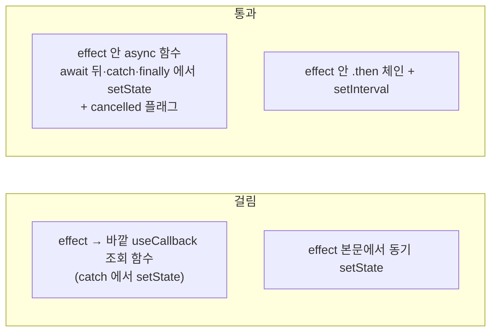
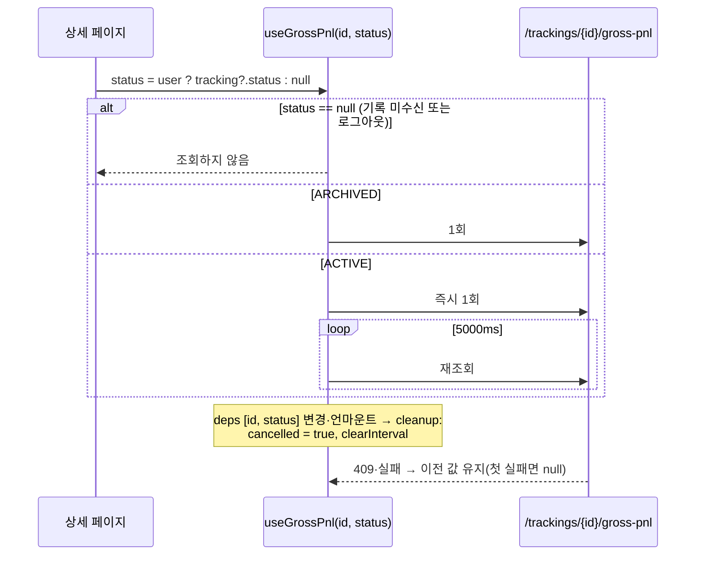

# 개발자 이해문서 — apps/web 트래킹 페이지 조회 훅 분리와 set-state-in-effect override 제거 (#96)

- PR/MR: (생성 전)
- 브랜치: `refactor/issue-96-trackings-fetch` ← `dev`
- 작성: 2026-11-09 · 문맥: warm

## 1. TL;DR
트래킹 목록·상세 페이지의 조회 로직을 `apps/web/src/hooks/useTrackings.ts`의 훅 3개로 옮겼다. 훅은 `useTrackingList`·`useTracking`·`useGrossPnl`이다.
각 훅은 조회 함수를 effect **안에** 두고, 지역 `cancelled` 플래그로 늦게 온 응답을 버린다.
그 결과 #82가 남긴 `react-hooks/set-state-in-effect` override(`eslint.config.mjs`)를 지워도 lint가 통과한다. 화면 동작·문구·API는 그대로다.

## 2. 왜
- #82(PR #95)에서 `eslint-plugin-react-hooks`가 7.1.1로 올라가면서 `react-hooks/set-state-in-effect` 규칙이 생겼다.
  - 이 규칙이 두 페이지의 세 호출을 오류로 잡았다: `[id]/page.tsx`의 `fetchTracking()`·`fetchPnl()`, `page.tsx`의 `fetchData()`.
  - #82는 의존성 정리 PR이라 두 파일에서만 규칙을 끄고(D7) #96으로 넘겼다.
- 목표는 override 없이 lint를 통과하면서 기존 동작을 지키는 것이다. 지켜야 할 동작은 다음과 같다.
  - 로그인 후에만 조회한다.
  - ACTIVE 기록은 손익을 5초마다 폴링한다.
  - ARCHIVED 기록은 1회만 조회한다.
  - 409는 "확정 불가"로 표시한다.
- 제약: SWR·React Query 같은 조회 라이브러리는 도입하지 않는다. 화면과 API 계약도 바꾸지 않는다.

## 3. 무엇을 바꿨나

| 파일 | 변경 |
|---|---|
| `apps/web/src/hooks/useTrackings.ts` | 신규. 훅 3개, `TrackingSummary`, `GROSS_PNL_POLL_INTERVAL_MS = 5000` |
| `apps/web/src/hooks/useTrackings.test.tsx` | 신규. 15개 테스트(목록 4, 단건 3, 손익 5, 늦은 응답 3) |
| `apps/web/src/app/trackings/page.tsx` | `useTrackingList(user?.id ?? null)` 사용, `RecordTrackingForm onSuccess={reload}` |
| `apps/web/src/app/trackings/[id]/page.tsx` | `useTracking`·`useGrossPnl` 사용. 조회 오류(`loadError`)와 종료 실패(`actionError`)를 분리. 로그아웃이면 손익 조회 status를 null로 넘김 |
| `apps/web/eslint.config.mjs` | override 블록 5줄 삭제 |
| `docs/work/issue-96-trackings-fetch/` | design·plan·dod·evidence(화면 스크린샷 6장)·이 문서 |

## 4. 설계

규칙이 실제로 잡는 것과 통과하는 것은 다음과 같다. 임시 파일로 후보 형태를 lint한 결과다(design §2).



`useGrossPnl`의 수명 주기:



## 5. 주요 결정과 버린 대안
- **조회 함수를 effect 안에 두고 `cancelled` 플래그를 쓴다(D2).**
  - "useCallback 함수를 effect에서 부른다"는 형태 자체는 문제가 아니다. 규칙이 보는 것은 그 함수가 동기 경로(예: `await` 전에 난 예외 → `catch`)에서 setState할 수 있느냐다. 실측으로 B2(catch setState)만 걸리고 B·B3는 통과했다.
  - 그래서 형태 규칙을 외우지 않고 lint로 판정했다. 이 방식은 React 문서의 "ignore flag" 패턴과 같다.
  - `AbortController`로 fetch 자체를 취소하는 대안은 버렸다. `apiClient`에 `signal`을 넘기는 경로를 검증해야 해서 범위를 넘는다.
- **훅을 분리한다(D1).** 페이지 안 effect만 고치면 diff는 작다. 하지만 조회 로직을 테스트하려면 페이지 전체를 렌더해야 해서 버렸다. 지금까지 조회 로직에는 테스트가 없었다.
- **훅은 `user` 대신 `userId: number | null`을 받는다(D3).** 객체 identity가 아니라 원시값을 deps로 쓴다. 같은 사용자가 다시 로그인해 객체만 바뀌면 재조회하지 않는데, 같은 데이터라 화면 결과는 같다.
- **`reload()`는 `reloadKey` state만 올린다(D4).** 재조회가 effect 안에서 일어나야 규칙을 통과한다. 재조회 중에는 `loading`을 true로 되돌리지 않는다. 기존 `fetchData`와 같다.
- **오류 state를 둘로 나눈다(D5).**
  - 기존에는 `error` 하나를 조회 실패와 종료 실패가 같이 썼다.
  - 이제 조회 실패는 훅의 `error`(페이지에서 `loadError`), 종료 실패는 페이지의 `actionError`다.
  - 조회가 실패하면 `tracking`이 null이라 오류 카드만 보이므로 화면 결과는 같다.
- **로그아웃 게이트는 페이지에 둔다(리뷰 수정).**
  - 첫 구현은 `useGrossPnl(id, tracking?.status ?? null)`이었다. Header의 로그아웃은 페이지를 떠나지 않으므로, ACTIVE 상세에서 로그아웃하면 401 폴링이 계속됐다.
  - 기존 코드는 effect deps에 `user`가 있어서 멈췄다. 훅 시그니처는 그대로 두고, 페이지에서 `user ? status : null`을 넘긴다.

## 6. 동작 확인 방법

로컬 Node가 20이면 jsdom 31 테스트가 돌지 않는다. Node 24(CI 6번 잡과 같은 `node:24-alpine`)에서 실행한다.

```bash
grep -c set-state-in-effect apps/web/eslint.config.mjs        # 0
npm --prefix apps/web run lint                                # exit 0
npm --prefix apps/web test -- src/hooks/useTrackings.test.tsx # 15 passed
npm --prefix apps/web run test                                # 2 files, 25 passed
npm --prefix apps/web run build                               # 라우트 6개
```

화면 관찰(dod AC7, `evidence/01~06`) 환경은 다음과 같다.
- api: 이 브랜치의 api를 임시 MySQL(3307)에 붙여 기동했다.
- web: `next dev`로 띄웠다.
- 관찰 도구: Playwright chromium.

관찰 결과는 다음과 같다.
- 폼으로 기록을 추가하면 요약이 2/2/0으로 갱신된다.
- ACTIVE 상세의 계산 시각이 5초 뒤 바뀌고, 손익 요청 간격은 5000ms다.
- ARCHIVED 상세는 손익 요청이 1회이고, 409면 확정 불가 안내를 보인다.
- 로그아웃 뒤에는 손익 요청이 0회다.

## 7. 후속·리스크·함정
- **로컬 api 기동 주의.** README대로 `./gradlew :apps:api:bootRun`을 local 프로필로 띄우면 `modules/jpa/.../jpa.yml`의 `ddl-auto: create-drop`이 공용 로컬 MySQL의 Hibernate 관리 테이블을 지우고 다시 만든다.
  - 이번 작업 중 실제로 `position`·`premium`·`ticker`·`trade_preparation`이 비워졌다.
  - 화면 확인용 api는 별도 DB를 쓰자. 예: `--spring.datasource.url=...:3307/...`, 그리고 빈 DB에서는 `--migration.v12.allow-empty-position-migration=true`.
  - 정상 종료하면 종료 시점에 한 번 더 drop하므로 주의한다.
- **로컬 AUTO 기록.** `from-market`은 환율 관측 시각이 `FX_MAX_AGE`를 넘으면 409를 낸다. 로컬 batch의 환율 수집이 멈춰 있으면 폼 AUTO 모드가 실패하므로 MANUAL "현재 시세 불러오기"를 쓴다.
- **보류한 리뷰 지적(머지 차단 아님).**
  - 409 뒤 "이전 값 유지"를 직접 재는 테스트가 없다.
  - `id`가 바뀌면 새 응답이 올 때까지 이전 기록의 상태가 남는다. 기존과 같고, 상세에서 상세로 바로 가는 경로는 없다.
  - 로그아웃 게이트(`[id]/page.tsx`의 `user ? … : null`)는 페이지 테스트 없이 관찰로만 확인했다.
- **범위 밖으로 남긴 것.**
  - 5초 폴링의 요청 겹침 방지. 응답이 5초보다 늦으면 요청이 겹친다.
  - 목록 조회 실패 표시. 지금도 조용히 무시한다.
