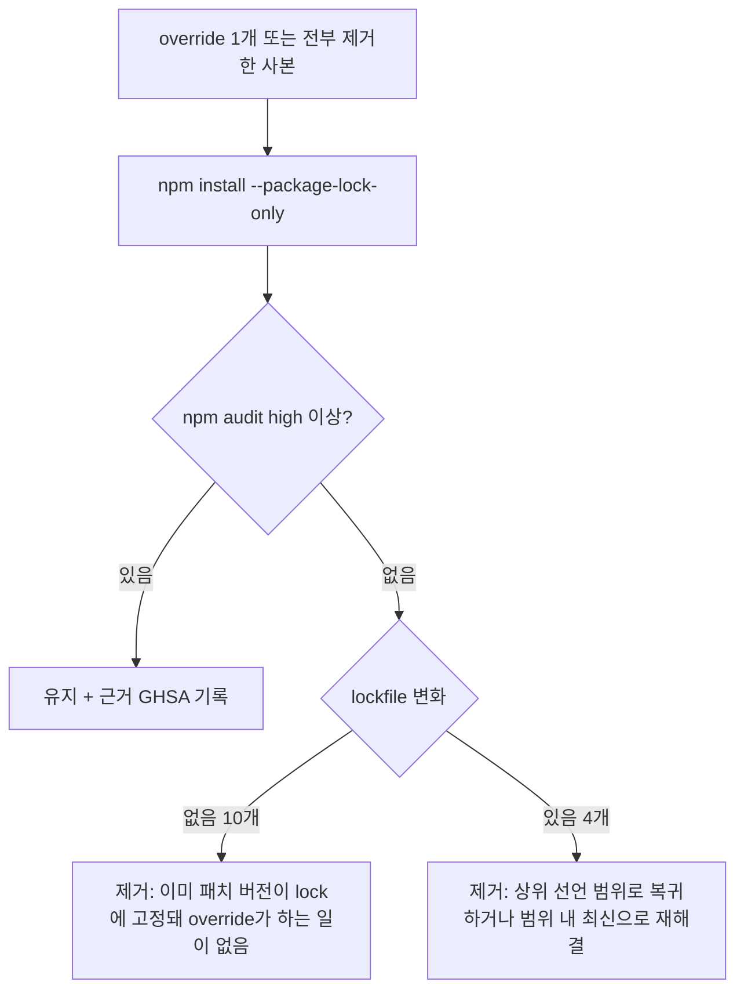
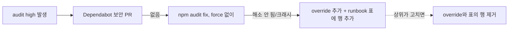

# 개발자 이해문서 — apps/web npm overrides 14개 제거 (#97)

- PR/MR: (생성 전)
- 브랜치: `chore/issue-97-web-npm-overrides` ← `dev`
- 작성: 2026-11-07 · 문맥: warm

## 1. TL;DR
`apps/web/package.json`의 `overrides` 14개를 모두 지웠다. 빼도 `npm audit` high 이상은 생기지 않았다.
lockfile은 재해결로 바뀐 15건만 반영했다. 이 중 둘(`brace-expansion`·`@eslint/config-array`)은 상위 패키지의 선언 범위를 넘어 강제하던 override였는데, 이제 원래 범위로 돌아갔다.
override 정책(언제 다시 넣는가, 무엇을 기록하는가)의 정본은 runbook이다. 남은 moderate·low advisory 2건은 열어 둔 채 상위 갱신을 기다린다.

## 2. 왜
- #82(PR #95) 때 `npm audit fix`가 npm 10.8.2 arborist 버그(`edgesOut`)로 크래시했다. 그래서 전이 의존성 취약점을 `overrides`로 막았다. 그 전(07~09월)에도 audit 실패 때마다 override를 추가했다.
- override는 조건 없이 버전을 강제한다.
  - upstream이 고친 뒤에도 남고, major 상향을 막는다. 예를 들어 `vite ^7.3.7`은 vite 8을 막는다.
  - 상위 패키지의 선언 범위 밖으로 강제할 수도 있다. `brace-expansion ^5`가 minimatch 3의 `^1` 요구를 깼고, 그 비호환을 피하려고 `@eslint/config-array`를 eslint 9 요구(0.21) 밖인 0.23.5로 함께 올려야 했다.
- #98에서 Dependabot을 도입했지만 Dependabot은 `overrides`를 갱신하지 않는다. 정리하지 않으면 계속 쌓인다.
- 제약
  - 이슈 범위: 직접 의존성 major 상향 금지, CI 게이트 변경 금지.
  - 열린 Dependabot PR #112~#116과 같은 lockfile을 건드리므로 lock diff를 최소로 유지해야 한다.

## 3. 무엇을 바꿨나

| 파일 | 변경 |
|---|---|
| `apps/web/package.json` | `overrides` 블록 삭제(14키). 나머지 바이트는 그대로 |
| `apps/web/package-lock.json` | `npm install --package-lock-only` 재해결 15건 (design §4). `@eslint/config-array` 0.23.5 → eslint 하위 0.21.2, minimatch@3 하위 `brace-expansion` 1.1.21 추가, next 하위 `postcss` 8.5.23 사본 추가, `browserslist` 4.28.9 → 4.29.5 연쇄 6건. 최상위 `postcss`는 `dev: true`가 됨 |
| `docs/runbooks/deployment.md` | Dependabot 절의 "(재검토는 #97)"을 **overrides 정책** 항목으로 교체 (재도입 조건 + 빈 등록 표) |
| `apps/web/README.md` | 정책 정본을 가리키는 "의존성 overrides 정책" 절 |
| `.ai/PROJECT_STATUS.md` | 진행 현황 항목, Known Issues 8에 남은 advisory 2건 |
| `docs/work/issue-97-web-npm-overrides/` | design(실측·판정표), plan, dod(FROZEN·증거 로그) |

## 4. 설계

어떻게 판정했나. 사본에서 override를 하나씩 빼 본 15케이스와 전부 뺀 1케이스를 실측했다.



결과는 16케이스 모두 high 0이었다. 그래서 유지(K)로 간 항목이 없다. 다음에 audit이 깨지면 다음 순서로 대응한다.



## 5. 주요 결정과 버린 대안
- **전부 제거** (③ 합의)
  - 버린 대안: 범위 위반 2개만 제거, 또는 상향을 막는 것만 제거.
  - 나머지를 "하한 가드"로 남기는 것은 실익이 없다. lock이 이미 패치 버전을 고정하고 있고, `npm ci`와 Dependabot은 lock을 뒤로 돌리지 않는다. 회귀는 CI 6번 잡의 audit 게이트가 잡는다.
- **lockfile은 재해결 15건만 반영**
  - 버린 대안: `npm audit fix` 결과 적용(약 158건). typescript-eslint 8.56→8.72, shadcn 4.23 등이 섞여 Dependabot #113과 겹친다.
  - 버린 대안: lock 전체 재생성. diff를 종이에서 검토할 수 없다.
- **minimatch(moderate)·deepmerge(low)는 열어 둔다** (③ 합의)
  - minimatch의 수정판 11.0.1은 모든 소비자의 선언 범위(`^10`) 밖이다. override로 강제하면 방금 없앤 "범위 밖 강제"를 되살리게 된다.
  - deepmerge는 수정판이 없다.
  - 둘 다 dev 도구 경로(eslint·typescript-eslint·shadcn CLI)이고 high 게이트 밖이다. alert는 dismiss하지 않는다. 상위가 갱신되면 Dependabot PR로 자동 해소된다.
- **정책 정본은 runbook, README는 포인터** (⑦ 승인)
  - Dependabot·audit 대응 절차가 이미 runbook에 있다. runbook은 `docs/check-documentation.sh` 검사 대상이고 README는 아니다.
- **Docker 로컬 스모크는 제외** (⑦ 승인)
  - 런타임에 닿는 변경은 next 하위 postcss 사본 하나뿐이고, `next build`와 CI 7a(web) 이미지 빌드로 확인한다.

## 6. 동작 확인 방법
```bash
rm -rf apps/web/node_modules apps/web/.next
npm --prefix apps/web ci --include=optional
npm --prefix apps/web pkg get overrides        # {}
npm --prefix apps/web ls browserslist @eslint/config-array brace-expansion postcss --all   # overridden·invalid 없음
bash ci/run-npm-audit.sh                       # exit 0 (high 0; moderate 11 · low 2)
npm --prefix apps/web run lint && npm --prefix apps/web run test && npm --prefix apps/web run build
bash ci/quality-gate-contract-test.sh && bash docs/check-documentation.sh
```
- 실측 기록(시각·SHA)은 `dod.md` 증거 로그에 있다. 최종 기준은 ff95bd4이고, Gradle 전체 회귀(76 task)도 green이었다.
- 판정표 재현은 design §2의 방법(override를 뺀 사본에서 `--package-lock-only` 후 `npm audit --json`)을 따른다.

## 7. 후속·리스크·함정
- **advisory는 날마다 바뀐다.** 머지 후 새 high가 나오면 runbook 정책 순서(보안 PR → audit fix → override)를 따른다. override를 넣으면 같은 PR에서 runbook 표에 행을 추가한다. 표가 비어 있으면 `overrides`도 없어야 한다.
- **`npm audit fix`는 이번 lockfile에서는 동작했지만 #82 때 같은 npm 10.8.2로 크래시했다.** 원인은 npm 버전이 아니라 그때의 lock 상태로 보인다. 다시 크래시하면 override 분기로 간다.
- **Dependabot PR #112~#116은 이 PR 머지 뒤 rebase된다.** 그중 #113(`web-minor-patch`)이 typescript-eslint·shadcn을 올리면 minimatch 경로가 바뀔 수 있으니 alert 상태를 다시 본다. eslint 10(#116)도 `@eslint/config-array` 경로를 바꾼다.
- **상위 선언 범위 밖으로 override를 넣지 않는다.** 이번 `brace-expansion`↔`@eslint/config-array` 짝처럼 한 override가 다른 override를 부른다.
- moderate 수치가 실행 회차에 따라 12와 13으로 갈린 적이 있다(`eslint` 경유 표시). 게이트(high)와는 무관하다.
