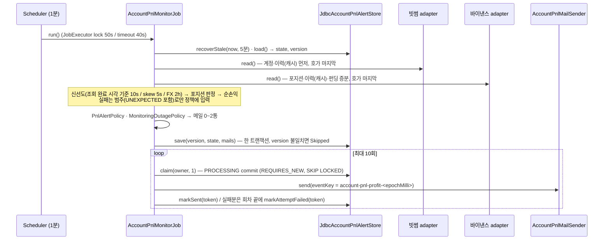
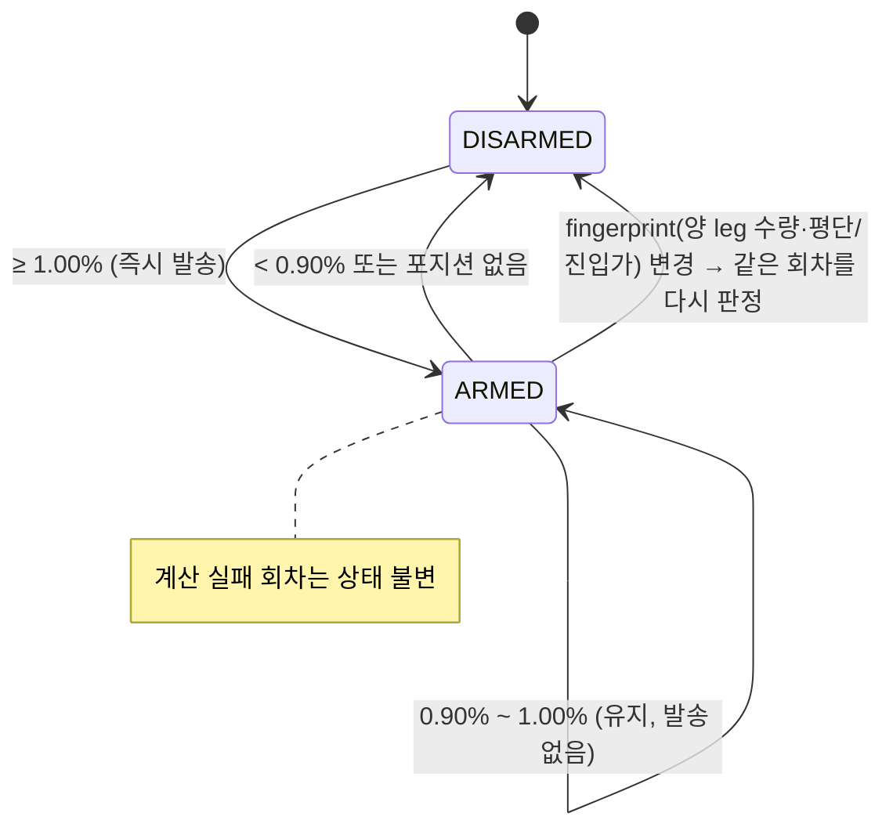

# 개발자 이해문서 — feat: 실계정 순손익 알림 (빗썸·바이낸스 read-only 조회 + 1% 메일)

- PR: [#83](https://github.com/geonyeop123/premium-spread/pull/83)
- 브랜치: `feat/live-account-pnl-alert` ← `dev`
- 작성: 2026-10-21 · 문맥: warm (구현 세션에서 직접 작성)
- 산출물: [design](design.md) · [plan](plan.md) · [dod](dod.md) · [runbook](../../runbooks/account-pnl-alert.md)

## 1. TL;DR

- owner 의 김프 포지션(빗썸 BTC 현물 + 바이낸스 BTCUSDT 선물 숏)을 **계정에서 직접 읽어** 1분마다 "지금 전량 청산하면 남는" 순수익률(수수료·펀딩·예상 청산 수수료 반영, 호가 깊이 VWAP)을 계산한다.
- 순수익률이 1% 이상이면 메일을 보내고(60분 재발송, 0.9% 재무장), 5분 넘게 계산이 안 되면 중단·복구 메일을 보낸다. 상태와 메일은 전용 DB outbox(V18)로 at-least-once.
- **조회 전용**(GET 만, 주문·출금 경로는 아키텍처 테스트로 금지), 기본 꺼짐, credential 은 환경변수로만. 실계정 검산(AC13)은 owner 가 로컬에서 한다.

## 2. 왜

- owner 는 지금 개인 사이트에 수량·평단을 손으로 넣고 화면을 지켜본다. 사이트와 기존 Domain `Tracking.grossPnl()` 은 **gross** 만 계산한다 — 수수료·펀딩비가 빠져 있어 "1% 났다"가 실제로는 0.6% 일 수 있다.
- 목표: 입력 자동화(계정에서 읽기) + gross→net + 메일 알림. 주문은 하지 않는다.
- 제약
  - PRIVATE LIVE master spec(`LIVE-1`, `ACT-1→ACT-2`)과 의도적으로 어긋난다 — read-only credential 을 batch 모니터가 읽는다. owner 가 "구현 결과를 근거로 master spec 을 나중에 고친다"고 결정했다(design §0.1). 이 문서와 AC13 결과가 그 근거가 된다.
  - 거래 준비 단위의 잔고 포트(`BalanceSnapshotReadPort` 등)는 구현하지 않는다 — 구현하면 그 단위의 `ARMED` 의미가 바뀐다(R2 회귀 테스트가 지킨다).
  - 로컬 PC(WSL) 실행. 잠자기·IP 변경·시계 오차가 일상적이다.

## 3. 무엇을 바꿨나

| 계층 | 핵심 파일 | 역할 |
|---|---|---|
| domain | `domain/.../accountpnl/AccountSnapshots.kt` | 계정·호가 Snapshot, 실패 범주 7종, 조회 port 2개 |
| domain | `AccountHedgePosition.kt` · `AccountNetPnl.kt` | 포지션 판정(dust·롱 제외, fingerprint) · 순손익 순수함수(VWAP, BigDecimal, 판정값만 scale 2) |
| domain | `PnlAlertPolicy.kt` · `MonitoringOutagePolicy.kt` · `AccountPnlMailContent.kt` | 수익 알림 상태기계 · 중단/복구 상태기계 · 메일 제목/본문(leg 별 수수료 표기) |
| domain | `AccountPnlAlertStore.kt`, `job/JobPorts.kt` | 상태·outbox port, `JobId.ACCOUNT_PNL_MONITOR`, `JobLastSuccessReadPort` |
| common | `db/migration/V18__create_account_pnl_alert.sql`, `persistence/jdbc/accountpnl/JdbcAccountPnlAlertStore.kt` | 단일행 상태(낙관적 version) + 전용 메일 outbox(SKIP LOCKED claim, UUID token fencing, stale 복구, 5회 후 FAILED) |
| infra:batch | `exchange/bithumb/BithumbPrivateAccountAdapter.kt` (+`BithumbJwtSigner`) | 빗썸 v1 JWT, 잔고(balance+locked)·평단·주문 이력 수수료 역추적·orderbook·ticker·ask_fee |
| infra:batch | `exchange/binance/BinanceFuturesPrivateAccountAdapter.kt` (+`BinanceRequestSigner`) | HMAC 서명, positionRisk·userTrades 7일 창 역추적·BNB 환산·income 펀딩 증분·depth·서버 시각 보정 |
| infra:batch | `accountpnl/AccountPnlMonitor*`, `notification/AccountPnlEmailSenderAdapter.kt`, `job/RedisJobRunRecorderAdapter.kt` | 조건부 배선·Properties(toString 마스킹)·메일 adapter·FX 마지막 성공 조회 |
| apps:batch | `application/job/accountpnl/AccountPnlMonitorJob.kt`, `config/AccountPnlMonitorConfiguration.kt`, `interfaces/scheduling/AccountPnlMonitorScheduler.kt` | 조합 Job, 활성 조건, 1분 Scheduler |
| supports | `logging/LogMaskingFilter.kt`, `logback-spring.xml` | `access_key`·`secret` 마스킹 확장 |
| arch-test | `PrivateAccountReadOnlyArchitectureTest.kt` | adapter 소스의 비-GET 호출·주문/출금/이체 경로 문자열 금지(규칙 20개, 자기검증) |
| docs | `docs/runbooks/account-pnl-alert.md` | key 발급·환경변수·로컬 실행·범주별 조치·AC13 체크리스트 |

## 4. 설계

한 회차(1분)의 흐름. 모든 실패는 범주로 정규화되어 중단 정책으로만 들어가고, Job 실패는 저장소 예외뿐이다.



수익 알림 상태기계(판정값 = 메일에 표시되는 scale 2 순수익률):



## 5. 주요 결정과 버린 대안

| 결정 | 이유 | 버린 대안 · trade-off |
|---|---|---|
| 기존 `notification_delivery`(V14) 대신 **전용 outbox V18** | V14 는 `subscription_id NOT NULL + FK` 와 premium 전용 event key 에 묶여 있다 | outbox 일반화 — 기존 premium 알림(R6)을 건드려야 해서 버림. 대신 같은 claim·fencing 계약을 복제했다 |
| FX "마지막 수집 성공" 원천 = **batch 프로세스 메모리**(`RedisJobRunRecorderAdapter` 가 port 구현) | plan 이 가정한 Redis `batch:last_run:*` 키는 TTL 5분이라 30분 주기 FX 를 덮지 못해 정상 상태에서도 상시 `STALE_FX` 가 된다(구현 전 사전 점검에서 발견) | DB `exchange_rate.created_at` — `observed_at` UNIQUE 라 값이 안 바뀌면 갱신되지 않아 못 씀 · 새 Redis 키 — Redis 계약 변경이 커서 버림. **대가:** 재시작 직후 최대 2시간 FX 실패를 못 잡고, PC 잠자기 후 깨어나면 "환율 수집 지연" 중단/복구 메일이 한 쌍 올 수 있다(runbook 에 알려진 동작) |
| 판정은 **scale 2 HALF_UP 순수익률**로 | 메일에 찍힌 숫자와 판정이 같아야 owner 가 헷갈리지 않는다 | 비반올림 값 판정 — 최대 0.005%p 차이. "1.00% 인데 왜 안 왔지"를 막는 쪽을 택함 |
| eventKey `account-pnl-{profit\|outage\|recovered}-<epochMilli>` | 실제 `JavaMailEmailSender` 가 deliveryId 를 `[A-Za-z0-9._-]{1,128}` 로 검증한다. plan 의 `profit|<Instant>` 은 **메일이 한 통도 안 나가는** 결함이었다(⑨ 리뷰에서 발견, 모든 테스트가 가짜 sender 라 통과하던 상태) | — 이후 실제 sender 를 거치는 adapter 테스트를 추가했다 |
| 빗썸 `query_hash` = **실제 전송 raw query** 의 SHA-512 | 문서 규칙. WebClient 템플릿이 `states[]` 를 `%5B%5D` 로 인코딩해, 디코딩 문자열을 해시하면 401 이 난다(태스크 리뷰에서 발견) | URI 를 한 번 만들어 그 raw query 로 서명·전송 |
| 진입 수수료·펀딩 이력을 못 찾으면 **0 + `미반영` 표시 후 그대로 알림** | owner 결정 — 이미 열린 포지션이 이력 한도 밖일 수 있다 | 알림 보류 — owner 가 원치 않음 |
| 빗썸 평단은 **수수료 미포함으로 가정**, 빗썸 진입 수수료(`paid_fee` 합)를 따로 차감하고 메일에 별도 줄로 표기 | 공식 문서에 포함 여부가 없다(Task 0). owner 승인 | 포함 가정 — AC13 검산으로 확정해 틀리면 변경 요청 |
| stale 복구도 시도 1회로 셈, claim 은 1건씩 | design §4.4 "최대 시도 후 FAILED" 와 `.ai/rules/batch.md` "실행 가능한 concurrency 만큼 claim" | 원 plan(복구 시 미계산) — 발송 중 프로세스가 계속 죽으면 무한 재시도 |
| 각 adapter 가 **호가를 마지막에** 읽고 이력 "미발견"도 캐시 | 이력 탐색(최대 13창·10페이지) 뒤에 호가를 읽으면 두 거래소 호가 시각 차가 5초를 넘어 `STALE_MARKET_DATA` 가 난다 | Domain port 를 계정/호가로 분리 — 범위가 커서 보류 |

## 6. 동작 확인 방법

```bash
# 단위·아키텍처 (clean 재실행 기준 unit 768 · arch 33 실패 0)
./gradlew test architectureTest --offline --no-daemon
# 통합 (Docker 필요) — AC6 재시작 내구성·동시 실행·stale fencing, V18 store
./gradlew :infrastructure:common:integrationTest :apps:batch:integrationTest --offline --no-daemon
./gradlew :infrastructure:common:verifyMigrations --offline --no-daemon
# AC 별 명령은 dod.md 수용기준 표의 '검증 명령' 칸 (AC10 은 :architecture-tests:architectureTest)
```

- 핵심 테스트: `AccountNetPnlTest`(기대값을 design §3 로 손 전개, `Tracking.grossPnl` 동치), `PnlAlertPolicyTest`·`MonitoringOutagePolicyTest`(경계값), `BithumbPrivateAccountAdapterTest`·`BinanceFuturesPrivateAccountAdapterTest`(MockWebServer, 문서 예제 HMAC 벡터, 서명 = 전송 문자열), `AccountPnlMonitorJobTest`, `AccountPnlAlertDurabilityIntegrationTest`(CyclicBarrier 로 두 인스턴스 겹침 강제), `AccountPnlMonitorWiringTest`(기본 꺼짐·scheduling off·메일 off·secret 비노출).
- 실계정: [runbook](../../runbooks/account-pnl-alert.md) 의 "로컬 실행 순서" → "AC13 owner 검산 체크리스트". 결과는 PR 코멘트로 남긴다.

## 7. 후속·리스크·함정

- **AC13 미완(AWAITING_HUMAN).** 실 API 에서 확정해야 할 것: 빗썸 평단의 수수료 포함 여부, 바이낸스가 보존기간(3개월) 밖 가장 오래된 창에 `[]` 대신 4xx 로 답하는지(그러면 `UNEXPECTED` 중단 메일), `endTime` 없는 income 조회가 전체 범위를 주는지, 체결 id 없을 때 7일 시각 범위 감지.
- **함정 — 테스트가 초록이어도 운영 경로가 다를 수 있다.** 이번에 실제로 두 번 겪었다(eventKey 형식, query_hash 인코딩). 외부 계약(SMTP sender 검증, 거래소 서명)은 가짜가 아니라 실제 구현을 한 번은 통과시키는 테스트를 둔다.
- **함정 — Spring 조건 평가 순서.** app `@Configuration` 은 auto-configuration 보다 먼저 평가되므로 app 쪽에서 `@ConditionalOnBean(infra bean)` 은 운영에서 영영 매치되지 않는다(단위 테스트에선 통과). 그래서 app 조건은 같은 환경 키를 읽는 `AccountPnlMonitorEnabledCondition` 이고 키 목록이 infra 조건과 중복된다 — 둘 중 하나만 바꾸면 갈린다(wiring 테스트가 지킨다).
- **함정 — batch 통합 테스트 스키마는 손으로 관리하는 fixture**(`batch-schema.sql`). V18 을 바꾸면 fixture 도 바꿔야 한다 — `AccountPnlFixtureSchemaIntegrationTest` 가 컬럼 단위로 잡는다(기본값·인덱스는 안 본다).
- 리스크: cold start(재기동·포지션 변경 직후) 이력 탐색이 길면 그 회차가 `STALE_MARKET_DATA` 또는 40s timeout 이 될 수 있다. 5분 미만이면 중단 메일은 없다.
- 후속(별도 작업으로 등록할 것): master spec 개정(design §0.1, 이 문서·AC13 결과 근거), `.ai/rules/batch.md` 의 event identity 규칙이 구독 없는 전용 outbox 를 어떻게 다룰지 보완, 계정/호가 port 분리.

## 외부 API 조사 (design §7, TP-OPEN-1)

확인일은 모두 2026-10-20 이다. 빗썸 문서는 `apidocs.bithumb.com` 의 각 페이지 markdown 판(`.md`, 페이지 내 OpenAPI 정의 포함)을,
바이낸스 문서는 `developers.binance.com` 페이지와 그 문서 사이트가 쓰는 OpenAPI schema(아래 "조사 경로" 참고)를 읽었다.

| # | 확인할 것 | 공식 문서 URL | 확인일 | 결론 |
|---|---|---|---|---|
| 1 | 빗썸 v1 인증(JWT, query hash) 과 잔고 응답의 평균매수가 필드 | https://apidocs.bithumb.com/docs/인증-토큰-생성하기 · https://apidocs.bithumb.com/reference/전체-자산-조회 · https://apidocs.bithumb.com/docs/api-주요-에러-코드 | 2026-10-20 | **JWT**: header `{"alg":"HS256","typ":"JWT"}`, secret key 로 HMAC-SHA256 서명, `Authorization: Bearer <jwt>`. payload 는 항상 `access_key`·`nonce`(요청마다 고유, UUID 권장)·`timestamp`(ms Unix). 파라미터가 있으면 `query_hash`(파라미터를 쿼리 문자열로 만든 뒤 UTF-8 바이트의 **SHA-512 hex**, 128자)와 `query_hash_alg="SHA512"` 를 추가한다. 해시 대상은 **실제로 보내는 쿼리 문자열 그대로**다(문서 예: `market=KRW-BTC`; Python `urlencode(param)`, Java `URLEncodedUtils.format` 결과를 해시하고 같은 문자열로 요청). 배열은 `key[]=v1&key[]=v2` 로 펼친다(쉼표 금지). 파라미터가 있는데 `query_hash` 가 없으면 401. 토큰 재사용 금지(매 요청 새 nonce·timestamp). 401 코드: `invalid_query_payload`·`jwt_verification`·`expired_jwt`·`NotAllowIP`·`out_of_scope`. JWT 유효 시간·허용 시계 오차는 **문서에 없음**. **잔고**: `GET https://api.bithumb.com/v1/accounts`(파라미터 없음 → query_hash 없음) → 배열 `[{currency, balance, locked, avg_buy_price, avg_buy_price_modified, unit_currency}]`, 숫자는 모두 **문자열**. `balance`=주문가능 수량, `locked`=주문 중 묶인 수량, `avg_buy_price`=매수 평균가, `avg_buy_price_modified`=매수 평균가 수정 여부(boolean), `unit_currency`=평단 기준 화폐. → `currency=BTC` 이고 `unit_currency=KRW` 인 행에서 수량 = `balance + locked`, 평단 = `avg_buy_price`. 응답 예시: fixture `bithumb-private/accounts.json` |
| 2 | 빗썸 평균매수가가 수수료를 포함하는가 | https://apidocs.bithumb.com/reference/전체-자산-조회 · https://apidocs.bithumb.com/reference/주문-가능-정보 · https://apidocs.bithumb.com/docs/가상-자산-투자-이해하기 | 2026-10-20 | **문서에 없음.** `avg_buy_price` 설명은 "매수 평균가" 한 줄뿐이고 계산식·수수료 포함 여부를 적은 곳이 없다(용어 페이지·주문 가능 정보·MyAsset 스트림 포함 확인). 문서가 말하는 사실은 (a) 체결 수수료는 주문 단위 `paid_fee` 로 **따로** 기록되고(기준통화=KRW) 매수 주문 `executed_funds` 와 별개라는 점, (b) `avg_buy_price_modified` 가 있어 **사용자가 평단을 수정할 수 있다**는 점이다. 결론: 문서로는 확정할 수 없다. plan 의 가정(평단은 수수료 미포함 → `entryFeeKrw` 별도 차감)을 뒤집을 문서 근거는 없으나 확인된 것도 아니다. owner 실계정에서 `avg_buy_price` 와 (Σ`executed_funds`) ÷ (Σ`executed_volume`) 를 대조해 확정해야 한다(아래 차이 (a)) |
| 3 | 빗썸 체결 이력에서 수수료 필드와 조회 가능 기간 | https://apidocs.bithumb.com/reference/주문-리스트-조회 · https://apidocs.bithumb.com/reference/종료-주문-목록-조회 · https://apidocs.bithumb.com/reference/개별-주문-조회 · https://apidocs.bithumb.com/changelog/업데이트-주문-조회-기능-고도화-및-성능-개선 | 2026-10-20 | **체결(trade) 단위 수수료 endpoint 는 없다.** `GET /v1/order` 의 `trades[]` 는 `market·uuid·price·volume·funds·side·created_at` 만 있고 fee 가 없다. 수수료는 **주문 단위 `paid_fee`**("체결 수수료 누적 합계, 기준통화 단위" → KRW-BTC 면 KRW)다. 목록 endpoint 는 두 개다. **(A) `GET /v1/orders`**(주문 리스트 조회): `market`, `state`(`wait` 기본·`watch`·`done`·`cancel`) 또는 `states[]`(동시 사용 불가), `uuids[]`/`client_order_ids[]`(선택, 최대 100 — 필수 아님, 미지정 시 최신 주문), `page`(기본 1), `limit`(기본 100, **최대값 문서에 없음**), `order_by`(`desc` 기본/`asc`). **기간 제한·보존 기간 문서에 없음.** 응답은 배열, 필드 `uuid`·`side`(`bid`/`ask`)·`ord_type`·`state`·`created_at`·`volume`·`executed_volume`·`executed_funds`·`paid_fee`·`trades_count` 등(문자열). **(B) `GET /v2/orders/history`**(종료 주문 목록, 2026-07-09 신설, "v1/orders 의 state=done/cancel 조회에 해당, 성능 개선"): `market`, `state` 또는 `states[]`(`done`·`cancel`, 미지정 시 둘 다), `start_time`/`end_time`(ms 또는 ISO-8601+tz), **범위 최대 7일**(초과 시 에러, 미입력 시 최근 7일), `limit` 1~1000(기본 100), `order_by`, `next_key` 커서. 응답 `{data:[...], has_next, next_key}`, 필드명이 v1 과 다르다(`order_id`·`order_type`). 7일 창을 뒤로 옮기며 걸을 수는 있으나 **얼마나 과거까지 조회되는지(하한) 문서에 없음.** 응답 예시: `bithumb-private/orders-done.json`(B), `bithumb-private/orders-list-v1.json`(A) |
| 4 | 빗썸 매도 수수료율 조회 방법 (주문 가능 정보 endpoint 등) | https://apidocs.bithumb.com/reference/주문-가능-정보 · https://apidocs.bithumb.com/docs/가상-자산-투자-이해하기 · https://apidocs.bithumb.com/reference/호가-조회 · https://apidocs.bithumb.com/reference/현재가-조회 | 2026-10-20 | `GET /v1/orders/chance?market=KRW-BTC`(JWT, query_hash 필요) → `bid_fee`·`ask_fee`·`maker_bid_fee`·`maker_ask_fee`(문자열 비율, 예 `"0.0025"`), `market{...}`, `bid_account`/`ask_account`(accounts 와 같은 필드). **매도 수수료율 = `ask_fee`.** 용어 페이지가 maker 율을 `maker_*` 로 따로 두므로 `ask_fee` 는 일반(taker) 매도율이다 — 즉시 청산 가정에는 `ask_fee` 를 쓴다(taker 라는 단어 자체는 문서에 없음, 구조상 판단). **호가**: 공개 `GET /v1/orderbook?markets=KRW-BTC`(파라미터 이름이 **`markets` 복수**, 인증 없음) → 배열 `[{market, timestamp(ms), total_ask_size, total_bid_size, orderbook_units:[{ask_price, bid_price, ask_size, bid_size}]}]`, 단일 market 이면 **30호가**까지, 값은 **JSON number**(문자열 아님). 1호가부터 순서대로 → `bid_price` 는 내림차순. **최근 체결가**: 공개 `GET /v1/ticker?markets=KRW-BTC` → `trade_price`(number), `trade_timestamp`, `timestamp`(ms). 예시: `orders-chance.json`·`orderbook.json`·`ticker.json` |
| 5 | 바이낸스 positionRisk 의 수량·진입가 필드 (one-way / hedge mode) | https://developers.binance.com/en/docs/catalog/core-trading-derivatives-trading-usd-s-m-futures/api/rest-api/trade#position-information-v3 · https://developers.binance.com/en/docs/catalog/core-trading-derivatives-trading-usd-s-m-futures/api/rest-api/account#get-current-position-mode | 2026-10-20 | `GET /fapi/v3/positionRisk`(SIGNED USER_DATA, IP weight 5, `symbol` 선택, `recvWindow` 최대 60000, `timestamp` 필수). **포지션 또는 미체결 주문이 있는 symbol 만 반환**(없으면 빈 배열 → 포지션 없음으로 처리). 필드 `symbol`·`positionSide`·`positionAmt`("positive for long, negative for short", 문자열)·`entryPrice`·`breakEvenPrice`·`markPrice`·`unRealizedProfit`·`liquidationPrice`·`isolatedMargin`·`notional`·`marginAsset`·`isolatedWallet`·`initialMargin`·`maintMargin`·`positionInitialMargin`·`openOrderInitialMargin`·`adl`·`bidNotional`·`askNotional`·`updateTime`. `positionSide` 는 one-way 면 `BOTH`, hedge 면 `LONG`/`SHORT`(Account V2 schema 설명 "One-way mode returns BOTH; hedge mode returns LONG/SHORT"). → hedge mode 에서는 `positionSide=SHORT` 행의 `positionAmt`(음수)·`entryPrice` 를 읽는다. 모드 자체는 `GET /fapi/v1/positionSide/dual`(weight 30) → `{dualSidePosition: true=Hedge}` 로 알 수 있으나 행의 `positionSide` 로 충분하다. 문서 예시는 one-way(ADAUSDT) 1건뿐 → `position-risk.json`(문서 예시), `position-risk-hedge.json`(**문서 스키마 기반 구성**) |
| 6 | 바이낸스 income 이력(`COMMISSION`, `FUNDING_FEE`) 조회 기간·페이지 한도 | https://developers.binance.com/en/docs/catalog/core-trading-derivatives-trading-usd-s-m-futures/api/rest-api/account#get-income-history · https://developers.binance.com/en/docs/catalog/core-trading-derivatives-trading-usd-s-m-futures/api/rest-api/trade#account-trade-list · https://developers.binance.com/en/docs/products/derivatives-trading-usds-futures/change-log | 2026-10-20 | **income** `GET /fapi/v1/income`(SIGNED, IP weight **30**): `symbol`, `incomeType`(`FUNDING_FEE`·`COMMISSION`·… 23종, 2026-09-10 `SPECIAL_FUNDING_FEE` 추가), `startTime`/`endTime`(ms, **양끝 포함**), `limit` 기본 100·**최대 1000**. 시각 미지정 시 최근 7일, **최근 3개월 데이터만**. **`page` 파라미터는 2026-10-16 부로 미지원** — "startTime/endTime 으로 위치를 찾으라"(change-log). startTime~endTime 최대 범위는 문서에 없음. 응답 배열 `[{symbol, incomeType, income, asset, info, time, tranId, tradeId}]`, `income` 부호 그대로(받은 펀딩 +). **userTrades** `GET /fapi/v1/userTrades`(SIGNED, IP weight 5): `symbol` 필수, `orderId`, `startTime`/`endTime`, `fromId`("Trade id to fetch from. Default gets most recent trades."), `limit` 기본 500·**최대 1000**. 규칙: 시각 미지정 시 최근 7일, **startTime~endTime ≤ 7일**, **`fromId` 는 startTime/endTime 과 함께 못 씀**, **최근 3개월만 조회**(2026-08-26 에 6개월→3개월로 정정). 응답 필드 `buyer`·`commission`·`commissionAsset`·`id`·`maker`·`orderId`·`price`·`qty`·`quoteQty`·`baseQty`·`marginAsset`·`realizedPnl`·`side`·`positionSide`·`symbol`·`pair`·`time`(ms). 결과 정렬 순서는 문서에 명시 없음. 예시: `user-trades.json`(문서 예시), `income-funding.json`(**문서 스키마 기반 구성** — 문서 예시는 `TRANSFER` 1건이라 `FUNDING_FEE` 로 구성) |
| 7 | 바이낸스 taker 수수료율 endpoint, BNB 수수료 할인 여부 | https://developers.binance.com/en/docs/catalog/core-trading-derivatives-trading-usd-s-m-futures/api/rest-api/account#user-commission-rate · https://developers.binance.com/en/docs/catalog/core-trading-derivatives-trading-usd-s-m-futures/api/rest-api/account#get-bnb-burn-status · https://developers.binance.com/en/docs/catalog/core-trading-derivatives-trading-usd-s-m-futures/api/rest-api/market-data#order-book · https://developers.binance.com/en/docs/catalog/core-trading-derivatives-trading-usd-s-m-futures/api/rest-api/market-data#symbol-price-ticker-v2 | 2026-10-20 | `GET /fapi/v1/commissionRate?symbol=BTCUSDT`(SIGNED, IP weight **20**) → `{symbol, makerCommissionRate, takerCommissionRate, rpiCommissionRate}`(문자열 비율, 예 `"0.0004"`=0.04%). **taker 율 = `takerCommissionRate`.** BNB 할인 on/off 는 `GET /fapi/v1/feeBurn`(weight 30) → `{feeBurn: boolean}`. **commissionRate 가 BNB 할인을 반영한 값인지는 문서에 없음.** BNB 로 낸 수수료는 userTrades `commissionAsset` 로 구분된다(필드 존재, 문서 예시는 USDT). BNBUSDT 환산용 가격: `GET /fapi/v2/ticker/price?symbol=BNBUSDT`(weight 1) → `{symbol, price, time}`; v1(`/fapi/v1/ticker/price`)은 "향후 deprecated 예정, v2 와 파라미터·응답 동일". **호가 깊이**: `GET /fapi/v1/depth?symbol=BTCUSDT&limit=20`(limit ∈ 5,10,20,50,100,500,1000, 기본 500; weight 5~50 → 2) → `{lastUpdateId, E(message output time), T(transaction time), bids:[[price,qty]], asks:[[price,qty]]}`(문자열), RPI 주문 제외. `asks` 는 낮은 가격부터. 참고 `GET /fapi/v1/ticker/bookTicker`(weight 2) → `{symbol, bidPrice, bidQty, askPrice, askQty, time}`. 예시: `commission-rate.json`·`depth.json`·`ticker-price.json` |
| 8 | 두 거래소 rate limit 과 서버 시각 오차 허용(recvWindow 등) | https://apidocs.bithumb.com/docs/api-요청-수-제한-안내 · https://apidocs.bithumb.com/docs/자주-묻는-질문-faq · https://developers.binance.com/en/docs/products/derivatives-trading-usds-futures/general-info · https://developers.binance.com/en/docs/products/derivatives-trading-usds-futures/common-definition · https://developers.binance.com/en/docs/products/derivatives-trading-usds-futures/error-code | 2026-10-20 | **빗썸**: IP·분류 항목별 합산. Public(캔들·호가·현재가·체결·기타) 분류별 **150회/초**, Private(주문 요청·주문 취소·기타) 분류별 **140회/초** — 자산·거래내역 조회는 "기타"로 합산. 초과 시 일시 차단(FAQ: Public 1분, Private info 5분·trade 10분, 실패 호출도 계수). REST 초과 시 HTTP status 는 **문서에 없음**(429 는 WebSocket 연결 제한에만 명시). JWT 시각 허용 오차 **문서에 없음**. 1분 주기 소비 ≈ accounts·chance·orderbook·ticker·orders 5회/분 → 한도 대비 무시 가능. **바이낸스**: IP 기준 `REQUEST_WEIGHT` **2400/분**(common-definition·응답 예시의 `rateLimits`; 정본은 `exchangeInfo.rateLimits`), 응답 헤더 `X-MBX-USED-WEIGHT-1M`. 429 → back off 의무, 반복 시 **418 IP ban 2분~3일**. 403 = WAF, 5xx = 서버, 503 은 상태 불명일 수 있음. 1분 주기 소비 ≈ positionRisk 5 + commissionRate 20 + depth 2 + ticker 1 + userTrades 확인 5 = 33, income 증분 30 포함해도 ~63/분 → 2400 대비 여유. **시각**: SIGNED 는 `timestamp`(ms) 필수, 서버 수락 조건 `timestamp < serverTime + 1000 && serverTime − timestamp ≤ recvWindow`. `recvWindow` 기본 5000, 각 endpoint schema 최대 **60000**, 문서 권고 ≤5000. 위반 시 `-1021 INVALID_TIMESTAMP`("outside of the recvWindow" 또는 "1000ms ahead of the server's time"). 서버 시각 `GET /fapi/v1/time` → `{serverTime}`. **서명**: HMAC-SHA256(key=secretKey, value=`totalParams` = query string + request body 그대로 이어붙임), hex, 대소문자 무관, `signature` 는 마지막 파라미터, API key 는 `X-MBX-APIKEY` 헤더. 인증 관련 코드: `-1022 INVALID_SIGNATURE`, `-2014 BAD_API_KEY_FMT`, `-2015 REJECTED_MBX_KEY`("Invalid API-key, IP, or permissions"). **문서 예제 벡터**(general-info "SIGNED Endpoint Examples for POST /fapi/v1/order - HMAC Keys", 로컬 `openssl dgst -sha256 -hmac` 로 재현 확인): secretKey=`2b5eb11e18796d12d88f13dc27dbbd02c2cc51ff7059765ed9821957d82bb4d9`, query=`symbol=BTCUSDT&side=BUY&type=LIMIT&quantity=1&price=9000&timeInForce=GTC&recvWindow=5000&timestamp=1591702613943`, signature=`3c661234138461fcc7a7d8746c6558c9842d4e10870d2ecbedf7777cad694af9` (참고 apiKey=`dbefbc809e3e83c283a984c3a1459732ea7db1360ca80c5c2c8867408d28cc83`, 혼합 query+body 예 signature=`f9d0ae5e813ef6ccf15c2b5a434047a0181cb5a342b903b367ca6d27a66e36f2`) |

### 조사 경로와 접근 한계

- 빗썸: 모든 페이지를 `https://apidocs.bithumb.com/reference/<slug>.md`·`/docs/<slug>.md` 로 직접 받아 읽었다(페이지 index
  `https://apidocs.bithumb.com/llms.txt`). 접근 실패 없음.
- 바이낸스: `developers.binance.com` HTML 은 일반 HTTP 클라이언트에 WAF challenge(HTTP 202, 빈 본문)를 돌려준다. 웹 페이지
  변환 도구로는 읽히나 페이지가 약 9만 자에서 잘려 `Position Information V3`·`User Commission Rate`·`Symbol Price Ticker V2`
  본문은 HTML 에서 읽지 못했다. 그 세 항목과 파라미터 한도(`maximum`)는 **같은 문서 사이트가 렌더링에 쓰는 공식 OpenAPI
  schema**(`https://bin.bnbstatic.com/static/dev-docs/html/en/docs/catalog/core-trading-derivatives-trading-usd-s-m-futures/api/rest-api/1.0.0/schema.yaml`,
  문서 번들이 참조하는 경로)와 문서 사이트의 `https://developers.binance.com/en/docs/llms-full.txt`(general-info·error-code·
  change-log 전문 포함), `https://developers.binance.com/en/docs/products/derivatives-trading-usds-futures/general-info.md` 에서
  확인했다. 문서 페이지의 예시 JSON 은 이 schema 의 필드별 `example` 값으로 렌더링되므로 fixture 값은 문서 예시와 같다.
  `Account-Trade-List`·`Get-Income-History`·`Order-Book`·`general-info` 는 HTML 페이지에서도 직접 읽어 일치를 확인했다.

### fixture 출처

| 파일 | 출처 |
|---|---|
| `bithumb-private/accounts.json` | 전체 자산 조회 응답 예시 |
| `bithumb-private/orders-chance.json` | 주문 가능 정보 응답 예시 (문서 예시는 `BTC-ETH` 마켓) |
| `bithumb-private/orders-done.json` | 종료 주문 목록 조회 `GET /v2/orders/history` 응답 예시 (`state=done`) |
| `bithumb-private/orders-list-v1.json` | 주문 리스트 조회 `GET /v1/orders` 응답 예시 (문서 예시는 `state=wait` 2건 — 응답 shape 용) |
| `bithumb-private/orderbook.json` | 호가 조회 응답 예시 (10호가) |
| `bithumb-private/ticker.json` | 현재가 조회 응답 예시 |
| `binance-private/position-risk.json` | Position Information V3 문서 예시 (one-way, ADAUSDT) |
| `binance-private/position-risk-hedge.json` | **문서 스키마 기반 구성** — hedge mode `LONG`(0)·`SHORT`(음수) 2행, 필드는 V3 schema 그대로 |
| `binance-private/user-trades.json` | Account Trade List 문서 예시 |
| `binance-private/income-funding.json` | **문서 스키마 기반 구성** — 문서 예시(`TRANSFER`)와 같은 필드로 `FUNDING_FEE` 1건 |
| `binance-private/commission-rate.json` | User Commission Rate 문서 예시 |
| `binance-private/depth.json` | Order Book 문서 예시 |
| `binance-private/ticker-price.json` | Symbol Price Ticker V2 문서 예시 (v1 과 응답 동일) |

### plan 가정과의 차이

- **(a) `avg_buy_price` 의 수수료 포함 여부 — 미확정(문서 침묵).** 포함한다는 근거도, 제외한다는 근거도 문서에 없다. plan
  Task 0 Step 3 의 "포함 → `entryFeeKrw`=0" 분기는 문서로 촉발되지 않았지만 해소되지도 않았다. owner 실계정 대조
  (`avg_buy_price` vs Σ`executed_funds`/Σ`executed_volume`)가 필요하다. 추가로 plan 이 다루지 않은 `avg_buy_price_modified`
  가 있다 — `true` 면 사용자가 평단을 수정한 값이라 gross 의 평단 원천으로 신뢰할 수 없다. 처리(경고·계산 실패 등) 결정이 필요하다.
- **(b) 빗썸 이력 역방향 탐색 — 부분 불일치.** `GET /v1/orders` 는 `page`/`limit`/`order_by=desc` 로 최신부터 넘길 수 있고 기간
  제한이 문서에 없으나, `limit` 최대값과 과거 보존 범위가 문서에 없다. `GET /v2/orders/history` 는 요청당 7일 창이라 창을 옮겨야
  하고 하한이 문서에 없다. 어느 쪽이든 "이력이 끝났다"를 문서가 정의하지 않으므로, plan 의 "이력이 끝나면 null" 은 builder 가
  탐색 상한(예: 페이지 수 또는 일수)을 정해야 성립한다. "마지막으로 본 체결 주문 이후만 한 페이지 조회" 는 v1 에 "이후" 파라미터가
  없어 `order_by=desc` 첫 페이지를 받아 마지막 식별자와 비교하는 방식이 된다(v2 는 `start_time` 사용 가능).
- **(c) 체결 단위 수수료 endpoint — 없음 (plan 과 일치: 주문 단위 `paid_fee` 사용).** `/v1/orders` 가 목록 endpoint 이고
  `state=done` 은 유효한 값이다 — 일치. **불일치: `state=done` 만으로는 부분 체결 후 취소된 주문(`state=cancel`,
  `executed_volume>0`, `paid_fee>0`)을 놓친다.** `states[]=done&states[]=cancel` 로 받고 `executed_volume>0` 만 합산해야 보유
  수량 누적이 맞는다(배열 파라미터는 `states[]=...` 형태로 query_hash 에 포함). v1 과 v2 는 필드명이 다르다(`uuid`/`ord_type`
  vs `order_id`/`order_type`).
- **(d) POST 를 쓰는 조회 endpoint — 있음.** `POST /v2/orders/search`(다건 주문 조회)는 읽기지만 POST 다. adapter 는 쓰지 않는다
  (GET 전용 규칙과 충돌 없음). **주문 경로는 plan 가정과 다르다**: 주문 요청은 **`POST /v2/orders`**(`/v1/orders` 가 아님),
  주문 취소 `DELETE /v2/order`, 다건 주문 `POST /v2/orders/batch`, 다건 취소 `POST /v2/orders/cancel`, TWAP `POST`/`DELETE /v1/twap`,
  출금 `POST /v1/withdraws/coin`·`POST /v1/withdraws/krw`·`DELETE /v1/withdraws/coin`, 입금 `POST /v1/deposits/krw`·
  `POST /v1/deposits/generate_coin_address`. **불일치: Task 13 금지 패턴 `/v1/orders"` 는 조회 endpoint(`GET /v1/orders`) 자체라
  adapter 가 그것을 쓰면 자기 위반이 되고, 실제 주문 경로(`/v2/orders"`)는 잡지 못한다.** `/order"` 는 조회 `GET /v1/order` 와
  취소 `DELETE /v2/order` 를 함께 잡는다. 경로 금지 목록 권고(빗썸): `/v2/orders"`, `/v2/order"`, `/v2/orders/batch`,
  `/v2/orders/cancel`, `/v2/orders/search`, `/twap`, `/withdraws`, `/deposits`. 바이낸스 쪽 변경 경로(참고): `/fapi/v1/order"`,
  `/fapi/v1/batchOrders`, `/fapi/v1/allOpenOrders`, `/fapi/v1/order/test`, `/fapi/v1/algoOrder`, `/fapi/v1/countdownCancelAll`,
  `/fapi/v1/leverage`, `/fapi/v1/marginType`, `/fapi/v1/positionMargin"`, `/fapi/v1/listenKey`, `/fapi/v1/convert/`. method 금지
  (`.post(` 등)는 그대로 유효하다.
- **(e) 바이낸스 userTrades 시간 창 — 대체로 일치, 구현 방식 주의.** 요청당 7일 창, `fromId` 와 시각 파라미터 동시 사용 불가,
  `limit` 최대 1000, **최근 3개월만** 조회. 최신부터 거꾸로 걷기는 `endTime=now`·`startTime=now−7d` 창을 7일씩 옮겨 최대 ~13창
  (weight 5 × 13 = 65)이면 3개월 전체를 덮는다. **3개월보다 오래 연 포지션은 진입 시각·진입 수수료를 찾을 수 없고**, income 도
  3개월만 보존되므로 펀딩도 미확보 → plan 의 `null`(unrecovered) 경로가 그 경우의 기본이 된다(plan 과 일치). 증분 확인
  `fromId=마지막id+1` 은 문서 규칙과 충돌 없음.
- **(e′) 바이낸스 income `page` 폐지 — 불일치.** 2026-10-16 부로 `page` 미지원. plan Task 9 의 "income 페이지를 끝까지 합산"·
  테스트 `펀딩을 여러 페이지에 걸쳐 합산한다` 는 `page` 가 아니라 **시각 기반 페이지네이션**(`limit=1000` 으로 받고 가득 차면
  마지막 `time`+1 을 다음 `startTime` 으로)이어야 한다. `startTime`/`endTime` 은 양끝 포함이라 경계 중복을 `tranId` 로 걸러야 한다.
- **(f) HMAC 예제 벡터 — 있음 (일치).** 위 표 8행의 secretKey·query·signature 3값. 로컬 openssl 로 같은 signature 재현.
- **(g) 바이낸스 시계 오차 — 불일치.** 서버는 `timestamp < serverTime + 1000` 을 요구한다. **로컬 시계가 서버보다 1초 넘게
  빠르면 `recvWindow` 와 무관하게 `-1021` 로 거부된다.** plan Review Focus 1 의 `recvWindow=10000` 은 느린 시계만 흡수한다.
  `GET /fapi/v1/time` 으로 offset 을 보정하거나 `-1021` 을 별도 처리해야 한다. 또 plan 의 오류 매핑에 `-1021` 이 없어 "그 밖의
  4xx → `UNEXPECTED`"로 떨어진다(분류 결정 필요). `recvWindow=10000` 자체는 최대 60000 이내라 허용된다(문서 권고는 ≤5000).
- **(h) 바이낸스 ticker price v1 — 경미한 불일치.** `/fapi/v1/ticker/price` 는 향후 deprecated 예정, 응답 동일한
  `/fapi/v2/ticker/price` 사용 권고.
- **(i) 바이낸스 positionRisk V3 — 일치(보충).** 포지션·미체결 주문이 없으면 해당 symbol 행 자체가 없다 → 빈 배열은 포지션 없음.
- **(j) 바이낸스 BNB 할인 반영 여부 — 문서 침묵.** `takerCommissionRate` 가 BNB 할인 후 율인지 문서에 없다. `exitFeeEst` 는
  `takerCommissionRate` 를 그대로 쓰면 BNB 할인이 켜진 계정에서 과대 추정(보수적)일 수 있다.
- **(k) 빗썸 호가·현재가 shape — 보충.** 파라미터가 `markets`(복수)이고 호가·현재가 값은 JSON number 다(잔고·주문은 문자열).
  BigDecimal 파싱 시 number 를 문자열 경유로 읽어야 정밀도가 보존된다. 호가 `timestamp`(ms) 가 있어 신선도 판정은 가능 — 일치.
- **(l) 빗썸 오류 분류 — 일치(보충).** 허용 IP 위반은 `401 NotAllowIP` 로 와서 `BITHUMB_AUTH` 매핑과 맞다. REST 요청 한도 초과의
  HTTP status 는 문서에 없다(plan 의 `429 → NETWORK` 은 가정).
- **(m) 빗썸 JWT 시계 오차 — 문서 침묵.** `expired_jwt` 가 있으나 허용 오차가 문서에 없다. Review Focus 1 은 빗썸에도 해당할 수 있다.
