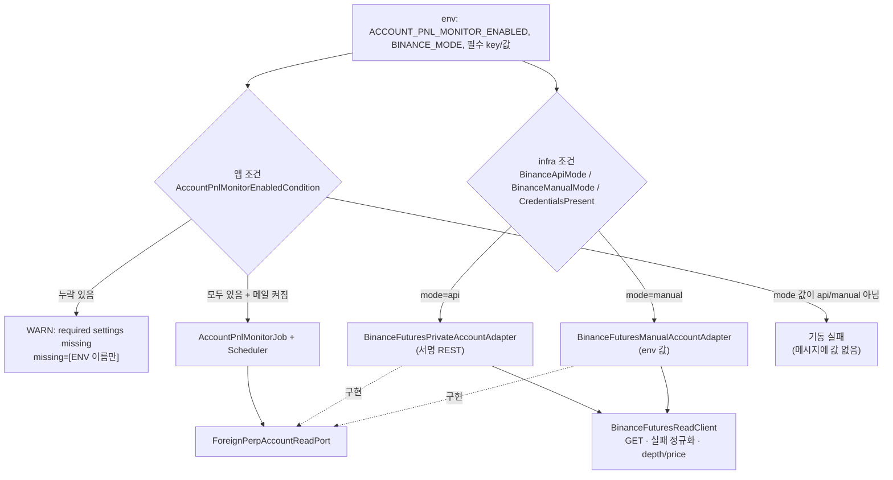
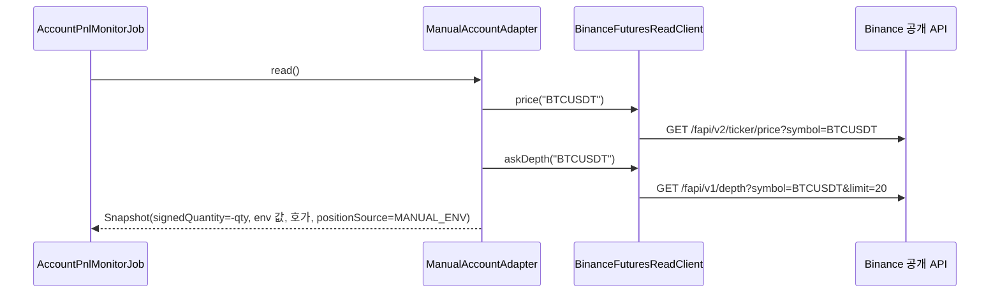

# 개발자 이해문서 — feat: 실계정 순손익 알림 바이낸스 수동 입력 모드

- PR: https://github.com/geonyeop123/premium-spread/pull/84
- 브랜치: `feat/live-account-pnl-manual-binance` ← `dev` (base `0a04546`)
- 작성: 2026-10-22 · 문맥: warm (구현 세션에서 직접 작성)

## 1. TL;DR

- 바이낸스 leg 를 `BINANCE_MODE=api`(기존 서명 REST) | `manual`(env 로 입력한 포지션 + 공개 호가) 중 하나로 띄운다. key 없이도 순손익 알림을 받을 수 있다.
- 공개 호가·체결가 조회와 HTTP 실패 정규화를 `BinanceFuturesReadClient` 로 추출해 두 adapter 가 공유한다. api 모드 결과·메일은 바이트 불변이다(golden 테스트로 고정).
- manual 설정은 `String?` 으로 받아 직접 해석한다. 잘못된 값은 기동 실패, 필수값 누락은 bean 0개 + env 이름만 담은 WARN 이다. 어디에도 입력 값을 남기지 않는다.

## 2. 왜

- **배경.** 직전 단위(PR #83, `docs/work/live-account-pnl-alert/`)는 빗썸·바이낸스 계정을 read-only key 로 읽어 순수익률 1% 이상이면 메일을 보낸다. 그런데 owner 가 바이낸스 API key 를 발급받지 못해 바이낸스 leg 가 뜨지 않았다. 필수 key 가 비면 모니터 전체가 기동하지 않으므로 알림을 하나도 받을 수 없었다.
- **목표.** key 없이 바이낸스 숏 포지션(수량·진입가·진입 수수료·펀딩)을 owner 가 env 로 넣고, 청산가 추정에 필요한 호가·최근 체결가는 공개 API 로 읽는다.
- **제약.**
  - 직전 단위의 동결 계약과 api 모드 동작은 바꾸지 않는다. 메일 바이트 불변, 기존 adapter 테스트 무수정.
  - 조회 전용을 유지한다. manual 모드는 서명·key 헤더 자체가 없다.
  - 설정 값(수량·가격·key·수신 주소)을 로그·예외·`toString()` 에 남기지 않는다.
  - Flyway·Redis·Job·outbox·순손익 공식은 바꾸지 않는다.

## 3. 무엇을 바꿨나

| 영역 | 파일 | 변경 |
|---|---|---|
| Domain | `domain/.../accountpnl/AccountSnapshots.kt` | `ForeignPerpPositionSource { EXCHANGE_API, MANUAL_ENV }`, `ForeignPerpAccountSnapshot.positionSource`(기본 `EXCHANGE_API`) |
| Domain | `domain/.../accountpnl/AccountPnlMailContent.kt` | 출처가 `MANUAL_ENV` 일 때만 `바이낸스 포지션: 수동 입력(env)` 줄, 수수료·펀딩 ` 수동 입력` 접미, 미입력은 `미반영(수동 미입력)` |
| infra:batch | `exchange/binance/BinanceFuturesReadClient.kt` (신규) | GET·실패 정규화·`/fapi/v1/depth`·`/fapi/v2/ticker/price`·BigDecimal `ObjectMapper` |
| infra:batch | `exchange/binance/BinanceFuturesPrivateAccountAdapter.kt` | 공유 클라이언트를 쓰도록 리팩터링(서명·`-1021` 재시도·캐시는 그대로) |
| infra:batch | `exchange/binance/BinanceFuturesManualAccountAdapter.kt` (신규) | env 값 + 공개 price → depth, 무상태 |
| infra:batch | `accountpnl/AccountPnlMonitorProperties.kt` | `mode`·`manual.*` 를 `String?` 로 바인딩, init 에서 해석·검증, 값 없는 `toString()` |
| infra:batch | `accountpnl/AccountPnlMonitorAdapterConfiguration.kt` | `AccountPnlMonitorRequirements`, 모드 조건 3종, manual bean + INFO |
| apps:batch | `config/AccountPnlMonitorConfiguration.kt`, `application.yml` | 앱 조건을 모드별 필수 키로 재작성, 누락 WARN, env placeholder 6개 |
| 아키텍처 | `architecture-tests/.../PrivateAccountReadOnlyArchitectureTest.kt` | 대상 = 기존 `*PrivateAccountAdapter.kt` ∪ `exchange/` 아래 `*AccountAdapter.kt`·`*ReadClient.kt`, manual 무서명 규칙 7개 |
| 문서 | `docs/runbooks/account-pnl-alert.md` | 모드 선택, manual env 표, 한계(펀딩 미갱신 과대평가 경고), 검산 체크리스트 |

## 4. 설계

모드는 기동 시점에 한 번 정해지고, 정확히 하나의 `ForeignPerpAccountReadPort` 만 bean 이 된다. app 조건과 infra 조건은 같은 규칙을 따로 구현한다(앱은 infrastructure 를 import 할 수 없다).



manual 한 회차의 요청은 공개 GET 두 건뿐이다. depth 를 마지막에 읽는 순서는 api 모드와 같다(관측 시각을 최신으로).



## 5. 주요 결정과 버린 대안

| 결정 | 이유 | 버린 대안 / trade-off |
|---|---|---|
| manual 설정을 `String?` 으로 받아 Properties `init` 에서 직접 해석 | Spring 변환기(`BigDecimal` 바인딩)는 실패 메시지·원인 체인에 입력 값을 싣는다. 빈 env(`BINANCE_MANUAL_X=`)의 해석도 변환기 버전에 기대지 않게 된다 | `BigDecimal?` 직접 바인딩 — 코드는 짧지만 값 노출. 남는 노출: 실제 `bootRun` 의 `BindFailureAnalyzer` 리포트가 값 한 줄을 찍을 수 있다(우리 코드 밖, runbook 한계에 명시) |
| 해석은 `toBigDecimalOrNull` + `require(...) { 고정 메시지 }` | `NumberFormatException` 이 생기지 않으니 cause 로 붙을 것도 없다 | `BigDecimal(s)` + catch — cause 미연결을 사람이 지켜야 한다 |
| 공개 조회를 `BinanceFuturesReadClient` 로 추출 | 두 adapter 가 같은 오류 매핑·timeout·정밀도를 가져야 한다. 복사하면 한쪽만 고쳐질 위험 | manual adapter 에 depth/price 코드를 복사 — AC4 가 중복을 금지 |
| 비서명 `-1021` 은 일반 상태 매핑으로 | 기존 코드는 이 경우 `AccountReadException` 이 아닌 private 예외를 밖으로 흘렸다. Job 이 어차피 `UNEXPECTED` 로 접으므로 관측 범주는 같다 | 기존 동작 그대로 — 공유 클래스 안에 서명 여부와 무관한 예외 분기를 남김 |
| app/infra 조건 이중 구현 + 28조합 행렬 테스트 | 앱이 infra 타입을 import 하면 아키텍처 규칙 위반. 대신 두 조건이 같은 답을 내는지 테스트로 고정한다 | 공용 모듈로 규칙 이동 — 이 정도 규칙에 모듈 추가는 과함 |
| 메일 golden 특성화를 구현보다 먼저 | 기존 테스트는 `contains` 라 문구 추가를 못 잡는다. api 메일 바이트 불변을 증명할 수단이 필요했다 | 기존 테스트만으로 진행 — 회귀를 못 잡음 |
| AC3 의 `Binance ` 메시지 접두 단언은 HTTP 경로에만 | 파싱 검증 실패 문구는 api 모드에서 쓰던 것을 그대로 공유한다. 접두를 붙이면 api 모드 메시지가 바뀐다 | 공유 클래스 문구 변경 — 동결 dod 는 접두를 요구하지 않음 |

## 6. 동작 확인 방법

```bash
# 핵심 수용기준 (gradle 은 --offline --no-daemon)
./gradlew :domain:test --tests 'io.premiumspread.domain.accountpnl.*' --offline --no-daemon
./gradlew :infrastructure:batch:test --tests 'io.premiumspread.infrastructure.batch.exchange.binance.*' --offline --no-daemon
./gradlew :apps:batch:test --tests 'io.premiumspread.config.AccountPnlMonitorWiringTest' --offline --no-daemon
./gradlew :architecture-tests:architectureTest --tests 'io.premiumspread.architecture.PrivateAccountReadOnlyArchitectureTest' --offline --no-daemon
# 공개 조회 경로가 한 파일뿐인지
grep -rl -e '/fapi/v1/depth' -e '/fapi/v2/ticker/price' infrastructure/batch/src/main/kotlin
```

- ⑩ 실측(코드 SHA `b41acb6`): `test` 726건, architectureTest 35건, integrationTest common 32·api 174·batch 100건 모두 실패 0. 수치는 dod `## 최종 판정` 에 있다.
- 실계정 확인(AC9)은 owner 가 runbook `## manual 모드 검산 체크리스트` 대로 한다.

## 7. 후속·리스크·함정

- **펀딩은 자동 누적되지 않는다.** env 를 갱신하고 재시작하지 않으면 장기 보유 시 순손익이 과대평가돼 1% 알림이 일찍 갈 수 있다. 포지션을 바꾸면 반드시 env 수정 + 재시작해야 한다. 수량·진입가가 바뀌면 새 에피소드로 즉시 판정한다.
- **manual 값 검증은 구성이 바인딩될 때만 일어난다.** 기능이 꺼져 있거나 필수값이 비면 Properties 가 만들어지지 않으므로, 잘못된 값이 있어도 기동은 성공한다. 잘못된 `BINANCE_MODE` 도 기능이 켜졌을 때만 기동 실패다.
- **함정: 앱 조건의 mode 해석은 사본이다.** `BinanceLegMode.parse`(infra)와 `AccountPnlMonitorEnabledCondition`(app)을 함께 고쳐야 한다. 어긋나면 `AccountPnlMonitorWiringTest` 의 모드 × 누락 키 행렬이 깨진다.
- **함정: manual adapter 파일의 금지 문자열.** 주석에도 `signature`·`apiKey`·`recvWindow`·`/fapi/v1/time` 등을 쓰면 아키텍처 테스트가 실패한다.
- **후속 과제.**
  - manual 값의 지수 표기·과대 scale 거부(`1E-1000000000` 은 지금 양수 검증을 통과하고, `toPlainString` 에서 메모리를 크게 쓸 수 있다).
  - private adapter 의 timeout 전달을 지키는 회귀 테스트 — 기존 테스트 클래스는 동결이라 새 클래스로 둔다.
  - 공개 fundingRate 기반 펀딩 추정.
- `-1021` 재시도까지 실패하면 예외 원인 체인에 HTTP 오류(서명이 붙은 URI)가 들어간다. 401/5xx 경로와 같은 수준이고 secret 자체는 아니다.
