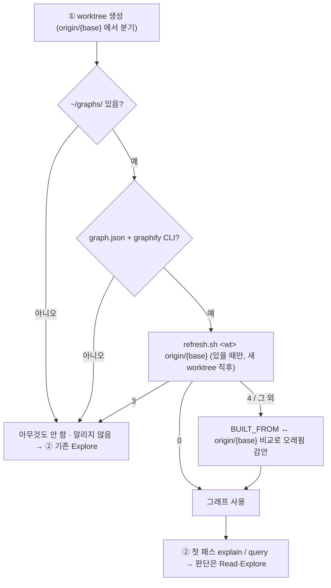

# 개발자 이해문서 — orchestrator ①② 에 선택 지식 그래프 경로 추가

- PR: (생성 전)
- 브랜치: `chore/orchestrator-knowledge-graph` ← `origin/dev` (`20a7484`)
- 작성: 2026-10-28 · 문맥: warm

## 1. TL;DR

- `orchestrator` ①·② 가 저장소 밖 지식 그래프(`graphify`, `~/graphs/<레포>/`)를 **있으면 쓰고, 없으면 지금과 똑같이** 돈다.
- `SKILL.md` 3 줄 추가(삭제 0), 상세는 새 파일 `.claude/skills/orchestrator/references/knowledge-graph.md`, `docs/harness-changelog.md` 1 행.
- 자매 저장소 aic-api(MR !239)에서 리뷰·머지된 문면을 옮겼다. 다른 점은 `refresh.sh`·오래됨 비교의 base 가 `origin/{base}` 라는 것 하나다.

## 2. 왜

- ② 의 영향 범위 파악은 `Explore` fan-out 이 전부였다. 그래프를 가진 개발자는 `graphify explain '<경로>::<심볼>'` 한 번으로
  사용처·테스트 import 를 `파일:L라인` 근거와 함께 받지만, 그 사용 조건·한계가 문서화돼 있지 않았다.
- 그래프는 **개인 설치**라 대부분의 실행 환경에 없다. 없는 경우 안내·질문·중단이 하나도 생기면 안 된다(최우선 제약).

## 3. 무엇을 바꿨나

| 파일 | 변경 |
|---|---|
| `.claude/skills/orchestrator/SKILL.md` | +3: "선택" 표 1 행(53) · ① 끝 불릿(215) · ② 끝 불릿(226) |
| `.claude/skills/orchestrator/references/knowledge-graph.md` | 신규 80 줄 — §1 판정 · §2 최신화 · §3 오래됨 · §4 사전 탐색 · §5 범위 밖 |
| `docs/harness-changelog.md` | 최상단 1 행 (CRLF 유지) |

## 4. 설계



## 5. 주요 결정과 버린 대안

| 결정 | 이유 | 버린 대안 |
|---|---|---|
| base 인자를 `origin/{base}` 로 | 이 저장소 ① 은 로컬 `{base}` 를 갱신하지 않고 `origin/{base}` 에서 분기한다. `refresh.sh` 는 둘째 인자로 `merge-base --is-ancestor` 를 판정하므로 stale 한 로컬 `dev` 를 주면 판정이 틀어진다 | aic-api 문면 그대로(`{base}`) |
| references 전체 경로 표기 | `docs/check-harness.sh` 축 1 이 접두 백틱 경로만 실재 검사한다 — 전체 경로여야 파일 이동이 게이트에 걸린다 | 상대 표기 |
| 갱신은 새 worktree 직후·변경 0 일 때만 | 그래프는 머신의 모든 worktree 가 공유한다. 피처 코드가 섞이면 다른 작업의 ② 가 머지 안 된 코드를 근거로 삼는다 | 매 실행 갱신 |
| 상세를 `references/` 로 분리 | `SKILL.md` 가 이미 595 행이고 미설치자도 매번 읽는다 | 본문에 절 추가 |

## 6. 동작 확인 방법

```bash
./gradlew harnessCheck harnessCheckTest      # 하네스 검사 통과: 파일 22개 · 모든 케이스 통과
bash docs/check-documentation.sh             # exit 0
git diff --numstat 20a7484 -- .claude/skills/orchestrator/SKILL.md   # 3  0
```

- RED→GREEN: `SKILL.md` 3 줄만 넣은 상태에서 `harnessCheck` 는 죽은 참조 3 건(53·215·226 행)으로 실패, references 생성 후 통과.
- 문면은 design §5 블록을 스크립트로 추출해 기계 삽입했다(references sha256 `5369caf6…`).

## 7. 후속·리스크·함정

- **AC9 (사람 확인 대기):** 그래프 없는 환경에서 행동 불변 — 리뷰어가 추가 3 줄과 references 서두를 읽고 확인한다.
- `docs/harness-changelog.md` 는 **CRLF** 다. 새 행을 LF 로 넣으면 게이트는 통과하지만 파일 규약이 깨진다(`grep -c $'\r$'` = 15 로 확인).
- ① 판정은 대화 문맥에만 있다 — 압축·재개 뒤 사라지면 ② 가 §1 을 다시 확인한다(잊어도 기존 `Explore` 로 빠지는 안전한 방향).
- 그래프는 베이스 스냅샷이다. 이번 작업의 새 코드는 그래프에 없다.
