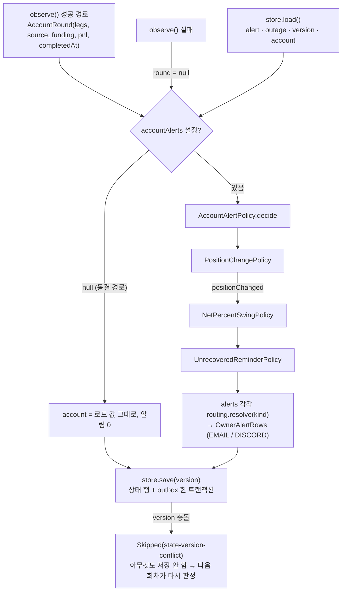
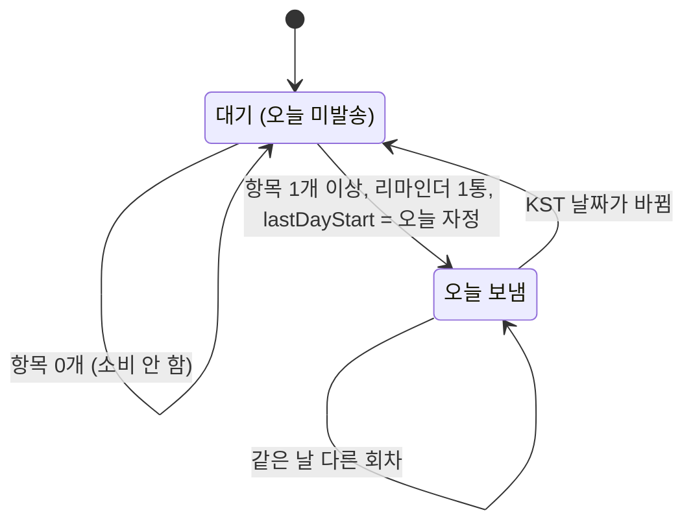

# 개발자 이해문서 — feat: owner 계정 알림 3종 (포지션 변경·순수익률 급변·미반영 리마인더)

- PR: (생성 전) — Closes #89
- 브랜치: `feat/issue-89-owner-account-alerts` ← `dev` (base `033d513`)
- 작성: 2026-10-23 · 문맥: warm (구현 세션에서 직접 작성)

## 1. TL;DR

- 기존 `AccountPnlMonitorJob` 이 매 회차 계정 알림 3종을 더 판정한다. 포지션 leg 변경은 메일과 Discord `@here`, 순수익률 급변은 Discord 소리, 미반영 리마인더는 Discord 무음이다.
- 판정은 Domain 순수 정책 3개와 조합기 `AccountAlertPolicy` 가 한다. 상태는 V20 이 `account_pnl_monitor_state` 에 더한 12열에 **기존 저장과 같은 트랜잭션·같은 version** 으로 들어간다.
- 새 Job·Scheduler·port·테이블은 없다. #88 라우팅(`OwnerAlertKind`)·outbox·디스패처를 그대로 탄다.

## 2. 왜

- **배경:** #88 이 owner 알림을 메일·Discord 로 라우팅하는 기반을 만들었다. 상위 #87 의 후속 중 #89 는 "계정 상태가 바뀌었을 때 owner 가 즉시 알아야 하는 것" 3종이다.
- **문제:**
  1. 빗썸 현물이나 바이낸스 선물 수량이 바뀌어도 알 길이 없다. manual 모드에서 빗썸만 바꾸고 바이낸스 env 를 갱신하지 않으면 헤지가 깨진 채로 손익이 계산된다.
  2. 정시 보고 사이에 순수익률이 크게 움직여도 다음 정시까지 모른다.
  3. 진입 수수료·펀딩 미반영이나 오래된 수동 펀딩 값은 손익을 틀리게 만드는데, 누가 알려 주지 않으면 방치된다.
- **목표:** 기존 회차 하나에서 세 알림을 판정하고, 재시작해도 중복·누락 없이 이어지게 한다.
- **제약:**
  - #88 과 실계정 알림의 동결 테스트는 **무수정**이어야 한다. 허용 예외는 dod R7·R8 두 곳뿐이다.
  - Job 생성자에는 맨 끝에만 인자를 붙일 수 있다.
  - migration 은 추가만 할 수 있다.
  - 실제 계정 값·webhook 은 테스트와 로그에 쓰지 않는다.

## 3. 무엇을 바꿨나

| 영역 | 파일 | 내용 |
|---|---|---|
| 라우팅 | `domain/.../owneralert/OwnerAlertRouting.kt`, `apps/batch/.../application.yml` | `OwnerAlertKind` 끝에 `POSITION_CHANGED`·`NET_PERCENT_SWING`·`UNRECOVERED_REMINDER`, override env 9개 |
| Domain 모델 | `domain/.../accountpnl/AccountAlertState.kt`, `AccountAlert.kt` | leg(`KoreaLeg`·`ForeignLeg`)·상태 3종·설정·`AccountRound`, sealed `AccountAlert` |
| Domain 정책 | `PositionChangePolicy.kt`, `NetPercentSwingPolicy.kt`, `UnrecoveredReminderPolicy.kt`, `AccountAlertPolicy.kt` | design §3.2 P1~P8 · §3.3 S1~S6 · §3.4 R1~R5, 조합 순서 포지션 → 급변 → 리마인더 |
| 렌더링 | `AccountAlertContent.kt`, `AccountPnlFormat.kt`(함수 2개 추가) | 메일·Discord 문구(design §7 exact copy), eventKey |
| 상태 저장 | `V20__add_owner_account_alert_state.sql`, `JdbcAccountPnlAlertStore.kt`, `AccountPnlAlertStore.kt` | 12열 + CHECK 3개, `AccountPnlMonitorState.account` 기본값 프로퍼티 |
| Job·배선 | `AccountPnlMonitorJob.kt`, `AccountPnlMonitorConfiguration.kt` | 생성자 끝 `accountAlerts: AccountAlertSettings? = null`, env 3개(`ACCOUNT_PNL_SWING_THRESHOLD_PERCENT`·`ACCOUNT_PNL_REMINDER_HOUR`·`ACCOUNT_PNL_MANUAL_FUNDING_STALE_DAYS`) |
| 문서 | `docs/runbooks/account-pnl-alert.md`, `.ai/*` | env·라우팅 표, 계정 알림 절, V20 배포·롤백, AC14 체크리스트 |

## 4. 설계

한 회차 안의 흐름. 기존 수익·중단 판정 뒤에 계정 알림 판정이 붙고, 모든 행과 상태가 한 번의 save 로 나간다.



리마인더 하루 판정(사용자 확정 D1). `lastDayStart` 는 **보냈을 때만** 바뀐다.



## 5. 주요 결정과 버린 대안

| 결정 | 이유 | 버린 대안 / trade-off |
|---|---|---|
| 상태를 기존 단일 행에 V20 열로 추가 (K1) | 새 port·테이블 없이 기존 save 의 트랜잭션·낙관적 version 을 그대로 쓴다. 동결 테스트의 fake store 가 기본값 프로퍼티 덕에 무수정 컴파일된다 | 별도 상태 테이블과 port를 두는 안은 version이 두 개라 부분 저장 경합이 생긴다. 대신 열 12개가 한 행에 붙어 행이 넓어진다 |
| Job 끝 인자 `accountAlerts: AccountAlertSettings? = null` (K2) | null 이면 판정하지 않고 `account` 를 읽은 그대로 저장하므로, 동결 Job 테스트가 같은 결과를 낸다. production 배선은 항상 넘긴다 | 알림 종류별 on/off env 는 범위에서 제외했다. 끄려면 route override 를 쓴다 |
| leg·펀딩을 정규화 10진 문자열 VARCHAR(64)로 저장하고 `compareTo` 로 비교 (K4) | DECIMAL scale 절단이나 `0.5`↔`0.50` 차이가 "매 회차 변경" 오탐, 곧 매 분 `@here` 를 만들지 않게 한다 | DECIMAL 열은 거래소 자릿수를 미리 정해야 해서 버렸다. 저장은 `toPlainString()` 이다. `stripTrailingZeros` 결과를 `toString` 하면 `1E+8` 이 된다 |
| sealed `AccountAlert` 로만 분기 (K3) | `OwnerAlertKind` 전체 `when` 이 생기면 #90·#91 에서 종류를 추가할 때마다 컴파일 강제가 퍼진다 | — |
| 리마인더는 "설정 시각 이후 항목이 처음 생긴 회차에 하루 1회, 보냈을 때만 소비" (사용자 D1) | 초안(09시 첫 회차 1회만 판정)은 09시 이후에 생긴 미반영을 그날 놓친다 | 계속 판정하므로 그날 두 번째로 생긴 항목은 다음 날 알림으로 미뤄진다 |
| 헤지 불일치 경고는 바이낸스 leg 변경 또는 API 출처일 때만 해소 (사용자 D3) | 빗썸이 원래 값으로 돌아와도 바이낸스 env 를 확인했다는 보장은 없다 | 경고가 해소되지 않은 채 남을 수 있다. 1회만 붙이므로 소음은 없다 |
| Discord 가 꺼지면 3종 모두 메일 (사용자 D2) | #88 D1 규칙과 같다 | 무음 리마인더도 메일로 와서 메일이 늘어난다 |
| `@Value` fallback 을 `0.50` 으로 (구현 중 판정) | `AccountAlertSettings` data class equals 가 scale 까지 비교하므로, AC11(a) 기본값 동등성을 맞추려면 scale 2 가 필요하다 | yml 은 design 대로 `0.5` 다. 판정은 `compareTo`, 표시는 `DecimalFormat("0.00")` 이라 동작 차이는 없다. 이유는 `AccountPnlMonitorConfiguration.kt:164` 주석에 적었다 |
| 리마인더 FUNDING 사유를 출처 기준으로 (구현 중 판정) | design §7.2 가 FUNDING 사유를 명시하지 않았다. 이웃 항목인 FOREIGN_ENTRY_FEE 와 같은 규칙(MANUAL_ENV → `수동 미입력`, 그 외 `이력 없음`)으로 맞췄다 | 틀리면 문구 한 줄과 golden 만 고치면 된다 |

## 6. 동작 확인 방법

판정 SHA `403e016` 기준 실측이다(dod `## 증거 로그` Task 14). 모두 exit 0, 실패 0 이다.

```bash
./gradlew test architectureTest --offline --no-daemon                       # unit 1021 · architecture 35
./gradlew :infrastructure:common:integrationTest --offline --no-daemon     # 51 (V20 4 · store 24 포함)
./gradlew :apps:batch:integrationTest --offline --no-daemon                # 105 (OwnerAccountAlertIntegrationTest 포함)
./gradlew :apps:api:integrationTest --offline --no-daemon                  # 174 (Flyway V20 까지 적용)
./gradlew :infrastructure:common:verifyMigrations --offline --no-daemon
bash docs/check-documentation.sh && ./gradlew harnessCheck --offline --no-daemon
```

- 핵심 시나리오는 `OwnerAccountAlertIntegrationTest` 한 메서드에 있다. 실제 MySQL 에서 첫 회차 기록 → 빗썸 변경(경고) → 재시작 + 바이낸스 변경(경고 해소) → 새 버킷 기준선 + 리마인더 → 급변 상승 → 중복 없음 순서로 진행한다.
  - fixture 는 trailing zero 값(`0.50000000`, `100000000.00` 등)이다. 그래서 DB 왕복 뒤 scale 차이가 변경으로 오탐되지 않는지까지 고정한다.
- 정책 경계는 Domain 단위 테스트가 소유한다. 경계값 예: 급변 `0.89`/`0.90`, 리마인더 `08:59:59`/`09:00 KST`, 펀딩 경과 `3일 − 1ms`/`3일`.
- **로컬에서 못 본 것:** ktlint·detekt(CI 전용)와 커버리지 artifact 는 CI `quality-gate.yml` 결과로 확인한다.
- **사람 확인:** AC13(runbook 검토), AC14(owner 의 실 Discord pnl 채널 수신)는 runbook `## 계정 알림 Discord 체크리스트 (owner-account-alerts AC14)` 로 확인한다.

## 7. 후속·리스크·함정

- **배포 순서:** V20 은 API 가 Flyway 로 적용한다. **API(V20) 를 먼저 배포하고 그다음 신 batch 를 기동한다.** 구 batch 의 9열 INSERT·UPDATE 는 V20 에서도 동작하고 새 열을 보존한다. 롤백 SQL 은 없다(additive).
- **첫 기동은 조용하다:** 저장된 leg 가 없으므로 포지션 변경 알림 없이 leg 만 기록한다. 수동 펀딩 "마지막 변경 시각"도 배포 후 첫 관측 시각에서 시작하므로, "N일 미갱신"은 배포 후 N일이 지나야 처음 나올 수 있다.
- **포지션 변경 회차는 그 시간의 급변을 끈다:** 그 버킷의 기준선이 null 이 되어 다음 정시에 다시 잡힌다. 테스트에서 급변을 보려면 다음 버킷으로 넘겨야 한다(AC10(g) 테스트가 그렇게 한다).
- **정책 예외는 회차를 Failure 로 만든다:** design §5.2 대로 `AccountAlertPolicy`·렌더링 예외를 잡지 않는다. 불변식 버그가 있으면 수익·중단 알림까지 함께 멈춘다. 현재 그런 입력은 찾지 못했다.
- **eventKey:** position 키는 감지 시각 ms 를 쓴다. 저장에 성공한 두 회차가 같은 ms 일 때만 충돌하는데, 락이 있는 분 단위 회차라 생기지 않는다. outbox `(event_key, channel)` UNIQUE 가 이중 방어다.
- **머지 후 후속 후보** (`.ai/PROJECT_STATUS.md` 에도 기록):
  1. 계정 알림이 켜진 상태의 Job save 예외·interrupt 분기 테스트
  2. 평단이 1원 미만으로 바뀌면 본문에서 before→after 가 같게 보이는 표시(`plainKrw` 정수 반올림)
- **범위 밖:** API 모드 헤지 수량 불일치 판정, 알림 종류별 on/off env, 시장(#90)·운영(#91) 알림, 환율 TTL 여유(#93).
