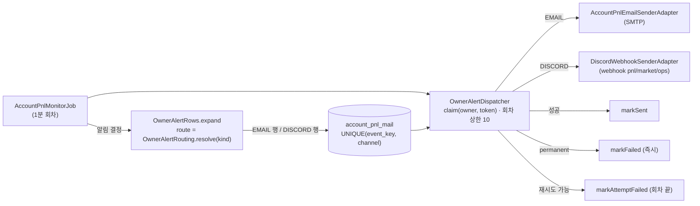
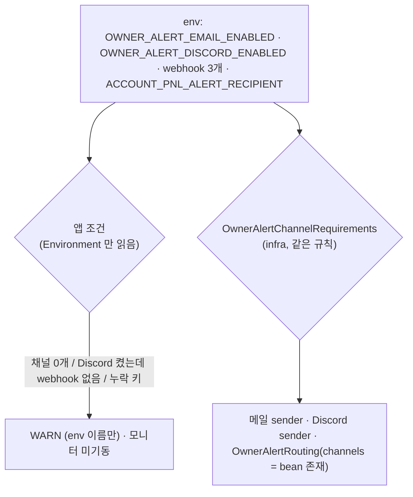

# 개발자 이해문서 — feat: owner 알림 메일·Discord 채널 라우팅 (#88)

- PR: https://github.com/geonyeop123/premium-spread/pull/92 · 이슈 #88 (상위 #87)
- 브랜치: `feat/issue-88-owner-alert-channel` ← `dev` (base `1bce3dd`)
- 작성: 2026-10-23 · 문맥: warm (구현 세션에서 작성)

## 1. TL;DR

- owner 알림(실계정 순손익 4종: 수익 1%·정시 보고·모니터링 중단·복구)을 **메일과 Discord** 로 보낸다. 두 채널은 env 로 각각 켜고 끄며, 알림 종류별 기본 경로(메일 여부, Discord 채널 `pnl`/`market`/`ops`, 푸시 무음/소리/`@here`)는 Domain `OwnerAlertKind` 한 곳에 있다.
- 기존 outbox `account_pnl_mail` 을 V19 로 넓혀 **한 알림 = 켜진 채널 수만큼 행** 으로 저장하고, 추출한 `OwnerAlertDispatcher` 가 행의 채널에 맞는 sender 로 보낸다. claim·fencing·재시도는 그대로다.
- Discord 를 끄면 지금과 바이트 단위로 같은 메일 4종이 간다. 후속 알림 10종(#89 계정·#90 시장·#91 운영)은 enum 값과 기본 경로만 더하면 붙는다.

## 2. 왜

- owner 는 실계정 알림을 휴대폰 푸시로 빠르게 받고 싶어 했고(메일은 늦게 보고 매시간 정시 보고가 메일함을 채운다), 앞으로 알림 종류를 10개 더 늘리기로 했다(#87). 알림마다 "어디로, 얼마나 시끄럽게" 보낼지 정할 공통 기반이 먼저 필요했다.
- 제약:
  - 기존 메일 알림의 제목·본문·eventKey 는 바꾸지 않는다(golden 6건).
  - 직전 단위들의 동결 테스트는 수정하지 않는다 — 그래서 store 에 추상 메서드를 더하지 않고, Job 생성자는 뒤에만 인자를 붙였다.
  - webhook URL(token 포함)은 비밀값이다. 로그·예외·원인 체인·`toString`·DB 어디에도 남기지 않는다.
  - Flyway append-only(V18 불변), 앱은 infrastructure 를 import 하지 않는다.

## 3. 무엇을 바꿨나

| 영역 | 파일 | 변경 |
|---|---|---|
| Domain | `domain/.../owneralert/OwnerAlertRouting.kt` | `OwnerAlertKind`(4종·기본 경로), `OwnerAlertRoute`·`DiscordTarget`·`DiscordPush`, override 해석 `resolve` |
| Domain | `domain/.../owneralert/OwnerAlertDiscord.kt` | `DiscordMessage`(제목 255·설명 4096 절단, surrogate 보존), port `OwnerAlertDiscordSender`, `OwnerAlertSendException(permanent)` |
| Domain | `domain/.../accountpnl/AccountPnlFormat.kt`·`AccountPnlDiscordContent.kt`·`OwnerAlertRows.kt` | 메일 서식 공유 추출, Discord embed 렌더링 4종, 알림 → 채널별 행 확장 |
| Domain | `AccountPnlMailContent.kt`·`AccountPnlAlertStore.kt` | `AccountPnlMail` 에 채널 프로퍼티(기본값), `markFailed` 기본 메서드 |
| DB | `infrastructure/common/.../db/migration/V19__add_owner_alert_channel.sql` | `channel`(기본 EMAIL)·`discord_target`·`discord_push`·`discord_color`, UNIQUE `(event_key, channel)`, CHECK |
| infra:common | `JdbcAccountPnlAlertStore.kt` | 채널 컬럼 읽기·쓰기, `markFailed` |
| infra:batch | `notification/DiscordWebhookSenderAdapter.kt` | webhook POST(embed·`flags 4096`·`@here`), 응답 분류, 429 Retry-After 1회, 취소 처리 |
| infra:batch | `owneralert/OwnerAlertProperties.kt`·`OwnerAlertChannelRequirements.kt`, `accountpnl/AccountPnlMonitorAdapterConfiguration.kt` | `owner-alert.*` 해석(webhook https 검증·마스킹), 채널 판정·수신 주소 소유, bean·조건, 기동 INFO 2종 |
| apps:batch | `application/notification/owneralert/OwnerAlertDispatcher.kt`, `AccountPnlMonitorJob.kt`, `config/AccountPnlMonitorConfiguration.kt`, `application.yml` | 전달 루프 추출·채널 분기, 행 생성 라우팅, 앱 기동 조건·WARN 3종, `owner-alert` 블록 |
| 문서 | `docs/runbooks/account-pnl-alert.md`, `.ai/architecture/ARCHITECTURE_DESIGN.md` | 채널 env·라우팅 표·Discord 설정·배포/롤백·복구 SQL·AC13 체크리스트 |

## 4. 설계





app 조건과 infra 조건은 모듈 경계 때문에 같은 규칙을 두 번 쓴다. 144조합 행렬 테스트가 두 쪽이 같은 답을 내는지 고정한다.

## 5. 주요 결정과 버린 대안

| 결정 | 이유 | 버린 대안 / trade-off |
|---|---|---|
| 기존 outbox 에 `channel` 컬럼(V19) | claim·fencing·재시도·중복 제거가 이미 검증된 테이블. 한 문장 ALTER, 기존 eventKey 그대로 | 새 공용 테이블(배포 중 두 테이블 drain) / rename(구 binary 깨짐). 대가: 이름이 `account_pnl_mail` 인 채 Discord 행을 담음(rename 은 별도) |
| 라우팅 표를 Domain enum 한 곳에 | 후속 이슈가 값만 더하면 됨, sender 와 어긋날 수 없음(channels 를 bean 존재로 만듦) | 설정 파일 표 — 기본값과 코드가 갈라짐 |
| Discord 를 켜면 정시 보고·복구는 Discord 만 (사용자 확정 D1) | 메일함이 매시간 차지 않게. 꺼 두면 지금처럼 4종 메일 | 항상 메일 병행 |
| SMTP 꺼짐 + Discord 켜짐이면 Discord 만으로 기동 + WARN (D2) | 메일 장애가 알림 전체를 막지 않게 | 메일 필수 |
| webhook 값은 `String?` 로 받아 직접 해석, 예외에 cause 미연결 | Spring 변환기·`URI.create` 예외가 입력값을 담는다 | 기본 바인딩 — token 이 기동 실패 로그에 남음 |
| Discord 응답은 `exchangeToMono` 로 상태만 읽음 | `WebClientResponseException`(URI 포함) 자체를 만들지 않음 | `retrieve()` + 예외 변환 |
| Discord 를 꺼도 잘못된 webhook 값이면 기동 실패 | 설정 실수를 켤 때가 아니라 지금 발견 | Discord 켤 때만 검증 |
| 배포는 구 batch 중지 후 신 batch 기동(겹침 없음) | 구 binary 의 claim 은 channel 을 몰라 DISCORD 행을 메일로 보낼 수 있다 | rolling — 신·구 겹침 시 오발송. 롤백 SQL 을 runbook 에 둠 |

## 6. 동작 확인 방법

```bash
./gradlew test architectureTest --offline --no-daemon
./gradlew :infrastructure:common:integrationTest --offline --no-daemon   # V19·store (Docker)
./gradlew :apps:batch:integrationTest --offline --no-daemon              # E2E 메일·Discord(MockWebServer)
```

- ⑩ 실측(코드 `0a1bda1`): unit 945, architecture 35, integration common 42·api 174·batch 104, 실패 0. CI 6/7(의존성 스캔은 dev 기존 실패).
- 실제 Discord 확인(AC13): runbook `## Discord 수신 체크리스트 (owner-alert-channel AC13)` — `OWNER_ALERT_DISCORD_ENABLED=true` + webhook env 로 batch 를 띄우면 기동 INFO 2줄(`owner-alert discord webhooks: …`, `owner-alert routes: …`)과 정시 보고 1통이 바로 보인다.

## 7. 후속·리스크·함정

- **poison row**: `discord_target`·`discord_push`·`channel` 에 알 수 없는 값이 든 행 하나가 claim 을 실패시켜 **EMAIL 포함 owner 알림 전체가 멈춘다**. 정상 binary 는 그런 값을 쓰지 않는다 — 수동 DB 편집·enum 축소 롤백에서만 생긴다. runbook 복구 SQL(collation 때문에 `BINARY` 비교)로 완화했고, 코드 격리는 #90 전에 권고(이슈 코멘트).
- **회차 시간**: Discord 행 최악 ~8초 × 회차 상한 10 > Job timeout 40초. Discord 장애 중에는 timeout·중복 발송(at-least-once 범위)이 날 수 있다 — #90 독립 Job 설계 때 예산 검사.
- **함정: app/infra 조건 이중화.** 채널 판정 규칙을 바꾸면 `AccountPnlMonitorConfiguration` 과 `OwnerAlertChannelRequirements` 를 함께 고쳐야 한다(행렬 테스트가 잡는다).
- **함정: webhook URL 은 token 이다.** WebClient·reactor-netty logger 를 DEBUG 로 켜지 않는다(runbook).
- `KST` 표기는 JDK CLDR 데이터에 의존(JDK 21 확인). Discord 408 은 계약상 영구 실패.
- 후속: #89(계정 알림 3종), #90(시장 알림 4종 + 독립 전달 Job), #91(운영 알림 3종). 테이블 rename 은 별도 이슈 후보.
