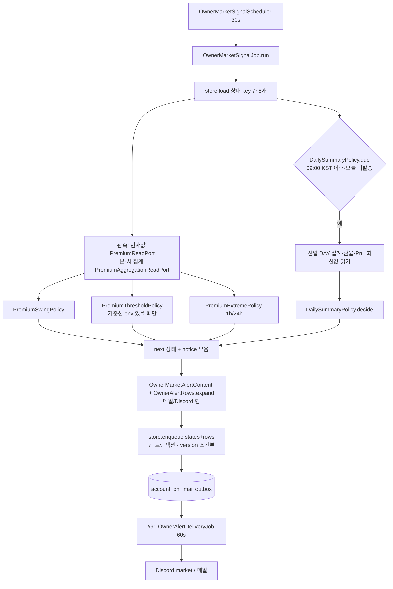

# 개발자 이해문서 — feat: owner 시장 알림 (김프 급변·기준선 돌파·신고가/신저가·일일 요약)

- PR/MR: (생성 전) · Closes #90 · 상위 #87
- 브랜치: feat/issue-90-owner-market-alerts ← dev (base 4f8727c)
- 작성: 2026-10-29 · 문맥: warm

## 1. TL;DR
batch 가 **새 데이터 수집 없이** 이미 쌓이는 김프(Redis 현재값 + 분·시·일 집계)만 읽어 30초마다 네 가지를 판정하고 owner Discord **market** 채널로 알린다.
급변(10분 ±0.5%p)·기준선 돌파(env 상·하단, 히스테리시스)는 소리, 1h/24h 신고가·신저가와 09:00 KST 일일 요약은 무음, 요약만 메일도 간다.
시장 상태는 V22 새 테이블에 outbox 행과 **한 트랜잭션**으로 쓰고, 전달은 #91 의 독립 전달 Job 이 그대로 맡는다.

## 2. 왜
- **배경.** #87(owner 알림 묶음)의 마지막 하위다. #88 이 채널(Discord/메일)·라우팅을, #89 가 계정 알림을, #91 이 운영 알림과 공용 기반(범용 enqueue port·독립 전달 Job·채널 bean 분리)을 만들었다. 남은 것은 "시장이 움직였다"는 알림이다.
- **문제.** owner 가 김프를 보려면 화면을 열어야 했다. 급하게 벌어지는 순간(급변·기준선 돌파)과 하루 정리(전일 OHLC·평균·환율·실계정 순수익률)를 놓친다.
- **목표(owner 합의).** 실계정 모니터와 **독립**으로 켜고 끈다(기본 켜짐). 기본 임계값은 "표준" 세트, 전부 env 로 조절. 요약의 실계정 값은 PnL 모니터가 남긴 최신값을 읽는다(거래소 API 추가 호출 없음). 신고가는 "직전 1h·24h 고저 돌파", 둘 다면 24h 하나만.
- **제약.**
  - **가짜 알림 금지.** 재시작 직후·데이터 부족·오래된 값으로 알림이 나가면 안 된다.
  - 동결 테스트·기존 PnL/ops 경로 무회귀(dod R3·R6·R8).
  - Domain 은 순수 Kotlin.
  - MarketPair identity 보존.
  - Flyway append-only.

## 3. 무엇을 바꿨나

| 영역 | 변경 | 핵심 파일 |
|---|---|---|
| Domain | `OwnerAlertKind` 4종 추가(`PREMIUM_SWING`·`PREMIUM_THRESHOLD_CROSSED`·`PREMIUM_NEW_EXTREME`·`DAILY_SUMMARY`), `JobId.OWNER_MARKET_SIGNAL` | `owneralert/OwnerAlertRouting.kt`, `job/JobPorts.kt` |
| Domain `ownermarket`(신규) | 상태 key·설정·상태 타입·port, 관측 창·근거 충분성, 정책 4종, 메일/Discord 렌더러 | `MarketAlertModel.kt`, `MarketObservation.kt`, `MarketNotice.kt`, `Premium{Swing,Threshold,Extreme}Policy.kt`, `DailySummaryPolicy.kt`, `OwnerMarketAlertContent.kt` |
| Domain `accountpnl` | 실계정 최신값 타입·port | `AccountPnlLatest.kt` |
| infra:common | V22 두 테이블, 저장소 2개, **구현체 없던** `PremiumAggregationReadPort` 를 기존 JPA adapter 가 구현 | `V22__create_owner_market_alert_state.sql`, `JdbcOwnerMarketAlertStore.kt`, `JdbcAccountPnlLatestStore.kt`, `JpaPremiumRepositoryAdapter.kt` |
| apps:batch | 시장 신호 Job, 기동 조건·배선·Scheduler, `owner-alert.market.*` 설정, PnL 모니터의 최신값 기록 | `OwnerMarketSignalJob.kt`, `OwnerMarketAlertConfiguration.kt`, `OwnerMarketAlertProperties.kt`, `OwnerMarketSignalScheduler.kt`, `AccountPnlMonitorJob.kt`(R8 한정) |
| 문서 | 시장 알림 runbook 신규, 기존 runbook·아키텍처·상태 갱신 | `docs/runbooks/owner-market-alert.md` 외 |

기존 코드 변경은 dod R7·R8 허용 범위뿐이다.
- `OwnerAlertRoutingTest`: 기대 목록 끝에 4개씩 추가했다.
- `AccountPnlMonitorJob`: 생성자 끝 인자 1개와 저장 성공 뒤 기록 1줄, 그리고 private fun 을 추가했다.
- `OwnerAlertReadiness`: `private` 를 `internal` 로 바꿨다.

## 4. 설계

한 회차(30초)의 흐름이다. lock 은 `lock:owner-market:signal`(lease 20s, timeout 10s)이다.

"모름"을 다루는 규칙은 둘이다.
- 각 원천(현재값·분·시·요약 입력)은 읽다가 실패하거나 null 이면 **그 판정만 멈추고 상태도 쓰지 않는다**.
- 근거가 충분해야 판정한다. 현재값은 10초 이내여야 하고 pair 가 같아야 한다. bucket 은 기대 개수의 80% 이상이어야 한다.

## 5. 주요 결정과 버린 대안

**K1. 범위 데이터는 기존 cache+DB 병합 경로로 읽는다.**
- 결정: 구현체가 없던 `PremiumAggregationReadPort` 를 `JpaPremiumRepositoryAdapter` 가 구현하고, 기존 `findAggregationByPair` 에 위임한다. 같은 시각이면 DB 가 정본이다.
- 버린 대안: Redis ZSet 직접 읽기. Redis 계약을 바꿔야 하고 eviction 중 부분 캐시 위험이 있다.
- trade-off: batch 컨텍스트에도 JPA(EMF)가 있어야 한다. 확인했다.

**K2. 판정 근거는 영속 집계(분·시·일 bucket)다.**
- 결정: 초 단위 Redis 원본(TTL 5분)이 아니라 분 집계 종가로 급변을, 고가·저가로 신고가를 판정한다.
- 이유: 재시작해도 같은 근거가 남아 가짜 알림이 없다.
- trade-off: 분 집계 지연만큼 최대 약 2분 늦게 알 수 있다(runbook 명시).

**K3. 시장 상태는 V22 새 테이블에 둔다.**
- 결정: `owner_market_alert_state` 에 저장하고 상태와 outbox 를 한 트랜잭션으로 쓴다. `JdbcOwnerAlertOutbox` 와 같은 순서이고 version 조건부이며, 충돌하면 전체를 롤백한다.
- 버린 대안: #91 의 `owner_alert_signal_state` 재사용. 그 테이블은 CHECK 제약(inactive 면 시각 열 NULL) 때문에 쿨다운 시각·기준선 구역·요약 일자를 담을 수 없다.

**K4. 실계정 최신값은 별도 단일 행 테이블 `account_pnl_latest` 에 둔다.**
- 결정(오케스트레이터가 처음 제안한 "상태 테이블에 열 추가"에서 architect 가 바꿨다): 별도 테이블로 둔다.
- 기존 상태 테이블에 열을 넣지 않은 이유는 셋이다.
  - 열을 넣으면 `AccountPnlMonitorState` 의 equals 를 쓰는 동결 테스트 4개가 깨진다.
  - 그 상태 저장은 version 조건부라 충돌 회차에 최신값까지 버려진다.
  - 별도 테이블이면 `JdbcAccountPnlAlertStore` 를 무변경으로 지킬 수 있다.
- 기록 방식: PnL 모니터는 save 가 성공한 뒤에만 기록하고, 기록이 실패해도 결과와 발송은 그대로다.

**K5. 09:00 요약은 cron 이 아니라 30초 회차 안에서 `summary_date` 로 하루 1회 보낸다.**
- 이유: cron 회차가 빠지면 그날 요약이 사라진다.
- 소급하지 않는다. 09:00 이후에 배포하면 그날 요약이 바로 1통 나간다.

**K6. 기준선 env 값은 소수 넷째 자리까지, 절댓값 10^6 미만만 받는다.** 그보다 정밀하면 기동이 실패한다.
- ⑥ 스펙 리뷰가 찾은 함정이다. DB `DECIMAL(10,4)` 가 반올림하면 설정값과 저장값의 `sameAs` 가 영영 false 가 되어 "기준 재설정(H2)"만 30초마다 반복한다.

**K7. outbox 4메서드를 상위 interface 로 올리는 일은 비목표로 했다.**
- 이유: #91 이 독립 전달 Job 을 이미 만들었고, 새 소비자가 없는 interface 가 된다.

**D1(owner 결정).** 일일 요약에 실계정 순수익률 %와 순손익 원을 **모두** 싣는다. MARKET 채널을 혼자 보는 전제다. 로그와 `toString` 에서는 금액을 뺀다.

## 6. 동작 확인 방법

로컬에서 HEAD 1618a04 기준으로 `--offline --no-daemon`, Docker 를 써서 실측했다.

| 명령 | 결과 |
|---|---|
| `./gradlew test architectureTest --offline --no-daemon` | unit 1303(기준선 1156), arch 35 |
| `./gradlew :infrastructure:common:integrationTest --offline --no-daemon` | 81(기준선 64). V22 migration, 저장소 원자성, **동시 enqueue 2건** 포함 |
| `./gradlew :apps:batch:integrationTest --offline --no-daemon` | 112(기준선 109). E2E `OwnerMarketAlertIntegrationTest` 포함 |
| `./gradlew :apps:api:integrationTest --offline --no-daemon` | 174. 아래 7절의 간헐 실패를 참고 |
| `:infrastructure:common:verifyMigrations`, `jacocoTestReport jacocoTestCoverageVerification`, `harnessCheck harnessCheckTest`, `bash docs/check-documentation.sh` | 모두 exit 0, 커버리지 overall 79.36% |

빠르게 볼 테스트는 다음과 같다.
- 정책 경계값:
  - `domain` 의 `ownermarket.*Test` 에서 급변 2.50 은 발동하고 2.49 는 발동하지 않는다.
  - 쿨다운은 정확히 30분이 되면 다시 발동한다.
  - 기준선은 `rate == U` 가 ABOVE 이고 `U − h` 에서 이탈한다.
  - 08:59:59 와 09:00:00 KST 를 구분한다.
- 회차 조합: `apps/batch` 의 `OwnerMarketSignalJobTest` 에 원천별 "모름", JobResult 4분기, 취소 재전파, 로그 금지 문자열 검사가 있다.
- E2E: `OwnerMarketAlertIntegrationTest` 의 (b)는 근거를 다시 채운 상태에서 쿨다운만으로 억제되는지, (f)는 `day_at` 2026-10-29 행이 있어도 10-28 행 값을 쓰는지 본다.

로컬 기동 전에 DB 가 V22 여야 한다. batch 는 Flyway 를 돌리지 않으므로 API 를 한 번 띄워 migration 을 적용한다. runbook 의 배포 절을 참고한다.

## 7. 후속·리스크·함정

- **기준선 돌파에는 쿨다운이 없다(design H표 그대로).**
  - 히스테리시스를 0 이나 아주 작게 두고 김프가 기준선을 오가면 SOUND 알림이 30초마다 날 수 있다. runbook 에 경고와 권장값(0.1 이상)을 넣었다.
  - 쿨다운 도입이나 히스테리시스 하한은 계약 변경이라 후속으로 미뤘다(`.ai/PROJECT_STATUS.md`).
- **Discord 가 꺼져 있으면 4종이 모두 메일로 간다(#88 D1).**
  - 메일만 쓰는 환경은 배포 즉시 시장 메일을 받기 시작한다.
  - 상한은 급변·1h 가 방향별 30분, 24h 가 방향별 2시간이다.
  - 끄는 예시(`OWNER_ALERT_PREMIUM_SWING_EMAIL=false`, `OWNER_ALERT_PREMIUM_NEW_EXTREME_EMAIL=false`)는 runbook 에 있다.
- **PnL 기록이 취소되면 `deliver()` 로 진행한다(design §6.3 그대로).** 회차 결과가 `Skipped(cancelled)` 가 아니라 dispatch 결과로 남는다. 실제 피해는 없고 후속 후보다.
- **새 `JobId.OWNER_MARKET_SIGNAL` 은 #91 연속 실패 감시에 자동으로 편입된다.** `MONITORED_JOBS` 가 `JobId.entries` 필터라서다. 의도한 동작이다.
- **api IT 간헐 실패(이번 변경 무관으로 판단).**
  - `TrackingControllerE2ETest:90`(201 기대, 409) 와 `TrackingArchiveIntegrationTest:130` 이 전체 스위트에서 3회 중 2회 실패했다.
  - 두 클래스만 단독으로 3회 돌리면 모두 통과한다. `apps/api` 의 diff 는 0 이다. CI 에서 다시 확인한다.
- **기존 flaky 2건(이번 변경 무관).**
  - `AccountPnlMonitorWiringTest.kt:387`: `doesNotContain("8.91")` 가 로그 타임스탬프의 ms 에 부분 일치해 실패한다.
  - `WebSocketConnectionManagerRegressionTest`.
- **커밋 `1618a04` 메시지에 문서 변경이 빠졌다.** ⑨ fix wave 에서 PROJECT_STATUS·runbook·dod 변경이 테스트 정리 커밋에 함께 들어갔다.
- **owner 확인 대기.**
  - AC16: runbook 사후 검토.
  - AC17: 실제 Discord market 채널 수신. 기동 INFO 4종, 09:00 무음 요약과 메일, 상단 기준선 소리, 급변·신고가 관찰을 runbook 체크리스트대로 확인한다.
- **ktlint·detekt 는 로컬에서 돌릴 수 없다.** CI 에서 결과를 확인한다.
