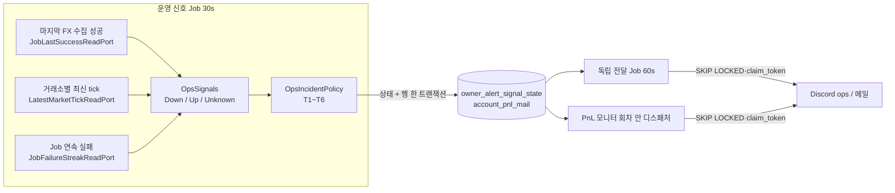
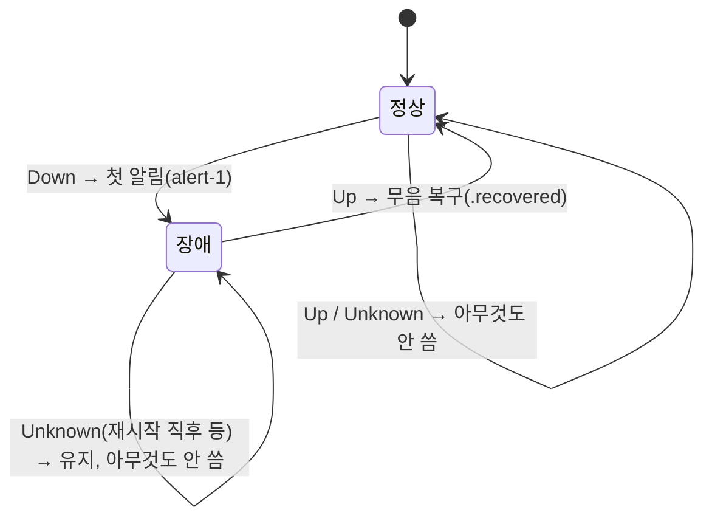

# 개발자 이해문서 — feat: owner 운영 알림 — 환율 지연·시세 끊김·Job 연속 실패

- PR/MR: (생성 전) · Closes #91 (상위 #87)
- 브랜치: feat/issue-91-owner-ops-alerts ← dev (base 20a7484)
- 작성: 2026-10-28 · 문맥: warm

## 1. TL;DR
batch 가 **지속되는 운영 이상** 세 가지를 감지해 owner Discord ops 채널(Job 연속 실패는 메일 포함)로 알린다: 환율 수집 지연(30분), 거래소 시세 끊김(5분), batch Job 연속 실패(3회·5분).
장애당 첫 알림 1회, 계속되면 6시간마다 재알림, 해소되면 무음 복구 1회를 보낸다.
이를 위해 #88 이 #90 몫으로 미뤄 둔 **공용 owner 알림 기반**(범용 enqueue port, 독립 전달 Job, PnL 모니터에서 분리된 채널 bean)을 이 PR 에서 만든다.

## 2. 왜
- 2026-10-22~23 밤 STALE_FX 가 49건 쌓였는데 owner 는 아무 알림도 받지 못했다. #93 batch 재시작 직전에도 환율 캐시가 비어 김프 계산이 SKIP 되고 있었다.
- 기존 Slack `OperatorAlert` 는 **순간 이벤트**(Job 실패 한 번, WebSocket 강제 재연결 순간)마다 울린다. "30분째 환율이 안 들어온다"는 **상태**를 추적하는 곳이 없었고, Job 실패 연속 횟수도 세지 않았다.
- owner 알림(#88)은 PnL 모니터 Job 회차 안에서만 쌓이고 발송됐고, 채널 bean 도 PnL 모니터 조건(`account-pnl-monitor.enabled` + 계정 credential)에 묶여 있었다. **PnL 을 끄면 운영 알림 채널도 사라지는** 구조라 운영 알림을 얹을 수 없었다.
- 제약: Domain 에 framework 의존 금지, 앱 main 은 infrastructure import 금지, 동결 테스트 무수정(허용 예외 R7·R8·R9), Flyway append-only, Redis 계약 무변경, secret 비노출.

## 3. 무엇을 바꿨나

| 층 | 파일 | 내용 |
|---|---|---|
| Domain `owneralert` | `OwnerAlertRouting.kt` | `OwnerAlertKind` 끝에 `FX_INGESTION_DELAYED`·`MARKET_STREAM_DOWN`(OPS/SOUND)·`JOB_CONSECUTIVE_FAILURES`(OPS/SOUND+메일)·`OPS_RECOVERED`(OPS/SILENT) |
| Domain `accountpnl` | `OwnerAlertOutbox.kt` (신규) | 범용 enqueue port(`loadSignals`/`enqueue`)와 `OwnerAlertSignalState`·`OwnerAlertIncident` |
| Domain `job` | `JobPorts.kt` | `JobId.OWNER_ALERT_DELIVERY`·`OWNER_OPS_SIGNAL`, `JobFailureStreak`·`JobFailureStreakReadPort` |
| Domain `ownerops` (신규) | `OpsSignal.kt`, `OpsIncidentPolicy.kt`, `OwnerOpsAlertContent.kt` | 신호 모델과 3상태 관측(`Down`/`Up`/`Unknown`), 장애 정책(첫 알림·재알림·복구), 메일·Discord 본문 |
| infra:common | `V21__create_owner_alert_signal_state.sql`, `JdbcOwnerAlertOutbox.kt`, `OwnerAlertOutboxRows.kt` | 신호별 지속 상태 테이블, 상태(version 조건부)+outbox 행 한 트랜잭션, 기존 outbox INSERT 를 단일 소유자로 추출(SQL 바이트 동일) |
| infra:batch | `RedisJobRunRecorderAdapter.kt`, `OwnerAlertChannelConfiguration.kt` | Job 별 연속 실패 in-memory 카운터, 채널 bean 3개를 PnL 구성에서 분리 |
| apps:batch | `OwnerAlertDeliveryJob`, `OwnerOpsSignalJob`, `OwnerAlertDeliveryConfiguration`, Scheduler 2개, `application.yml` | 독립 전달 Job(60s), 운영 신호 Job(30s), 기동 조건·`owner-alert.ops.*` 설정 |
| 문서 | `docs/runbooks/owner-ops-alert.md`(신규), `account-pnl-alert.md`, ARCHITECTURE_DESIGN, PROJECT_STATUS | 판정 경계·라우팅·env·기동 로그·한계·정리 SQL·Discord 수신 체크리스트 |

테스트: unit +109(1047→1156), common IT +13, batch IT +3. 기존 테스트 수정은 `OwnerAlertRoutingTest`(기대 목록 끝 4개)와 `AccountPnlMonitorWiringTest`(+2/−1) 뿐.

## 4. 설계





판정 경계: FX 는 기존 `FxIngestionFreshness.isStale`(30분 **초과**), 시세·Job·재알림은 **이상**(정확히 5분·6시간에 발동). 모든 시각은 주입 `Clock`.

## 5. 주요 결정과 버린 대안
- **공용 기반을 #91 에서 만든다** (사용자 합의). 버린 대안: #90 을 먼저 끝내고 그 위에 얹기. 운영 알림은 PnL 모니터가 꺼져 있어도 와야 하고, 기반이 있어야 #90 이 가벼워진다.
- **3상태 관측(`Unknown`)**. 재시작 직후에는 FX 성공 기록·tick·실패 카운터가 모두 비어 있다. 이를 `Up` 으로 보면 열린 장애에 **가짜 복구**가 나가고, `Down` 으로 보면 가짜 장애가 난다. `Unknown` 은 장애를 열지도 닫지도 않으며, 근거가 없는 상태가 `firstRunAt` 기준 임계만큼 지속되면 그때 `Down(since = null)` 이 된다.
- **판정 근거는 우리 쪽 수집 성공 시각**. 제공자 timestamp·DB `observed_at` 은 주말에 고정되므로 쓰지 않는다(#93 Twelve Data).
- **상태는 DB(V21), 연속 실패 카운터는 메모리**. 알림 중복 방지·재알림 6시간은 재시작을 넘어야 하므로 outbox 와 같은 트랜잭션의 DB 행에 둔다. 1초 주기 Job 의 실패마다 DB 를 쓰는 비용은 피하고, 카운터는 재시작하면 0부터 다시 센다(그 사이 장애는 `Unknown` 규칙으로 유지돼 가짜 복구가 없다).
- **복구용 종류 `OPS_RECOVERED` 를 따로** 둔다. 라우팅이 종류 단위라 "장애는 소리, 복구는 무음"을 표현하려면 별도 종류가 필요하다.
- **카운터 `lastFailureAt = maxOf(기존, at)`** (구현 중 결정, design §6.2 반영). 동시 완료가 역순으로 도착하면 `(n+1, first, at)` 가 `JobFailureStreak` 불변식 예외를 `completed` 첫 문장에서 던져 메트릭·Redis 기록까지 막는다.
- **전달 주기 60초** (⑨ 에서 발견 → dod 변경 요청 #1, owner 승인). 재시도 가능 실패는 백오프 없이 다음 회차에 재시도되고 5회면 `FAILED` 다. 처음 계획한 15s 전달 Job 이 같은 outbox 를 집으면 행당 재시도 예산이 약 4~5분에서 약 1분으로 줄어 **기존 PnL 알림이 회귀**한다. 버린 대안: 시도 간 최소 간격(claim SQL·스키마·기존 store 계약 변경), 줄어든 예산 수용. 대가: 운영 알림 도착이 최대 약 1분 늦다.
- **기존 Slack 은 유지**. 순간 이벤트(Slack)와 지속 상태·복구(Discord/메일)로 역할을 나눴다. 새 Job 두 개 자신의 실패는 이 경로로 알릴 수 없으므로 감시 대상에서 빼고 Slack `BATCH_JOB_FAILED` 에 맡긴다.

## 6. 동작 확인 방법
```bash
./gradlew test architectureTest --offline --no-daemon            # unit 1156 · arch 35
./gradlew :infrastructure:common:integrationTest --offline --no-daemon   # V21 migration, JdbcOwnerAlertOutbox (64)
./gradlew :apps:batch:integrationTest --offline --no-daemon      # OwnerOpsAlertIntegrationTest E2E 포함 (109)
./gradlew :infrastructure:common:verifyMigrations --offline --no-daemon
```
핵심 테스트:
- `OpsSignalsTest`·`OpsIncidentPolicyTest` — 경계값(30분/5분/3회·5분/6시간)과 전이표 T1~T6
- `OwnerOpsSignalJobTest` — 회차 순서, 취소 재전파, 재시작 후 가짜 복구 없음, `firstRunAt` 유지(변이로 RED 확인)
- `JdbcOwnerAlertOutboxIntegrationTest` — 두 번째 신호 version 충돌 시 첫 신호와 행까지 롤백
- `OwnerAlertDeliveryWiringTest` — 기동 조건 48조합에서 앱 조건 = infra ready, PnL 켜짐과 새 Job 공존
- `OwnerOpsAlertIntegrationTest` — 실제 MySQL 에서 첫 알림 → 6h 재알림 → 복구, 재시작 29분 행 불변, 두 디스패처 동시 전달 시 eventKey 당 1회

운영 확인: `docs/runbooks/owner-ops-alert.md` 의 "Discord 수신 체크리스트 (AC14)" — owner 확인 대기.

## 7. 후속·리스크·함정
- **함정 — `application.yml` 은 CRLF/LF 혼합**이다. 편집 도구가 파일 전체를 정규화하면 diff 가 수십 줄로 부풀어 오른다. 바꾼 뒤 `git diff --stat` 줄 수와 `grep -c $'\r'` 를 base 와 비교한다.
- **함정 — 앱 조건은 infra 규칙의 사본**이다(앱 main 이 infra 를 import 할 수 없다). `OwnerAlertChannelRequirements.ready` 를 바꾸면 `OwnerAlertDeliveryConfiguration` 의 사본도 같이 바꿔야 하며, 48조합 테스트가 어긋남을 잡는다.
- **함정 — `JdbcOwnerAlertOutbox.enqueue` 는 호출자 트랜잭션 밖에서** 불러야 한다. 참여하면 충돌 시 `setRollbackOnly` 가 바깥 트랜잭션 전체를 rollback-only 로 만든다(#90 재사용 시 주의).
- 한계: 연속 실패 카운터는 재시작하면 사라진다. 다중 인스턴스면 인스턴스별로 센다. 장애가 열린 Job 을 설정으로 끈 채 재시작하면 그 신호는 `Unknown` 으로 남아 복구 알림이 오지 않는다(runbook 정리 SQL).
- 후속 후보: E2E 동시 전달 경합 강제, `isCancellation()` 공용화(AccountPnlMonitorJob 동결 해제 후), MarketPair guard exchange 불일치 테스트, 재시도 시도 간 최소 간격, infrastructure:api `RedisRefreshSessionStoreIntegrationTest` 간헐 initializationError 조사.
- owner 확인 대기: AC13 runbook 사후 검토, AC14 실제 Discord 수신.
