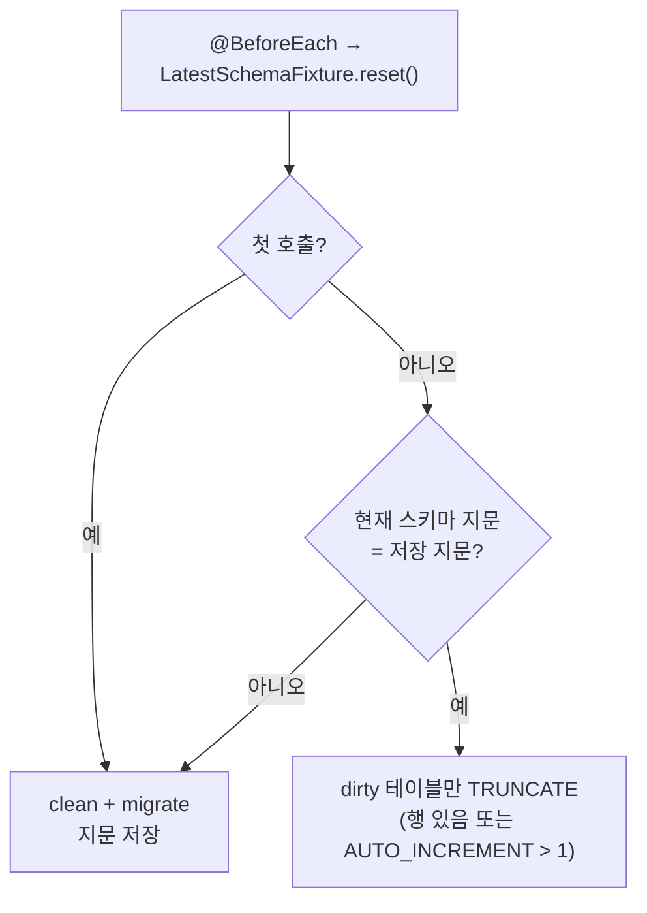
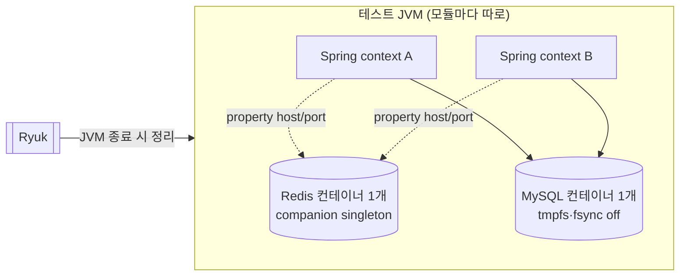

# 개발자 이해문서 — chore: 테스트 실행 시간 단축 (issue #104)

- PR/MR: (생성 전) · issue [#104](https://github.com/geonyeop123/premium-spread/issues/104)
- 브랜치: chore/issue-104-test-time-reduction ← dev
- 작성: 2026-10-30 · 문맥: warm

## 1. TL;DR
- 로컬 전체 검증(orchestrator ⑩)은 직렬 1516초에서 Gradle 한 번 호출 `--parallel` 163초로 줄었다. common 통합 테스트는 889초에서 52초가 됐다. 테스트 수는 그대로이고 실패 0이다.
- 시간을 가장 많이 먹던 것은 테스트 코드가 아니었다. **MySQL DDL fsync**, **테스트마다 Flyway clean+migrate**, **클래스마다 Spring context와 컨테이너 재기동** 세 가지였다.
- 측정하다 기존 잠재 결함 하나를 찾아 고쳤다. "Testcontainers reuse 금지" 정책이 로컬에서 실제로는 작동한 적이 없었다(§7 함정 1).

## 2. 왜
- **문제:** CI Quality Gate는 PR마다 8.5~10분이 걸렸다. 가장 긴 경로는 `1. Compile → 3. API integration`이다. orchestrator ⑩ 검증은 로컬에서 17~25분이 걸려 개발 루프를 지배했다. 재작업이 2번 돌면 이 시간이 두 배, 세 배로 붙는다.
- **측정으로 찾은 원인:**
  - common 통합 테스트: adapter 테스트가 `@BeforeEach`마다 `flyway.clean()+migrate()`를 돌렸다. 로컬 WSL2에서 테스트당 약 6.8초다. 16개 클래스는 각자 MySQL 컨테이너를 띄웠다.
  - batch 통합 테스트: `@DirtiesContext(AFTER_CLASS)` 때문에 Spring context가 35번 기동했고, 그때마다 Redis 컨테이너도 새로 떴다.
  - CI: 모든 job이 compile job을 기다렸고(`needs`), API job 하나에 common 통합 테스트까지 몰려 있었다.
  - unit: MockWebServer 응답 지연 2초가 timeout(200ms)과 무관하게 매번 끝까지 돌았다.
- **목표(dod 수용기준):** 로컬 ⑩ ≤ 7분, common IT ≤ 4분, CI ≤ 6분. **검증 범위와 테스트 수는 줄이지 않는다.**
- **제약:**
  - retry, `@Disabled`, run 간 컨테이너 reuse는 금지다.
  - leak 검사는 유지한다.
  - 앱·도메인·infrastructure `src/main`은 바꾸지 않는다.
  - Gradle build cache는 Kotlin CVE 때문에 다시 켤 수 없다(범위 밖).

## 3. 무엇을 바꿨나

| 영역 | 변경 | 핵심 파일 |
|---|---|---|
| common IT | JVM당 공용 MySQL 1개, 클래스마다 자기 database. adapter 테스트는 migrate를 1회만 하고, 스키마 지문이 같으면 dirty 테이블만 TRUNCATE한다 | `infrastructure/common/src/integrationTest/.../support/SharedMySqlContainer.kt`, `LatestSchemaFixture.kt`(+자가검증 `LatestSchemaFixtureIntegrationTest`) |
| 테스트 MySQL | 내구성 튜닝: tmpfs datadir, `flush-log-at-trx-commit=0`, `doublewrite=0`, `sync-binlog=0`. common, api·batch 공용, api 전용 2개 컨테이너에 적용 | `modules/jpa/src/testFixtures/.../MySqlTestTuning.kt`, `MySqlTestContainersConfig.kt` |
| Redis 테스트 컨테이너 | `withReuse(true)`를 제거했다. JVM당 1개이고, bean으로 노출하지 않고 `DynamicPropertyRegistrar`로 host/port만 넘긴다 | `modules/redis/src/testFixtures/.../RedisTestContainersConfig.kt`, `apps/batch/.../config/BatchTestConfig.kt` |
| reuse 차단 | 모든 Test task에 env `TESTCONTAINERS_REUSE_ENABLE=false`를 넣고, `verifyTestIsolationPolicy`가 이 env를 검사한다 | `build-logic/.../KotlinLibraryConventionPlugin.java`, `build.gradle.kts` |
| batch IT | `@DirtiesContext`를 제거해 context가 35개에서 8개로 줄었다. base `@BeforeEach`가 DB·Redis·공용 MockWebServer를 초기화한다. 같은 내용의 FixedClockConfig 두 개는 하나로 합쳤다 | `apps/batch/src/integrationTest/.../support/BatchIntegrationTestBase.kt`, `FixedClockTestConfig.kt`, `SharedContextIsolationIntegrationTest.kt`, `apps/batch/build.gradle.kts`(heap 1g) |
| unit | MockWebServer 지연을 2초에서 1초로(timeout 200ms 유지) | `BithumbPrivateAccountAdapterTest.kt`, `ExchangeRateClientTest.kt` |
| CI | 모든 job의 `needs`를 제거하고, common IT를 `8. Common integration` job으로 분리했다. PR에서는 Gradle 캐시를 읽기만 하고, unit은 `--parallel`로 돈다 | `.github/workflows/quality-gate.yml`, `ci/quality-gate-contract-test.sh`, `docker/deploy-contract-test.sh` |
| 하네스·규칙 | ⑩ 검증을 Gradle 한 번 호출 `--parallel --continue`로 바꿨다. 개별 재실행 명령은 `.ai/rules/testing.md`만 가진다 | `.claude/skills/orchestrator/SKILL.md`, `.claude/agents/qa-agent.md`, `.ai/rules/testing.md`, `AGENTS.md` 등 |

## 4. 설계

common 어댑터 테스트의 초기화 경로:



테스트 JVM 하나 안에서 컨테이너와 context가 어떻게 공유되는지:



## 5. 주요 결정과 버린 대안
- **TRUNCATE만으로 초기화하지 않고 지문 비교를 넣었다.** `JdbcOwnerMarketAlertStoreIntegrationTest`가 CHECK 제약을 DROP하는 테스트를 갖고 있다. 데이터만 비우면 다음 테스트가 제약 없는 스키마에서 돈다. 지문 조회 비용은 실측 12~29ms라 무시할 만하다.
- **dirty 테이블만 TRUNCATE한다.** 처음에는 전 테이블을 TRUNCATE했지만 그것만으로는 8분 31초였다. AUTO_INCREMENT 조건은 `information_schema_stats_expiry=0` 세션에서 읽어, DELETE나 rollback으로 비워진 테이블도 1부터 다시 시작하게 한다.
- **MySQL 내구성 튜닝을 넣었다.** 시간을 크게 줄인 것은 결국 이것이다(common 674초에서 56초). 테스트는 crash 내구성을 검증하지 않고, 트랜잭션 가시성·락·제약·charset·시간대는 바뀌지 않는다.
  - `--skip-log-bin`은 ⑨ 리뷰 뒤 뺐다. binlog가 켜져 있어야 드러나는 migration 오류(trigger/function의 `log_bin_trust_function_creators`)를 테스트가 놓치지 않게 하려는 것이다.
  - api 전용 컨테이너 2개는 동결 DoD의 제외 항목이었다. 승인 없이 먼저 튜닝을 넣었다가 ⑨에서 지적받았고, 사용자 승인으로 dod 변경 요청에 기록했다(커밋 순서 위반도 함께 기록).
- **Redis 컨테이너를 bean으로 노출하지 않는다.** 처음에는 `@Bean(destroyMethod = "")`로 context가 닫힐 때 멈추지 않게 하려 했다. 하지만 spring-boot-testcontainers의 `TestcontainersLifecycleBeanPostProcessor`가 `Startable` bean이면 그래도 `close()`를 부른다(바이트코드로 확인). 실행 도중 context가 하나라도 닫히면 나머지 context가 옛 포트에 연결된 채 연쇄 실패한다. 그래서 컨테이너는 companion에 두고 property만 넘긴다.
- **CI `needs`를 모두 제거했다(사용자 결정).** compile이 실패하면 다른 job도 함께 빨개지지만, 공개 저장소라 runner 비용은 없다. 미검증 의존성은 job마다 `--dependency-verification strict`로 막는다.
- **버린 대안:**
  - **⑩에서 변경된 모듈만 통합 테스트하기:** 로컬 검증 범위가 줄어 사용자가 고르지 않았다.
  - **WebSocket 회귀 테스트의 sleep 줄이기:** flaky 위험이 있어 범위에서 뺐다.
  - **migration 경로 테스트에서 clean 대신 database 재생성:** fsync 튜닝 뒤에는 이득이 약 2초뿐이라 하지 않았다.

## 6. 동작 확인 방법
```bash
# 로컬 전체 검증 (⑩) — Docker 필요
./gradlew test architectureTest :infrastructure:common:verifyMigrations :infrastructure:common:integrationTest :apps:api:integrationTest :apps:batch:integrationTest --parallel --continue --offline --no-daemon

# 개별
./gradlew :infrastructure:common:integrationTest --rerun --offline --no-daemon
./gradlew verifyTestIsolationPolicy harnessCheck harnessCheckTest --offline
bash ci/quality-gate-contract-test.sh && bash docker/deploy-contract-test.sh
```
- **실측(콜드 스냅샷, 2f3f950):**
  - ⑩ 163초(기준선 1516초)
  - common IT 52초(889초)
  - 테스트 수: unit 1303, common 84(기준선 81 + 자가검증 3), api 174, batch 114(112 + 자가검증 2), 실패 0
  - batch context 8개(35개)
- 수용기준별 증거는 [`dod.md`](dod.md) 증거 로그에 있다. AC3(CI ≤ 6분)은 이 PR의 Quality Gate run으로 확인한다.

## 7. 후속·리스크·함정
1. **reuse 금지는 system property로는 작동하지 않는다.** Testcontainers 1.21.4는 env `TESTCONTAINERS_REUSE_ENABLE`와 `~/.testcontainers.properties`만 읽는다. 개발자 PC에 `reuse.enable=true`가 있으면 모듈 JVM끼리 컨테이너를 공유해 서로의 데이터를 지운다. 실제로 `--parallel`에서 api의 `flushAll`이 batch 시드를 지운 사례가 있었다. **fixture에 `withReuse`를 다시 넣지 말고, Test task env를 지우지 말 것.**
2. **batch 통합 테스트는 이제 context를 공유한다.** 상태를 남기는 공용 bean을 새로 추가하면 반드시 `BatchIntegrationTestBase` 초기화에 넣는다. `premium`·`ticker` 테이블은 base가 비우지 않는다. 지금은 batch 코드가 쓰지 않아서 문제없지만, 새 테스트가 쓰기 시작하면 추가해야 한다.
3. **context 하나가 실행 중 닫히면(로딩 실패 등) Hibernate create-drop이 공용 MySQL의 엔티티 테이블을 지운다.** 그러면 이후 클래스가 연쇄 실패할 수 있다. 이미 다른 실패가 있을 때만 생기는 기존 구조라 고치지 않았다. 실패가 여러 건 보이면 첫 실패부터 볼 것.
4. **seed migration을 넣을 때 주의.** migration이 seed 행이나 `AUTO_INCREMENT=N`을 넣기 시작하면, `LatestSchemaFixture`의 TRUNCATE 경로가 "migrate 직후 상태"와 달라진다. 그런 migration을 넣으면 fixture를 다시 검토한다.
5. **로컬 tmpfs MySQL은 메모리를 쓴다.** `--parallel`이면 모듈 JVM과 컨테이너가 동시에 뜬다. 로컬은 24코어/31GB에서 측정했다.
6. **required check 설정.** 새 job `8. Common integration`이 branch protection의 required status check에 있어야, common IT가 실패할 때 merge가 막힌다. merge 뒤 저장소 설정을 확인한다.
7. **후속 후보:**
   - Quality Gate의 Gradle job이 각자 전체를 다시 컴파일한다. build cache를 다시 켜면 job마다 약 1분을 줄일 수 있다.
   - `infrastructure:batch` unit의 Binance 13-window 테스트도 손볼 여지가 있다.
